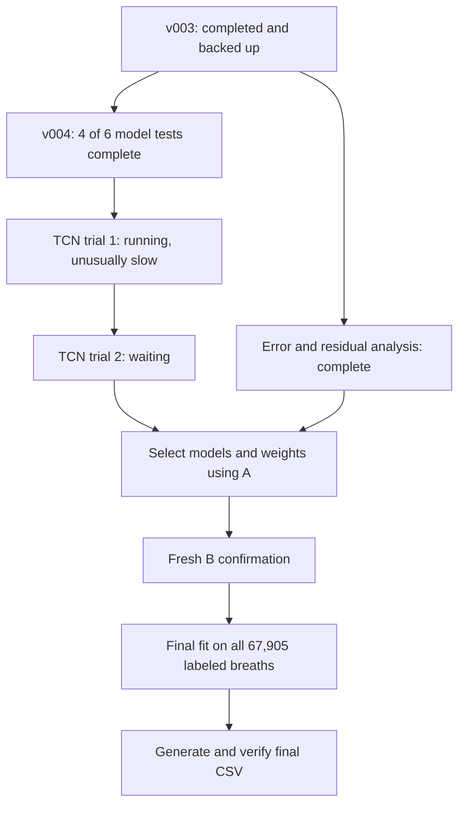

# Visible AI interaction history

Snapshot UTC: 2026-11-08T23:20:06.207030+00:00

Available visible user and assistant messages for this assignment. System/developer instructions, internal reasoning, tool payloads and app/environment control metadata are excluded. Experiment code and execution logs are stored separately. Nothing is uploaded by this export.

## 2026-11-02T06:16:58.302Z — user

Read in the pdf and discussion pdf for context. This is the coding gym link: [https://aicodinggym.com/challenges/mle/ventilator-pressure-prediction. ](https://aicodinggym.com/challenges/mle/ventilator-pressure-prediction.)


## 2026-11-02T06:17:00.201Z — assistant

I’ll find and read both PDFs, then review the coding gym challenge for context.

## 2026-11-02T06:17:08.455Z — assistant

I found `PA3 (1).pdf` and `PA3_Discussion_Slides.pdf`. I’m using the PDF skill to review them, with a parallel pass through the discussion slides. The challenge link didn’t load through the web reader, so I’ll try another way to access it.

## 2026-11-02T06:18:06.373Z — assistant

The challenge page loaded in Chrome. It scores mean absolute error only during inhalation and requires an `id,pressure` CSV. The data consists of time steps grouped into breaths, with valve controls and lung resistance/compliance as inputs. I’m checking the PDFs for course-specific requirements.

## 2026-11-02T06:18:32.277Z — assistant

I’ve read the assignment PDF, discussion slides, and [coding gym challenge](https://aicodinggym.com/challenges/mle/ventilator-pressure-prediction).

:codex-file-citation{path="/Users/generalclasher/Documents/dsc102/pa3/PA3 (1).pdf" purpose="source"}
:codex-file-citation{path="/Users/generalclasher/Documents/dsc102/pa3/PA3_Discussion_Slides.pdf" purpose="source"}

I’ll carry these requirements into our work:

- **Task:** Predict pressure for every test row; scoring uses MAE only during inspiration (`u_out == 0`).
- **Restrictions:** Use only Gym-provided data. No existing competition solutions, original Kaggle data, or winner-strategy lookups.
- **Process:** Run careful experiments, log results, and record AI mistakes and your corrections.
- **Deliverables:** Gym predictions, Canvas username, complete AI interaction history, and a **3–5-paragraph PDF report** with a leaderboard screenshot.
- **Grading:** Score 30%, reflection 40%, diagnosis of your own AI 30%.
- **Deadline:** **November 13, 2026, at 11:59 PM Pacific**, with no late days.

## 2026-11-02T20:43:03.851Z — user

Before writing any modeling code,  Inspect the current machine, help launch/connect to the course DataHub container if needed, verify the GPU, install and configure the AI Coding Gym CLI, then download and unzip the approved ventilator-pressure-prediction dataset into a project folder. Ask me for my AI Coding Gym user ID or any login steps you cannot complete. Use only the assignment-approved data; do not download original Kaggle data or existing solutions. Preserve existing files and keep a setup log. Confirm the environment works, list the downloaded files and their paths, and explain where I should work next. Stop once setup is complete; do not build or train a model yet.


## 2026-11-02T20:43:08.235Z — assistant

I’ll inspect this machine and the existing project first, then set up a working environment with the approved Gym download. I’ll keep a setup log and stop before writing any modeling code.

## 2026-11-02T20:44:31.015Z — assistant

This is an M3 Pro Mac with an Apple GPU, rather than the course’s NVIDIA/CUDA setup. The Gym CLI is already installed and configured, so I can reuse it to download the approved data into this project while you choose where to work. I’ve started [SETUP_LOG.md](/Users/generalclasher/Documents/dsc102/pa3/SETUP_LOG.md).

## 2026-11-02T20:46:24.767Z — assistant

The Apple GPU passed a compute check, and the approved dataset download is running. I’ll proceed with a local Apple GPU environment so setup can continue. If you prefer DataHub, send your UCSD username and I’ll help connect there; its NVIDIA GPU still needs to be verified after login.

## 2026-11-02T20:48:05.702Z — user

<send_user_message_question_reply>
[{"questionItemId":"[\"request_user_input_async\",\"call_9c2325da40684cb093f22be2628a14fd\",0]","question":"This Mac has an Apple M3 Pro GPU and 18 GB RAM, but no NVIDIA/CUDA GPU. Which setup should I complete? For DataHub, include your UCSD username and connect the UCSD VPN if you’re off campus; enter passwords or Duo prompts yourself, never in this chat.","answer":"Course DataHub NVIDIA GPU (Recommended)"},{"questionItemId":"[\"request_user_input_async\",\"call_9c2325da40684cb093f22be2628a14fd\",1]","question":"What is your AI Coding Gym user ID? You can find it on your Gym profile. If the CLI is already configured, I’ll check that first and reuse it.","answer":"jhei3w76dhk7"}]
</send_user_message_question_reply>


## 2026-11-02T20:48:20.561Z — assistant

I’ll complete setup on DataHub. Your Gym user ID matches the existing configuration, and the approved download has finished locally. I’ll check for an open DataHub session and unpack the data while we arrange the course connection.

## 2026-11-02T20:48:45.206Z — user

<send_user_message_question_reply>
[{"questionItemId":"[\"request_user_input_async\",\"call_6b13943f244942a39977b3331c09c89e\",0]","question":"What is your UCSD username for dsmlp-login.ucsd.edu, and is the UCSD VPN connected (or are you on campus)? I need the username to start SSH. You’ll enter any password or Duo prompt yourself.","answer":"v2gao. I am on campus. my full ucsd email is v2gao@ucsd.edu"}]
</send_user_message_question_reply>


## 2026-11-02T20:49:24.176Z — assistant

The DataHub server is reachable, but SSH requires your password and Duo approval. I’ll open a separate Terminal window for you to authenticate. The local archive has also passed its integrity check and been extracted.

## 2026-11-02T20:50:44.764Z — user

<send_user_message_question_reply>
[{"questionItemId":"[\"request_user_input_async\",\"call_7faaad0434974a169be6dffdb5706179\",0]","question":"The computer-use tool cannot control Terminal. Please open your Mac’s Terminal and run:\n\nssh -M -S /tmp/pa3-datahub.dBUi9F/control -o ControlPersist=7200 -o ServerAliveInterval=60 -o UserKnownHostsFile=/tmp/pa3-datahub-known_hosts -o StrictHostKeyChecking=yes v2gao@dsmlp-login.ucsd.edu\n\nEnter your password and approve Duo there. Leave that SSH window open, then reply “connected.” The shared SSH connection lets me finish setup without seeing your password.","answer":"connected"}]
</send_user_message_question_reply>


## 2026-11-02T20:51:39.237Z — assistant

Your DataHub login works, and there are no existing containers in your namespace. I’ll launch the course GPU container now. The approved data checks passed: 5,432,400 training rows and 603,600 test rows, with matching test/submission IDs and no malformed or nonfinite values.

## 2026-11-02T20:52:57.164Z — assistant

The course launch is still in progress. I’m checking its queue/startup status; once it starts, I’ll verify CUDA and set up the project inside the container. Your local approved data and setup records are ready.

## 2026-11-02T20:53:51.383Z — assistant

The course job `v2gao-254347` is queued because the eligible GPU nodes are full. I’ll leave it queued to preserve your place and prepare the remaining setup steps. The container’s GPU checks will run once it starts; no training is being launched.

## 2026-11-02T20:55:39.417Z — assistant

No course GPU has been assigned yet. I’m preparing the container setup to reuse the course image’s PyTorch installation, verify an actual CUDA operation, and install the CLI in a separate environment while preserving existing files.

## 2026-11-02T20:57:28.007Z — assistant

The container is still waiting for a GPU. The local download is complete and contains `train.csv`, `test.csv`, `sample_submission.csv`, and `description.md`; their hashes and validation results are saved in the project. The DataHub copy and CUDA check are the remaining steps.

## 2026-11-02T20:59:19.250Z — assistant

I’ve arranged for the setup script to run inside `v2gao-254347` as soon as it becomes ready. It will stop if CUDA verification fails, and it contains only environment checks and approved data setup. The shared GPU queue is still the blocker.

## 2026-11-02T21:01:40.805Z — assistant

DataHub is still waiting for a GPU. The setup will stop after verifying CUDA and preparing the approved files; no modeling code has been written. I’m continuing to monitor the queued job.

## 2026-11-02T21:03:46.788Z — assistant

The pod is still pending with no GPU assigned. I’m making the setup wait independent of this chat connection, so it can continue if you step away. That will leave the existing queued job in place.

## 2026-11-02T21:05:23.891Z — assistant

The background setup worker is now running on DataHub. Its private log is `~/.pa3-setup-control.gty67K/worker.log`. I’m checking the launcher’s disconnect behavior too, to make sure leaving this chat won’t cancel the queued job.

## 2026-11-02T21:07:17.171Z — assistant

The launcher only detaches after the GPU starts, even with `-b`. I’m keeping the original launch connection open to preserve your queue position. The background setup worker is waiting separately, but I can’t yet confirm the DataHub environment works.

## 2026-11-02T21:09:32.693Z — user

<send_user_message_question_reply>
[{"questionItemId":"[\"request_user_input_async\",\"call_2956a1e29a8b463ab456d8088e209b73\",0]","question":"The course GPU nodes are full, and DataHub gives no estimate for when this queued job will start. The remaining setup is already waiting to run automatically. How would you like me to handle the wait?","answer":"Keep waiting here until DataHub setup finishes"}]
</send_user_message_question_reply>


## 2026-11-02T21:09:38.654Z — assistant

I’ll keep waiting and finish the DataHub checks once the GPU is allocated. The queued launch and setup worker are both still active.

## 2026-11-02T21:09:54.263Z — user

can you check position in queue and approximate time?


## 2026-11-02T21:10:16.225Z — assistant

I’ll check the live pod status and DataHub’s cluster dashboard for a queue position or wait estimate. I’ll leave the job queued and keep the setup wait running.

## 2026-11-02T21:11:41.698Z — assistant

As of **1:11 PM Pacific**, your job had waited about **19 minutes**. Both eligible GTX 1080 Ti nodes show **8/8 GPUs occupied—16/16 total**. [Live status](https://datahub.ucsd.edu/hub/status)

Neither the dashboard nor launcher provides a numbered queue position or per-job ETA. UCSD lists a general average wait of **5–10 minutes**, but we’ve already exceeded that, so it isn’t a useful estimate for this job. I’ll keep it queued and continue monitoring. [UCSD launch guide](https://support.ucsd.edu/services?id=kb_article_view&sysparm_article=KB0032269)

## 2026-11-02T21:13:02.409Z — user

by the way, how long will we use the gpa for. do an approximation? 


## 2026-11-02T21:13:53.534Z — assistant

For this setup, estimate **5–15 minutes after a GPU is allocated**. The GPU arithmetic check takes seconds; installation and downloading take most of that time.

For later modeling, I’d tentatively reserve **2–4 hours for a first experiment session**. That’s a planning allowance, not a measured training time—we haven’t chosen or benchmarked a model yet. The course container defaults to a **6-hour limit**. I’ll still stop after setup as requested.

## 2026-11-02T21:15:21.262Z — assistant

I checked whether the free GPUs shown elsewhere on the dashboard could help. The documented model selector would only narrow this job’s eligibility; it doesn’t expand access to another GPU class. I’m leaving the current request unchanged.

## 2026-11-02T21:17:01.544Z — assistant

Still queued. The setup worker is active and will begin the CUDA checks when DataHub assigns a GPU.

## 2026-11-02T21:18:14.630Z — assistant

The job has now waited about **26 minutes**. The latest scheduler check still reports insufficient GPUs on the eligible nodes; there’s no new setup error.

## 2026-11-02T21:19:38.097Z — assistant

Still waiting for a free GPU. The launch and setup worker remain active, and the approved local files are ready.

## 2026-11-02T21:20:15.374Z — assistant

The staged setup script matches the reviewed copy and passed its syntax checks. It’s ready to run; GPU allocation is still the remaining blocker.

## 2026-11-02T21:21:27.233Z — assistant

About **29 minutes queued** now. The scheduler still reports insufficient GPUs, and I’m keeping the launch open.

## 2026-11-02T21:22:34.322Z — assistant

Still queued, with no GPU assigned. No changes to the request or the setup scope.

## 2026-11-02T21:23:48.649Z — assistant

The wait has reached roughly **31 minutes**. GPU capacity is still the only reported scheduling blocker.

## 2026-11-02T21:24:58.672Z — assistant

Still pending. The setup worker hasn’t reached the CUDA checks yet; I’m continuing to wait as requested.

## 2026-11-02T21:26:05.772Z — assistant

About **34 minutes queued** now. No GPU has freed up for this request yet.

## 2026-11-02T21:27:17.783Z — assistant

Still queued. The launch connection is active, so the request remains in place.

## 2026-11-02T21:28:20.882Z — assistant

The scheduler still reports no available GPU for the job. I’m continuing to wait.

## 2026-11-02T21:29:27.857Z — assistant

About **37 minutes queued** now. The request is still pending, with no GPU assignment yet.

## 2026-11-02T21:30:36.637Z — assistant

A short status watch timed out, but the actual launch and longer setup wait are both still active. The queued job was not canceled.

## 2026-11-02T21:32:11.954Z — assistant

The GPU has been allocated, and the course image passed the CUDA check. The CLI installed successfully, but Gym configuration failed. I’m checking that error before continuing with the DataHub data download.

## 2026-11-02T21:35:31.533Z — assistant

The container has a **GTX 1080 Ti with 11 GB VRAM**, and PyTorch CUDA arithmetic passed. My direct container command missed DataHub’s user initialization, which caused the Gym key-generation error. I’m switching to the official `kubesh` connection method.

## 2026-11-02T21:37:38.143Z — assistant

Gym configuration now succeeds through the official container wrapper. I’m downloading the approved dataset into DataHub, then I’ll check its archive and file hashes against the verified local copy.

## 2026-11-02T21:40:21.686Z — assistant

The DataHub download and extraction are complete. Every file hash matches the approved local copy that passed the CSV checks, and CUDA arithmetic passes through the official wrapper. I’m saving the final setup records and connection instructions now.

## 2026-11-02T21:44:35.683Z — assistant

All setup checks have passed. I’m copying the setup log and instructions into the DataHub project, then I’ll give you the exact working paths and stop.

## 2026-11-02T21:46:22.828Z — assistant

Setup is complete on DataHub. **GTX 1080 Ti (11 GB)** and PyTorch CUDA checks passed; the Gym CLI is configured. Only approved data was downloaded. Archive/file integrity checks passed, existing PDFs were preserved, and **no model was written or trained**.

Files are available locally and on DataHub. The DataHub directory is:

```text
/home/v2gao/dsc102/pa3/gym-workspace/ventilator-pressure-prediction/data/
  train.csv
  test.csv
  sample_submission.csv
  description.md
  ventilator-pressure-prediction.zip
```

To work next, run these commands in order:

```bash
# From your Mac, if reconnecting
ssh v2gao@dsmlp-login.ucsd.edu

# On the login server
kubesh v2gao-254347

# Inside the container
source /home/v2gao/dsc102/pa3/.venv/bin/activate
cd /home/v2gao/dsc102/pa3/gym-workspace/ventilator-pressure-prediction
```

The current container expires around **7:30 PM Pacific on November 2**; project files are on persistent storage.

Saved: [setup log](/Users/generalclasher/Documents/dsc102/pa3/SETUP_LOG.md), [instructions](/Users/generalclasher/Documents/dsc102/pa3/ventilator-pressure-prediction/README_SETUP.md), and [verification results](/Users/generalclasher/Documents/dsc102/pa3/ventilator-pressure-prediction/datahub-verification.json).

## 2026-11-02T21:58:16.663Z — user

Ok I want you to check the current fallacies and mistakes the previous submissions has and then identify them. Then come up with a better solution. First list your ideas and thought processes here so I can review them as well.


## 2026-11-02T21:58:34.568Z — assistant

I’ll inspect the benchmark agents’ published runs, identify weaknesses supported by their code and logs, and propose improvements for your review. I’ll keep this to analysis—no model changes or training yet.

## 2026-11-02T22:00:18.033Z — assistant

The benchmark source link leads to grading reports. I’m checking whether it also provides code or execution logs before attributing specific mistakes to the agents. A poor score alone doesn’t tell us whether the cause was a bug, weak validation, or model choice.

## 2026-11-02T22:04:42.557Z — assistant

I found a useful comparison pitfall: the challenge’s displayed scores match the best of each agent’s three public runs. MLEvolve has the best single run, but Disarray’s three-run average is slightly better. AIBuildAI’s three submissions were all accepted as valid, yet their errors were much higher and varied widely.

## 2026-11-02T22:08:00.972Z — user

<send_user_message_question_reply>
[{"questionItemId":"[\"request_user_input_async\",\"call_2b7efa82b75c4980bd39baf14e0824c3\",0]","question":"Do you have direct links to the benchmark agents’ code or execution logs? The assignment-linked folders contain grading reports only. I can give you an evidence-based score comparison and a proposed approach now, but identifying their exact implementation bugs requires those logs or source files.","answer":"Nope/ If no code, its fine. Come up with a valid submission first. You may use subagents to come up with different ideas as part fo your research workflow."}]
</send_user_message_question_reply>


## 2026-11-02T22:08:56.893Z — assistant

I’ll build a learned baseline, generate the prediction CSV, and submit it to Gym for a first score.

The baseline will use whole breaths for validation, inspiratory-only MAE for evaluation, and boosted trees with control-history features computed within each breath. I’ll check every test ID before submission. In parallel, agents can assess sequence-model ideas and review leakage risks. We’ll treat those ideas as hypotheses, since the public benchmark reports don’t expose the agents’ code.

## 2026-11-02T22:12:13.763Z — assistant

The data checks confirm every breath has 80 ordered steps, with fixed R/C settings and no train/test breath overlap. I’ll use a 10% holdout of whole breaths, balanced by R/C setting, and train the first baseline on 20,000 training breaths. That should give us a quick, reproducible score.

## 2026-11-02T22:15:20.773Z — assistant

The code review and small synthetic checks passed: history resets at breath boundaries, changing pressure labels does not change features, and predictions are aligned to sample-submission IDs. I’m starting training and recording the validation score and runtime.

## 2026-11-02T22:17:45.337Z — assistant

The first baseline finished in about **26 seconds** and achieved **1.01089 MAE** on held-out inspiratory rows. It produced all **603,600 predictions**, with schema, ID-order, and finite-value checks passing. I’m submitting that CSV to Gym now.

## 2026-11-02T22:20:26.742Z — assistant

Gym accepted the submission and returned **1.02635 MAE**. That gives us a valid first baseline. It is below AIBuildAI’s displayed reference score of 1.0759, while the Disarray and MLEvolve references are much lower. I’m saving the artifacts and documenting the next experiments.

## 2026-11-02T22:27:14.252Z — assistant

The first submission was **accepted by Gym: MAE 1.02635**.

- Held-out inspiratory MAE: **1.01089**
- Predictions: **603,600**, with schema, ID-order, and finite-value checks passed
- Model: LightGBM trained on 20,000 breaths, using a separate holdout of whole breaths

Saved: [submission CSV](/Users/generalclasher/Documents/dsc102/pa3/ventilator-pressure-prediction/outputs/baseline_v001/submission.csv), [Gym receipt](/Users/generalclasher/Documents/dsc102/pa3/ventilator-pressure-prediction/outputs/baseline_v001/submission_receipt.json), [source](/Users/generalclasher/Documents/dsc102/pa3/ventilator-pressure-prediction/train_baseline.py), and [experiment log](/Users/generalclasher/Documents/dsc102/pa3/ventilator-pressure-prediction/EXPERIMENTS.md).

My next ideas for your review:

1. **Increase the tree count.** Validation error was still decreasing at the 300-tree cap.
2. **Use more training breaths.** Keep the same holdout so we can measure whether additional data helps.
3. **Compare a compact GRU.** It could learn pressure’s dependence on control history more effectively than our selected lag features.
4. **Investigate high-resistance settings.** Validation error was highest at R=50/C=10; we should diagnose that gap before choosing a fix.

These are proposed experiments; only the first baseline has been trained. The [benchmark review](/Users/generalclasher/Documents/dsc102/pa3/benchmark-review/REVIEW.md) distinguishes verified score findings from unconfirmed implementation hypotheses.

## 2026-11-02T22:31:01.081Z — user

could you implement it on a ipynb notebook instead instead of py files? you may keep everything the same so far but notebook is easier to track.


## 2026-11-02T22:31:09.843Z — assistant

I’ll turn the baseline script into a notebook with separate cells for data checks, features, training, validation, and submission output. I’ll preserve the script and results, and won’t retrain or resubmit during the conversion.

## 2026-11-02T22:36:32.269Z — assistant

I’ll make the notebook open in review mode, showing the accepted score, validation results, and prediction checks. The full training code will be in separate cells, with switches for retraining and submission so “Run All” can safely review the existing run.

## 2026-11-02T22:55:04.475Z — user

what sthe progress so far, update me


## 2026-11-02T22:55:18.718Z — assistant

The notebook is written with **28 cells** covering the full baseline workflow, saved results, and prediction checks. I’m running it in review mode now to verify it opens and displays the existing run correctly. Then I’ll copy it to DataHub. Training and submission are disabled during this check.

## 2026-11-02T22:58:06.806Z — assistant

The review-mode run passed: the notebook’s training pipeline matches the script, and all 603,600 saved predictions passed the ID, finite-value, and hash checks. The script and baseline artifacts are unchanged. I’m copying the notebook to DataHub now.

## 2026-11-03T01:23:56.693Z — user

continue


## 2026-11-03T01:24:36.488Z — assistant

The notebook is complete locally and passed its checks. I’ll retry the DataHub copy and finish saving the change.

The previous copy attempt was not executed because automatic approval review hit a usage limit; it was not rejected as unsafe. I’ll retry through the normal approval process.

## 2026-11-03T01:26:06.989Z — assistant

The local notebook is ready: [baseline_v001.ipynb](/Users/generalclasher/Documents/dsc102/pa3/ventilator-pressure-prediction/baseline_v001.ipynb). It’s validated and committed, with the model and saved predictions unchanged.

The old DataHub SSH session has closed, so copying it there requires a fresh login.

## 2026-11-03T01:27:47.799Z — user

<send_user_message_question_reply>
[{"questionItemId":"[\"request_user_input_async\",\"call_72d34e6b733f496daaa5c24089ee117f\",0]","question":"Please run this in your Mac Terminal, enter your UCSD password, and approve Duo if prompted:\n\nssh -M -S /tmp/pa3-datahub.dBUi9F/control -o ControlPersist=7200 -o ServerAliveInterval=60 -o UserKnownHostsFile=/tmp/pa3-datahub-known_hosts -o StrictHostKeyChecking=yes v2gao@dsmlp-login.ucsd.edu\n\nLeave that window open and reply “connected.” The previous SSH session ended, so I need this login to copy the completed notebook into DataHub.","answer":"connected"}]
</send_user_message_question_reply>


## 2026-11-03T01:28:27.371Z — assistant

Thanks. I’ll copy it beside the baseline on DataHub and verify that both notebook copies match. This won’t change the trained model, CSV, or Gym score.

## 2026-11-03T01:30:35.066Z — assistant

Done: [baseline_v001.ipynb](/Users/generalclasher/Documents/dsc102/pa3/ventilator-pressure-prediction/baseline_v001.ipynb).

- **28 cells** covering the complete baseline workflow and saved results.
- “Run All” defaults to review mode; training and submission are disabled.
- Validated and executed successfully. Original script, model, predictions, and **1.02635 Gym score** are preserved.

Also copied to DataHub:

```text
/home/v2gao/dsc102/pa3/gym-workspace/ventilator-pressure-prediction/baseline_v001.ipynb
```

For future experiments, set `RUN_TRAINING = True` and choose a new `RUN_NAME`.

## 2026-11-03T01:43:49.707Z — user

explain to me the logic to ur run


## 2026-11-03T01:45:54.176Z — assistant

The run learns **pressure from the valve controls, lung settings, and recent control history**, then tests whether it works on unseen breaths.

1. **Build the inputs.** Each breath has 80 time steps. We use `u_in`, `u_out`, time, resistance (`R`), and compliance (`C`). We also add previous valve values, changes, rolling averages, and cumulative control history. The idea is that the same valve opening can produce different pressures depending on what happened earlier in the breath. Observed pressure is never an input.

2. **Separate training from validation.** We hold out **6,791 complete breaths**, balancing the R/C settings. Keeping whole breaths together prevents neighboring time steps from leaking between training and validation. For this quick baseline, we fit on **20,000 other breaths**.

3. **Match the scoring rule.** Gym scores only inspiration, where `u_out == 0`. We therefore train and evaluate on those rows using absolute error:
   \[
   \text{MAE}=\text{average}\left(|\text{predicted pressure}-\text{actual pressure}|\right)
   \]

4. **Train boosted trees.** LightGBM builds trees sequentially, with each new tree helping correct the current model’s errors. We allowed **300 trees** and selected performance using validation MAE. This first model used **four CPU threads**.

5. **Create the submission.** The model predicts all **603,600 test rows**, including unscored expiration rows. We restore the exact sample-submission ID order and check the CSV’s columns, row count, and finite values before uploading.

The result was **1.01089 validation MAE** and **1.02635 Gym MAE**. It gives us a working reference for future experiments. Validation was still improving at the 300-tree limit, so more trees—and separately, more training breaths—are reasonable next tests.

The [notebook](/Users/generalclasher/Documents/dsc102/pa3/ventilator-pressure-prediction/baseline_v001.ipynb) follows these stages. Its default review mode displays the saved results; it does not train again.

## 2026-11-03T02:23:03.426Z — user

lets try expanding the number of trees and complexity of the model. Additionally try different models as well. Do some hyperparameter tuning per each model and list me the results. And also have you did data quality checks (e.g. data cleaning, standardizing, etc)


## 2026-11-03T02:23:09.784Z — assistant

I’ll expand the tuning work in the notebook, compare models on a fixed holdout of whole breaths, and record accuracy, runtime, and settings for each run. I’ll also document the data checks already completed and verify what cleaning or scaling each model needs.

## 2026-11-03T02:29:17.394Z — user

are you currently working?


## 2026-11-03T02:29:45.470Z — assistant

Yes. The data-quality audit is complete: no missing/nonfinite values, control-range violations, or exact duplicate breaths were found, so no rows need removing or imputing. The first tree model needed no standardization; the GRU will use scaling fitted only on training breaths.

I’m now preparing the notebook comparisons for larger LightGBM models, ExtraTrees, and GRUs. The tuning runs haven’t started yet.

## 2026-11-03T02:33:50.765Z — assistant

The container is available until about **7:30 PM Pacific**. I’m setting up a bounded search: three larger LightGBM configurations, two ExtraTrees configurations, and three GRU configurations, all using the original training/validation breaths.

The audit also found finite negative pressures. I’m retaining them because there’s no verified reason to treat them as errors.

## 2026-11-03T02:36:47.885Z — user

Also why is the container available until about 7:30 pm pacific? and remind me, if we past 7:30pm. our work is not in jeopardy right?


## 2026-11-03T02:37:21.842Z — assistant

The container has a **six-hour lifetime** from its start at about 1:30 PM, so it is scheduled to stop around **7:30 PM Pacific** and release the GPU.

**Saved work is safe:** the notebooks, data, results, and checkpoints are in your persistent course home directory. The cutoff can interrupt a running trial and discard unsaved notebook variables. I’m saving results after each completed trial and GRU checkpoints whenever validation improves. If needed, we can launch another container and use those saved files.

## 2026-11-03T02:40:09.988Z — assistant

The first two tuning runs improved validation MAE from **1.01089** to **0.86675** with 1,000 trees, then to **0.76259** with the larger 127-leaf configuration. The third LightGBM run is in progress, followed by ExtraTrees and the GRUs.

## 2026-11-03T02:43:35.309Z — assistant

The strongest LightGBM setting so far reached **0.71803 validation MAE**, about **29% lower** than the original baseline. The first ExtraTrees configuration reached **0.88272**. The second forest configuration is running now; the GRUs are next.

## 2026-11-03T02:45:49.490Z — assistant

Four new trials have completed, with their results and checkpoints saved. The second ExtraTrees fit is still running; no failures have been reported. The models are being compared on the same held-out rows.

## 2026-11-03T02:49:15.581Z — assistant

All eight initial trials finished. The best tree result is **0.71803 MAE**. The GRUs were still improving when they hit the 12-epoch cap, so I’ll extend two of them to 100 epochs before drawing a model-family conclusion. I’ll retain the short-run results separately.

## 2026-11-03T02:55:49.396Z — assistant

The search is complete. Longer training improved the best GRU to **0.83781 MAE**, but LightGBM remains best at **0.71803**.

That’s ten new configurations across three model families, plus the original baseline. I’m scoring only the selected model on Gym and assembling the full results table and data-quality notes.

## 2026-11-03T03:05:22.655Z — user

did you implement these changes?:

- Increase the number of training breaths as a separate change.
- Compare the proposed compact GRU on the same split and inspiratory metric.
- Investigate the larger errors in high-resistance settings and confirm
  promising changes on another grouped split/seed.


## 2026-11-03T03:07:23.063Z — assistant

Not all three yet:

- **GRU comparison: done**, using the same breaths and inspiratory metric.
- **More training breaths: not yet.** I kept training size fixed to isolate the model and hyperparameter changes.
- **High-resistance errors:** per-setting results are saved, but I haven’t yet completed the deeper comparison or second-split confirmation.

I’ll add the training-size ablation, compare the high-resistance errors, and check the promising settings on another held-out group before the final report.

## 2026-11-03T03:15:13.893Z — assistant

The high-resistance analysis is complete. For the 20,000-breath tuned tree, R=50 errors improved from **1.343 to 0.970 MAE**, but that setting remains harder—especially in middle/late inspiration and at higher pressures.

I’ve also selected a confirmation holdout from previously unused breaths. The separate fit on all **61,114 original training-pool breaths** is now running, with the original validation set unchanged.

## 2026-11-03T03:17:33.064Z — assistant

The follow-ups are complete:

- Increasing training from **20,000 to 61,114 breaths**, with the same tree settings and validation set, improved MAE from **0.71803 to 0.66439**.
- On **6,791 previously unused confirmation breaths**, the baseline scored **1.00919** and the tuned 20,000-breath tree scored **0.71781**, closely matching the original holdout comparison.

The high-resistance gap still remains, though it is smaller. I’m saving the final notebook and results and scoring the larger-data model.

## 2026-11-03T03:27:57.736Z — assistant

Gym accepted the larger-data model at **0.67230 MAE**, down from **1.02635** for the first submission—about a **34.5% reduction**.

All three items you asked about are now implemented. The notebook, results, splits, checkpoints, and best CSV have local copies as well as persistent DataHub copies. I’m finishing the receipt and notebook summary checks.

## 2026-11-03T03:30:57.500Z — assistant

The experiment work is finished. I’m checking that the notebook opens in review mode without retraining, and that the saved CSV matches the accepted submission receipt. The original baseline artifacts are unchanged.

## 2026-11-03T03:47:39.084Z — user

lets start another container


## 2026-11-03T03:48:04.148Z — assistant

The tuning work is complete and saved: the best Gym score is **0.67230**, and the notebook and results have local copies too.

I’ll check the current pod and launch another course GPU container. I’ll check the one-GPU-per-user limit before attempting a second allocation.

## 2026-11-03T03:50:13.150Z — assistant

The old container has completed, so it no longer occupies a GPU. I’ll launch the same course configuration—**1 GPU, 8 CPU limit, 16 GB RAM limit**—with a fresh six-hour lifetime. It will reuse your saved project and environment.

## 2026-11-03T03:50:59.353Z — user

also did u implement


1. Increase the number of training breaths as a separate change.
2. Compare the proposed compact GRU on the same split and inspiratory metric.
3. Investigate the larger errors in high-resistance settings and confirm\
   promising changes on another grouped split/seed.


## 2026-11-03T03:51:22.484Z — assistant

**Yes—all three are now completed.**

1. **More training breaths, tested separately:** increased from **20,000 to 61,114**, keeping the tree settings and original validation set fixed. MAE improved **0.71803 → 0.66439**.
2. **Compact GRU comparison:** tested five configurations on the same breaths and inspiratory metric. Best GRU MAE was **0.83781**; LightGBM performed better in this search.
3. **High-resistance diagnosis and confirmation:** R=50 error improved **1.34282 → 0.90038**, though R=50/C=10 remains weakest. On a second group of **6,791 previously unused breaths**, the baseline scored **1.00919** and the tuned 20,000-breath tree **0.71781**.

That second check confirms the tuned 20,000-breath model; those breaths were later included in the larger training pool. Details are in the [notebook](/Users/generalclasher/Documents/dsc102/pa3/ventilator-pressure-prediction/model_tuning_v002.ipynb) and [experiment log](/Users/generalclasher/Documents/dsc102/pa3/ventilator-pressure-prediction/EXPERIMENTS.md).

## 2026-11-03T03:53:09.431Z — assistant

The three experiment changes are complete and saved. The new container launcher rejected the request because batch mode requires a command to keep the container running. I’ll correct that and verify the GPU and saved files once it starts.


## 2026-11-03T03:54:06.877Z — assistant

DataHub still counts the completed container against your one-GPU quota. I’ll archive its pod details and logs, then remove the completed pod so the replacement can launch. Your notebooks, data, and models are in persistent home storage and will remain available.


## 2026-11-03T03:55:33.355Z — assistant

The replacement pod, `v2gao-939516`, has been submitted successfully. I’m checking readiness next, then CUDA and the saved project files. I also verified the 12 completed experiment results and that the final CSV matches the receipt for the accepted Gym score of **0.67230**.


## 2026-11-03T03:56:39.248Z — assistant

The pod is queued because the eligible course GPUs are occupied. DataHub exposes no queue position or reliable ETA; its six-hour lifetime starts when it runs.

I’m attaching a verification step that will check CUDA and the persistent files as soon as it becomes ready.


## 2026-11-03T03:59:21.879Z — assistant

The replacement is still waiting for a GPU. One limitation in the experiment results is worth making clear: the second holdout confirmed the tuned **20,000-breath** model. Those breaths were later included in the 61,114-breath fit, so they are not an independent check of the final model. The final model has the original held-out validation score and the separate Gym score.


## 2026-11-03T04:01:13.904Z — assistant

The connection guide now points to the replacement pod. Verification and delivery of the updated setup documents are queued to run when it starts, with prior versions preserved.


## 2026-11-03T04:01:56.817Z — assistant

Yes—all three are implemented and executed in the [tuning notebook](/Users/generalclasher/Documents/dsc102/pa3/ventilator-pressure-prediction/model_tuning_v002.ipynb).

1. **More training breaths, tested separately:** increased from **20,000 → 61,114**, keeping tree settings and validation breaths fixed. Inspiratory MAE improved **0.71803 → 0.66439**.

2. **Compact GRU comparison:** tested five configurations using the same training/validation breaths and inspiratory metric. Best GRU MAE: **0.83781**; tuned LightGBM performed better.

3. **High-resistance investigation and confirmation:** R=50 MAE improved **1.34282 → 0.90038**. On another 6,791 previously unused breaths, baseline versus tuned-tree MAE was **1.00919 → 0.71781**.

That second holdout confirms the **20,000-breath model**. Those breaths later entered the expanded training set, so it does not independently validate the final model.

The final accepted **Gym score is 0.67230**. All configurations, quality checks, and limitations are in the [experiment log](/Users/generalclasher/Documents/dsc102/pa3/ventilator-pressure-prediction/EXPERIMENTS.md).

The replacement container **`v2gao-939516` is submitted but still queued** as of 8:01 PM Pacific. Automatic GPU and file verification is attached; its GPU is not yet verified.

## 2026-11-03T04:11:00.074Z — user

nvestigate these ten improvements: (1) use more training breaths if we currently use a subset, without moving validation breaths into training; (2) train with inspiratory MAE loss, testing loss type and phase masking separately if both need changing; (3) compare a compact GRU that processes each breath as a sequence and resets its memory between breaths; (4) separately test lagged u_in values and changes in u_in, calculated within each breath using only available inputs; (5) standardize numerical inputs for the GRU using training-only statistics; (6) compare numerical versus categorical representations of R and C if their observed values justify it; (7) test a small range of learning rates; (8) use the checkpoint with the lowest inspiratory validation MAE instead of automatically using the final epoch; (9) diagnose underfitting or overfitting and test model capacity or regularization changes separately; and (10) compare the best individual model against an equal-weight ensemble trained with different model seeds while keeping the split fixed. Skip changes already implemented correctly and explain why. Log configurations, seeds, runtime, validation scores, genuine mistakes, and conclusions, and preserve the AI interaction history. Explain the results simply, confirm promising improvements on another grouped split, and generate a correctly aligned submission CSV from the strongest validated approach.

if you already have used one of these approaches, disregard it and do the others. These are just ideas


## 2026-11-03T04:11:04.464Z — assistant

I’ll audit the notebook against these ten ideas, keep the parts already implemented correctly, and test the remaining changes separately. I’ll also check the queued GPU container, preserve prior results, and select the final CSV using validation scores.


## 2026-11-03T04:13:05.248Z — assistant

The audit confirms that we already use all 61,114 non-validation breaths, train the main models on inspiratory L1 loss, reset GRU state between breaths, fit GRU scalers on training data only, and restore the best validation checkpoint. I’ll keep those.

The missing tests are separate lag/change ablations, numerical versus categorical R/C, controlled learning-rate and capacity/regularization changes, and a fixed-split seed ensemble. I’ll screen these on the saved 20,000-breath sample, expand promising candidates, then confirm them on a second grouped split. The original validation breaths will stay out of every training fit.


## 2026-11-03T04:17:55.171Z — assistant

The audit found two issues worth addressing: earlier comparisons changed several hyperparameters together, which limited attribution, and the GRU scheduler reduced learning rates to about \(10^{-8}\). I’ll test a learning-rate floor separately before drawing conclusions about GRU capacity. The new notebook will also save each model’s feature and R/C encoding recipe so prediction uses the same inputs as training.


## 2026-11-03T04:21:20.015Z — assistant

The controlled experiment plan is written. It will log settings, seeds, runtimes, learning curves and validation scores. The ensemble will use three fixed model seeds and equal weights; B confirmation must support an improvement before it can replace the current approach.

The GPU is still queued after about 25 minutes. I’m checking the notebook locally while waiting.


## 2026-11-03T04:27:09.416Z — assistant

The review caught an important confirmation detail: B must not choose its own stopping point. I’ll freeze each B model’s tree count—or GRU epoch count and learning-rate schedule—from its corresponding A run, then score B after fitting. That prevents B’s scores from feeding back into training.


## 2026-11-03T04:30:08.405Z — assistant

The notebook passes schema, syntax, review-mode, feature-boundary and categorical-mapping checks. I’ve also saved a local snapshot of the visible AI conversation; execution logs will accompany the runs.

The batch has 15 controlled screening configurations, followed by larger-data tests, seed averaging and B confirmation. Based on prior runtimes, I estimate **45–90 minutes of compute after the GPU starts**, plus the queue wait.


## 2026-11-03T04:32:50.620Z — assistant

The final code review found no blocking issue after the B fix. The notebook is staged on DataHub and will preserve the current model unless an improvement passes the confirmation rule.

The remaining blocker is GPU allocation. I’m preparing the guarded launch so the batch can start after CUDA and file verification pass.


## 2026-11-03T04:36:01.214Z — assistant

The GPU has been queued for about 40 minutes. The verification and experiment workers are still waiting normally; no v003 training has started. The reviewed notebook and investigation plan are committed locally as `4badc40`.


## 2026-11-03T04:42:44.496Z — user

continue


## 2026-11-03T04:42:50.674Z — assistant

I’m continuing. I’ll check the GPU and guarded launch, then monitor the experiment batch once it starts.


## 2026-11-03T04:44:32.447Z — assistant

The GPU is still queued after about 48 minutes. Since the tree comparisons use CPUs, I’m checking whether the course quota permits a temporary CPU container to run them while the GPU waits.


## 2026-11-03T04:49:39.477Z — assistant

The CPU-container launch is in progress. The first attempt did not run because automatic permission review timed out; the retry has started. The GPU request remains queued.


## 2026-11-03T04:51:40.460Z — assistant

The temporary CPU container is running. I’ll use it for the tree screening now, then hand the saved results to the GPU notebook for the GRU runs and later stages. This avoids repeating completed fits.


## 2026-11-03T04:55:01.489Z — assistant

The CPU run reproduced the prior validation scores exactly: **0.71803** for the 20,000-breath reference and **0.66439** for the full-pool reference. The lag/change ablations are now training. The GPU is still queued, but the tree screening is progressing.


## 2026-11-03T04:57:04.766Z — assistant

The first ablations support keeping the existing history features. On the same split, removing both lags and changes worsened MAE from **0.71803 to 0.88131**; using lags without changes scored **0.74587**. The change-only and categorical R/C tests are running next.


## 2026-11-03T04:59:15.659Z — assistant

I’ll keep the CPU container for the two planned larger-data tree tests after screening. It will then release automatically. Those saved fits will be reused by the GPU notebook, so the wait for a GPU won’t hold up that part of the comparison.


## 2026-11-03T05:00:14.181Z — assistant

At the same 2,500-tree limit, learning rates **0.02 / 0.04 / 0.08** scored **0.74868 / 0.71803 / 0.70623**. Categorical R/C scored **0.71635**, a small improvement over numerical R/C. I’ll treat these as screening results until the larger-data and confirmation tests finish.


## 2026-11-03T05:14:09.530Z — user

reconnected?


## 2026-11-03T05:19:23.068Z — user

reconnected>


## 2026-11-03T05:19:29.558Z — assistant

I’ll check whether the SSH connection is working and read the latest experiment status.


## 2026-11-03T05:20:35.311Z — assistant

Not yet—the local SSH control socket and saved host-key file are missing. The DataHub workers were detached, so they may still be running. I’ll restore the trusted host record and check whether a fresh login is needed.


## 2026-11-03T05:22:16.994Z — user

give me the terminal commands again


## 2026-11-03T05:22:33.675Z — assistant

Run this in your Mac Terminal:

```bash
mkdir -p /Users/generalclasher/Documents/dsc102/pa3/.datahub-ssh
chmod 700 /Users/generalclasher/Documents/dsc102/pa3/.datahub-ssh

ssh -M \
  -S /Users/generalclasher/Documents/dsc102/pa3/.datahub-ssh/control \
  -o ControlPersist=7200 \
  -o ServerAliveInterval=60 \
  -o UserKnownHostsFile=/Users/generalclasher/Documents/dsc102/pa3/.datahub-ssh/known_hosts \
  -o StrictHostKeyChecking=ask \
  v2gao@dsmlp-login.ucsd.edu
```

Complete the SSH prompts, enter your UCSD password, and approve Duo in Terminal. Leave that window open and reply **“connected.”**

This uses a persistent project folder because the previous temporary connection files disappeared.

## 2026-11-03T05:23:40.275Z — user

done


## 2026-11-03T05:23:44.227Z — assistant

I’ll verify the new connection, check what finished during the disconnect, and continue the experiment batch.


## 2026-11-03T05:24:04.295Z — assistant

Yes—the SSH connection is working. The GPU container started, CUDA verification passed, and the notebook resumed automatically. CPU screening and the two larger-data tree fits finished; the temporary CPU container has been released. I’m checking the GRU and ensemble results now.


## 2026-11-03T05:26:05.124Z — assistant

The larger-data tree tests improved the original holdout score from **0.66439** to:

- **0.62576** with 5,000 trees and the same leaf limit.
- **0.61900** with 511 leaves and the same 2,500-tree limit.

The best new 20,000-breath GRU so far scores **0.78059**. Its final screening variant is running; then the notebook will compare the larger-data GRU, seed ensemble and fresh B confirmation fits.


## 2026-11-03T05:30:10.614Z — assistant

All controlled screening tests are complete. For the GRU, a higher learning rate helped, while smaller width and stronger dropout worsened validation error. Its training and validation errors remain close, which suggests limited fit or optimization rather than a large overfitting gap. The selected GRU is now training on all 61,114 allowed training breaths.


## 2026-11-03T05:33:27.994Z — assistant

The larger-data GRU is promising: its current best held-out MAE is about **0.498**, compared with **0.619** for the strongest tree. That run is still finishing. The notebook will then test whether the gain holds across model seeds and on B.

The larger dataset also gives the GRU more optimizer steps per epoch, so I’ll describe this as the benefit of the expanded training run—not isolate it as a pure data-volume effect.


## 2026-11-03T05:36:37.343Z — assistant

The full-data GRU finished at **0.49627 MAE**, about **25% lower** than the previous full-pool model’s **0.66439** on the same holdout. It restored epoch 99, rather than using the final epoch automatically.

The second model seed is training now. After the third seed, the notebook will compare the best individual with their equal-weight average and run B confirmation.


## 2026-11-03T05:40:04.595Z — assistant

The second seed’s current best MAE is about **0.511**, versus **0.496** for the first. That variation is why the ensemble comparison matters: averaging may help, but it must beat the best individual on both A and B to be selected.


## 2026-11-03T05:41:16.365Z — assistant

The second seed finished at **0.50942 MAE**; the third is now training. I’ve added the completed screening results and their interpretations to the investigation log.


## 2026-11-03T05:42:40.748Z — assistant

The third seed is still training. Based on the measured runtimes, I estimate roughly **25–35 minutes** for that run, B confirmation, and the final CSV checks. Completed metrics and notebook outputs are backed up locally.


## 2026-11-03T05:48:17.769Z — assistant

I’ve added a read-only [results notebook](/Users/generalclasher/Documents/dsc102/pa3/ventilator-pressure-prediction/results_review_v003.ipynb) with learning curves and comparison charts. It explains the completed tests without retraining anything. Seed averaging and B confirmation are still pending.


## 2026-11-03T05:49:17.653Z — assistant

The three-seed comparison is complete on A:

- Individual MAEs: **0.49627, 0.50942, 0.58090**
- Equal-weight ensemble: **0.50513**

The ensemble beats the average individual score, but not the best individual. B confirmation has now started, with model settings and training schedules locked before viewing B scores.


## 2026-11-03T05:50:26.692Z — user

approxmiately how much longer?


## 2026-11-03T05:50:33.149Z — assistant

About **20–25 minutes**, including final checks and downloading the CSV. The original-holdout experiments are complete; fresh training on the second grouped split is the main work left. The ensemble scored **0.50513** on the original holdout, versus **0.49627** for the best individual GRU.

## 2026-11-03T05:52:37.035Z — user

Lets see if we can push the mae even down more. if these tasks do no depend on the current process, start these, otherwise wait:


1. **Find which errors contribute most to the score.**\
   Break MAE down by `R`, `C`, and position within the breath. Plot predicted versus actual pressure for several difficult breaths. Prioritize groups contributing the most **total absolute error**, a tiny group with high MAE may have little effect overall.
2. **Fine-tune your best checkpoint at a lower learning rate.**\
   Try continuing training with a learning rate around **one-tenth of the current rate**. This may help refine predictions if learning has plateaued. Compare against continuing at the original rate for the same additional epochs.
3. **Try a bidirectional GRU if your current model only reads forward.**\
   This processes the input sequence in both directions. It could help when the **whole breath’s input sequence is available before prediction**, as in an offline prediction task. It uses later known inputs, not unknown pressure labels. PyTorch supports this architecture directly. [PyTorch 2.15 documentation](https://docs.pytorch.org/docs/2.15/generated/torch.nn.GRU.html?utm_source=chatgpt.com)
4. **Compare a small temporal convolutional network, or TCN.**\
   It learns patterns across windows of time, such as changes in valve opening. General sequence-model research supports convolutional networks as serious alternatives to recurrent models; whether they improve your MAE needs testing. [arxiv.org](https://arxiv.org/abs/1803.01271?utm_source=chatgpt.com)
5. **Check how the sequence model receives lung properties.**\
   If `R` and `C` are supplied only at the beginning, test supplying them at every time step. If they have a small set of repeated values, separately test learned categorical representations. This may help the network distinguish different lung responses.
6. **Choose ensemble members by their errors.**\
   Compare where your strongest models fail. Two models with different error patterns may produce a better average than several models making nearly identical mistakes. Choose any averaging weights using validation data only.
7. **Use all approved training breaths for the final fit.**\
   After selecting your approach and training duration through validation, retrain on all available labeled breaths. Keep your earlier validation results as evidence; this final model no longer has that same independent holdout.


## 2026-11-03T05:53:01.576Z — assistant

I’ll keep the current confirmation runs intact and start the independent error analysis now. GPU training will follow after they finish.

R and C are already supplied at every time step, so I’ll test learned categorical representations separately. I’ll also verify the offline-input assumption before testing a bidirectional GRU, compare lower-rate versus original-rate continuation from the same checkpoint, and test a small TCN. After validation selects the approach and duration, I’ll make the final fit on all approved labeled breaths and keep its earlier validation evidence clearly separate.


## 2026-11-03T06:04:45.937Z — user

approx how much longer?


## 2026-11-03T06:05:10.495Z — assistant

About **10–15 minutes remain for the original batch**. The seven new requests add roughly **60–90 minutes beyond that** for training, confirmation, and the final all-data fit.

The independent error analysis is already running; the new GPU experiments will start after the current confirmation finishes.

## 2026-11-03T14:44:20.125Z — user

cpmtomie


## 2026-11-03T14:44:50.588Z — assistant

I’m continuing. I’ll check the saved results and remaining GPU time, then resume the added experiments from the preserved artifacts.


## 2026-11-03T14:45:12.466Z — assistant

The SSH session has expired, and the previous GPU container’s deadline has passed. DataHub is requiring a fresh password/Duo login. Your saved files are persistent, but I need that login to check the completed run and launch a replacement.

I’ll prepare the new notebook locally while you reconnect. The scheduled login-node maintenance is 7–8 AM Pacific today; running containers are expected to continue through it.


## 2026-11-03T14:50:40.043Z — assistant

The added model components are ready and have passed CPU checks for checkpoint loading, embeddings, TCN causality, and fixed-schedule training. The error analysis also found that R=50/C=10 contributes about **24% of the best GRU’s total absolute error**.

The new GPU experiments have not run yet. They’re waiting on the fresh login; I’m finishing their notebook locally.


## 2026-11-03T15:02:38.253Z — assistant

Prepared the [refinement notebook](/Users/generalclasher/Documents/dsc102/pa3/ventilator-pressure-prediction/sequence_refinement_v004.ipynb) and completed the [error analysis](/Users/generalclasher/Documents/dsc102/pa3/ventilator-pressure-prediction/error_analysis_v004.ipynb).

An exploratory 75% GRU / 25% tree blend scored **0.48508** versus **0.49627** for the GRU alone. It still needs confirmation.

New GPU training awaits your fresh SSH/Duo login. Complete the Terminal command in the pending prompt and reply **“connected.”** Scheduled login-node maintenance is **7–8 AM Pacific today**.

## 2026-11-03T15:45:53.222Z — user

<send_user_message_question_reply>
[{"questionItemId":"[\"request_user_input_async\",\"call_28266e43c6ed447ebb1b92f9610fd2e0\",0]","question":"Please run this in your Mac Terminal, complete your UCSD password and Duo prompts there, and leave the window open. Then reply “connected.”\n\nssh -M -S /Users/generalclasher/Documents/dsc102/pa3/.datahub-ssh/control -o ControlPersist=7200 -o ServerAliveInterval=60 -o UserKnownHostsFile=/Users/generalclasher/Documents/dsc102/pa3/.datahub-ssh/known_hosts -o StrictHostKeyChecking=yes v2gao@dsmlp-login.ucsd.edu\n\nThe server requires Duo again after eight hours. Never enter your password or Duo code in this chat.","answer":"connected"}]
</send_user_message_question_reply>


## 2026-11-03T15:46:17.247Z — assistant

I’ll verify the connection, check the completed v003 run, and launch a fresh GPU container for the refinement notebook.


## 2026-11-03T15:49:41.189Z — assistant

The connection is working. The old GPU pod stopped at its time limit, and its pod records are archived. A temporary CPU container is now available to check the saved results and stage the next run. The new GPU will start the notebook directly, so it won’t depend on a login-node worker.


## 2026-11-03T15:51:24.898Z — assistant

The v003 run finished successfully: **27 completed trials**, selected GRU MAE **0.49627 on A** and **0.52283 on B**. The equal-weight seed ensemble was worse on both splits. Its checked 603,600-row CSV is saved in persistent storage; I’m backing it up before the new experiments.


## 2026-11-03T15:58:51.364Z — assistant

The new GPU container, `v2gao-11673`, is running and has passed CUDA checks. Its deadline is about **1:53 PM Pacific today**. Both matched fine-tuning runs have finished, and the bidirectional GRU is training now.


## 2026-11-03T16:01:41.719Z — assistant

Fine-tuning gave small gains: continuing at **1e-5** reached **0.49415 MAE**, while one-tenth that rate reached **0.49583**, versus **0.49627** unchanged. Both arms started from identical weights and scalers.

The local v003 backup also passed independent checks of all 27 trial scores, both ensemble averages, the selected checkpoint hash, and CSV alignment.


## 2026-11-03T16:13:37.249Z — assistant

The compact bidirectional GRU finished at **0.56908 MAE**, so it didn’t beat the current unidirectional GRU in this comparison. The learned R/C embedding model is training next, followed by the two TCN learning-rate trials. All results remain in the log.


## 2026-11-03T16:17:15.948Z — assistant

The learned R/C embeddings finished at **0.53517 MAE**, which is worse than the numeric representation in this run. The TCN trial has started; I’m checking its first-epoch progress and GPU activity before estimating the remaining time.


## 2026-11-03T16:21:15.983Z — user

give me a map of the current processes and where their status is at now


## 2026-11-03T16:21:22.878Z — assistant

I’ll check the live run and map what’s finished, what’s running, and what each remaining stage depends on.


## 2026-11-03T16:22:50.305Z — assistant

As of **8:21 AM Pacific**, one training process is active on GPU pod `v2gao-11673`.



| Stage | Status | Result |
|---|---|---|
| v003 study | Complete | 27 trials; selected GRU **A 0.49627 / B 0.52283**; verified CSV saved |
| Error analysis | Complete | R=50/C=10 contributes **24.23%** of total error |
| Matched fine-tuning | Complete | Current rate **0.49415**; tenth-rate **0.49583** |
| Compact bidirectional GRU | Complete | **0.56908** |
| Learned R/C embeddings | Complete | **0.53517** |
| TCN, LR 0.0015 | **Running—current bottleneck** | Process alive, but no first-epoch result after about eight minutes |
| TCN, LR 0.003 | Waiting | Starts after trial 1 |
| New ensemble, B confirmation, all-data fit, CSV | Waiting | Depend on the remaining model tests |

The TCN is much slower than expected and GPU utilization is low. I’m investigating that now; the earlier validated checkpoint and CSV are safely backed up.

## 2026-11-03T16:30:05.746Z — assistant

I’ll check the live GPU job and notebook logs, then map what has finished, what is running, and what is waiting on it.


## 2026-11-03T16:30:39.497Z — assistant

As of **8:30 AM Pacific**, the GPU job is connected and running:

```text
Approved data + environment checks ✓
                 │
v003: 27 experiments + checked CSV ✓
                 │
v004 error analysis + plots ✓
                 │
v004 model comparisons
  ├─ Current-rate fine-tuning       ✓  MAE 0.49415
  ├─ One-tenth-rate fine-tuning     ✓  MAE 0.49583
  ├─ Bidirectional GRU              ✓  MAE 0.56908
  ├─ Learned R/C embeddings         ✓  MAE 0.53517
  ├─ TCN, learning rate 0.0015       ▶  Running unusually slowly
  └─ TCN, learning rate 0.003        …  Waiting
                 │
Ensemble comparison on split A     …  Waiting
Second grouped-split confirmation  …  Waiting
Final fit on all labeled breaths   …  Waiting
Final submission CSV + checks      …  Waiting
```

The current bottleneck is TCN training speed. The GPU shows about **28% utilization**, so I’m checking the implementation before spending more time on that run. The best completed v004 result is **0.49415 on split A**; it still needs confirmation on the second split. Earlier notebooks, checkpoints, and the v003 CSV are preserved.

The container expires around **1:53 PM Pacific**. Files are in persistent storage and will survive its expiry.


## 2026-11-03T16:32:02.374Z — assistant

The TCN completed its first epoch in about **9 minutes**, versus roughly **4–6 seconds per epoch** for the GRUs. That is too slow for a useful comparison under the planned budget. I’ve paused it and am profiling synthetic batches to locate the bottleneck; its existing checkpoint and logs are preserved.


## 2026-11-03T16:34:09.654Z — assistant

I found the bottleneck: this GPU/software combination handles dilated convolutions through a slow fallback that launches thousands of small operations.

An equivalent implementation reduced a synthetic training batch from **2.04 seconds to 0.037 seconds—about 55× faster**. It passed output and gradient equivalence checks and preserves the model’s parameters. I’m putting it in a separate notebook/run, reusing the four completed comparisons and preserving the original TCN attempt.


## 2026-11-03T16:39:03.567Z — assistant

The optimized run is healthy: its first real TCN epoch took **11.3 seconds**, and it has reached epoch 9. All four earlier comparisons passed the checks needed to reuse them.

The active notebook is now `sequence_refinement_v004b.ipynb`. The original notebook and interrupted TCN logs remain available, and I’ve saved an updated copy of the visible interaction history.


## 2026-11-03T16:40:59.483Z — assistant

The optimized convolution also passed the float32 CUDA output/gradient checks and the causality check. The TCN has reached epoch 20, with its best A MAE around **0.7612** so far—still behind the GRU.

I’m preparing a read-only results notebook so you can review the learning curves, split comparisons, and final CSV checks together.


## 2026-11-03T16:42:52.986Z — assistant

I saved the process map in [PROCESS_STATUS.md](/Users/generalclasher/Documents/dsc102/pa3/ventilator-pressure-prediction/PROCESS_STATUS.md), including the notebook, log, and output paths.

There is **one active training worker**. The TCN trials come next, followed by ensemble selection, second-split confirmation, and the final fit. The research-agent work is already incorporated.


## 2026-11-03T16:45:31.043Z — assistant

The independent review found no blockers in the convolution change or reuse checks. The first TCN trial is near its 10-minute budget, with best A MAE about **0.732**. It is still behind the GRU, so the current best individual remains the fine-tuned GRU at **0.49415**.


## 2026-11-03T16:47:03.363Z — assistant

The first optimized TCN trial finished at **0.73033 A MAE**, selecting epoch 48 within its 10-minute budget. The second trial, at learning rate 0.003, is now running.

After it finishes, the notebook will compare ensembles on A, freeze the choice, and check it on split B.


## 2026-11-03T16:48:33.015Z — assistant

The fine-tuned GRU’s small A improvement appears across all nine R/C settings. It reduces total absolute error by about **438 pressure units** across the scored A points, including about **200** in R=50 breaths.

That is encouraging, but split B still needs to confirm it before the final fit.


## 2026-11-03T16:50:25.250Z — assistant

The final checks are ready. They will recompute validation MAE from saved predictions and approved labels, verify split separation and row alignment, and check that the final model’s scaler statistics use all approved labeled breaths.

They will also verify that the submission has exactly **603,600 finite predictions** in sample-ID order.


## 2026-11-03T16:52:58.874Z — assistant

The second TCN trial has reached epoch 34, with best A MAE **0.69590**. That improves on the first TCN trial but remains behind the GRU. It has about **3½ minutes** left in its planned budget before the ensemble comparison begins.


## 2026-11-03T16:54:09.523Z — assistant

The read-only review is now queued to run automatically after training finishes. It will generate the review plots, run the alignment and scaler checks, and package a backup. It uses CPU only; the TCN remains the only active training job.


## 2026-11-03T16:55:24.805Z — assistant

All six A comparisons are complete. The strongest A result is now **0.48372 MAE**, from **75% fine-tuned GRU + 25% larger LightGBM**. The best individual is **0.49415**.

Those weights are frozen. Split B confirmation is now running; the final fit and CSV will follow once it determines whether the blend’s improvement holds.


## 2026-11-03T16:58:11.316Z — assistant

The fine-tuning improvement held on split B: MAE fell from **0.52283 to 0.52039**, using the A-selected 29 extra epochs without B stopping feedback.

The larger tree is now fitting on B’s training breaths. Once it finishes, the notebook can test the frozen 75/25 blend and select the final approach.


## 2026-11-03T17:03:09.582Z — assistant

The blend’s improvement held on split B:

| Approach | A MAE | B MAE |
|---|---:|---:|
| Previous best GRU | 0.49627 | 0.52283 |
| Fine-tuned GRU | 0.49415 | 0.52039 |
| **75% fine-tuned GRU + 25% larger tree** | **0.48372** | **0.50759** |

The selected blend is now being refitted on **all 67,905 approved labeled breaths**. Roughly **15–20 minutes** remain for fitting, CSV generation, verification, and backup. These scores belong to the earlier validation models; the final all-data fit has no independent holdout.


## 2026-11-03T17:06:04.821Z — assistant

The final fit is training the larger tree on all labeled breaths. The GRU’s fresh fit and selected continuation come next, followed by CSV generation and the independent checks. The process map and experiment log now include the confirmed A/B results.


## 2026-11-03T17:07:26.837Z — assistant

The all-data tree fit is complete. The fresh GRU is at **epoch 14 of 99**, followed by the selected 29-epoch continuation.

The selected blend improves all nine R/C settings on A, but high resistance remains the main weakness: **R=50 still contributes about 54% of total absolute error**.


## 2026-11-03T17:09:08.847Z — assistant

The final GRU is at **epoch 39 of 99**. The larger tree is saved, and model selection is complete. What remains is the rest of this fit, its 29-epoch continuation, and the automated CSV checks and backup.


## 2026-11-03T17:10:57.123Z — assistant

The GRU has reached **epoch 58 of 99** at a steady pace. The remaining work is still on track for roughly **7–10 more minutes**, including continuation, checks, and the local backup.


## 2026-11-03T17:13:19.241Z — assistant

The GRU base is at **epoch 98 of 99**. Its 29-epoch continuation should take about two minutes, then the notebook will generate the CSV and trigger the independent review.


## 2026-11-03T17:14:48.795Z — assistant

The fresh 99-epoch GRU fit is complete. Continuation is at **epoch 18 of 29**, so model fitting should finish in about a minute. CSV verification and backup follow immediately.


## 2026-11-03T17:16:10.791Z — assistant

All model fitting is complete. The notebook is generating predictions from the two all-data models and aligning them to the sample submission IDs. I’m waiting for the CSV checks and backup before marking the run finished.


## 2026-11-03T17:17:56.073Z — assistant

The CSV is created with **603,600 rows**. The notebook’s schema, finiteness, and ID-order checks passed.

The independent review is now checking saved validation scores, checkpoint hashes, and the final scaler statistics. The models and CSV are saved in persistent DataHub storage.


## 2026-11-03T17:19:05.119Z — assistant

The independent review passed, including validation-score recomputation, split checks, checkpoint hashes, all-data scaler checks, and CSV alignment.

The **134-file backup archive is complete**. I’m copying it to your Mac, then I’ll verify the local copy and inspect the saved plots.


## 2026-11-03T17:21:28.130Z — assistant

The full backup is now on your Mac. I’m checking its checksum and extracted files against the DataHub manifest, then inspecting the saved learning curves and difficult-breath plots.


## 2026-11-03T17:23:09.605Z — assistant

Local verification passed: the archive checksum matches, all **17 checkpoint records** and **14 validation prediction files** match their hashes, and the CSV passes the local row-order and finiteness checks. Both saved plots are readable.

The GPU and review workers have finished. I’m saving the final status map and history snapshot.


## 2026-11-03T17:28:13.718Z — assistant

All training and verification are now complete.

| Process | Current status |
|---|---|
| Six model comparisons on A | Complete |
| Ensemble selection and B confirmation | Complete — **A MAE 0.48372 / B MAE 0.50759** |
| Final fit on all 67,905 labeled breaths | Complete |
| Submission CSV | Verified — 603,600 aligned, finite predictions |
| Notebook, checkpoint and plot checks | Passed |
| Local backup | Verified |
| GPU container | Running **idle**, available until about **1:53 PM Pacific today** |

The selected blend is **75% fine-tuned GRU + 25% LightGBM**. Scores above come from the validation models; the final all-data fit has no independent holdout.

Open the [full process map](/Users/generalclasher/Documents/dsc102/pa3/ventilator-pressure-prediction/PROCESS_STATUS.md), [results notebook](/Users/generalclasher/Documents/dsc102/pa3/ventilator-pressure-prediction/results_review_v004.ipynb), or [final CSV](/Users/generalclasher/Documents/dsc102/pa3/ventilator-pressure-prediction/outputs/sequence_v004b/final_all/submission.csv).

Files are preserved on DataHub and your Mac. The CSV has **not been uploaded to Gym**.

## 2026-11-03T17:28:13.976Z — user

give me an update of the map of processes


## 2026-11-03T17:28:17.590Z — assistant

I’ll check the live container and completion records so the map reflects the current state.


## 2026-11-03T17:28:50.714Z — assistant

As of **9:28 AM Pacific**, everything is complete. **No training or review job is running.**

```text
Approved data + environment checks     ✓ Complete
                ↓
27 controlled experiments             ✓ Complete
                ↓
Error analysis + six new comparisons   ✓ Complete
                ↓
Ensemble selection + B confirmation    ✓ Complete
                ↓
Final fit: all 67,905 labeled breaths  ✓ Complete
                ↓
CSV: 603,600 predictions               ✓ Verified
                ↓
Independent checks + local backup     ✓ Passed
```

The selected blend achieved **A MAE 0.48372 / B MAE 0.50759** on the validation models.

- **Container:** `v2gao-11673` remains connected and idle; **GPU utilization is 0%**.
- **Expiry:** approximately **1:53 PM Pacific today**.
- **Files:** preserved on DataHub and your Mac.
- **Gym upload:** not performed.

Open the [full process map](/Users/generalclasher/Documents/dsc102/pa3/ventilator-pressure-prediction/PROCESS_STATUS.md) or [results notebook](/Users/generalclasher/Documents/dsc102/pa3/ventilator-pressure-prediction/results_review_v004.ipynb).

## 2026-11-03T17:29:42.918Z — user

Submit it and check


## 2026-11-03T17:29:46.404Z — assistant

I’ll verify the final CSV, submit it to AI Coding Gym, and check the returned score.


## 2026-11-03T17:31:47.485Z — assistant

Gym accepted the submission and returned **MAE 0.47462**—about **29.4% lower** than the previous Gym score of 0.67230. I’m saving the receipt and updating the project records.


## 2026-11-03T17:34:57.878Z — assistant

Submitted and accepted. **Official Gym MAE: 0.47462**, which is **29.4% lower** than the previous score of 0.67230.

The verified CSV and source code were submitted successfully. The [submission receipt](/Users/generalclasher/Documents/dsc102/pa3/ventilator-pressure-prediction/research/submission_receipt_v004b.json) is saved locally and on DataHub.

## 2026-11-03T17:49:12.615Z — user

Just wanted to verify, did you go through all of my suggestions listed here?:


1. **Find which errors contribute most to the score.**\
   Break MAE down by `R`, `C`, and position within the breath. Plot predicted versus actual pressure for several difficult breaths. Prioritize groups contributing the most **total absolute error**—a tiny group with high MAE may have little effect overall.
2. **Fine-tune your best checkpoint at a lower learning rate.**\
   Try continuing training with a learning rate around **one-tenth of the current rate**. This may help refine predictions if learning has plateaued. Compare against continuing at the original rate for the same additional epochs.
3. **Try a bidirectional GRU if your current model only reads forward.**\
   This processes the input sequence in both directions. It could help when the **whole breath’s input sequence is available before prediction**, as in an offline prediction task. It uses later known inputs, not unknown pressure labels. PyTorch supports this architecture directly. [PyTorch 2.15 documentation](https://docs.pytorch.org/docs/2.15/generated/torch.nn.GRU.html?utm_source=chatgpt.com)
4. **Compare a small temporal convolutional network, or TCN.**\
   It learns patterns across windows of time, such as changes in valve opening. General sequence-model research supports convolutional networks as serious alternatives to recurrent models; whether they improve your MAE needs testing. [arxiv.org](https://arxiv.org/abs/1803.01271?utm_source=chatgpt.com)
5. **Check how the sequence model receives lung properties.**\
   If `R` and `C` are supplied only at the beginning, test supplying them at every time step. If they have a small set of repeated values, separately test learned categorical representations. This may help the network distinguish different lung responses.
6. **Choose ensemble members by their errors.**\
   Compare where your strongest models fail. Two models with different error patterns may produce a better average than several models making nearly identical mistakes. Choose any averaging weights using validation data only.
7. **Use all approved training breaths for the final fit.**\
   After selecting your approach and training duration through validation, retrain on all available labeled breaths. Keep your earlier validation results as evidence; this final model no longer has that same independent holdout.


## 2026-11-03T17:49:45.698Z — assistant

I’ll check the saved experiment records against each suggestion and distinguish what was tested from what was already implemented correctly.


## 2026-11-03T17:51:48.267Z — assistant

**Yes—all seven were addressed.** I rechecked the saved configurations and results. For comparisons below, the original GRU’s **A validation MAE was 0.49627**; lower is better.

| Your suggestion | What we did and found |
|---|---|
| **1. Identify the largest error contributors** | Broke errors down by R, C, R/C combinations, and position within inspiration; ranked by **total absolute error**; plotted actual versus predicted pressure for six difficult breaths. R=50 still contributes about **54%** of the selected model’s error, and late inspiration contributes **36.7%**. |
| **2. Compare lower-rate fine-tuning** | Started both runs from identical weights and scalers, training **30 extra epochs each**. The checkpoint’s current LR was already `1e-5`: continuing there scored **0.49415**, versus **0.49583** at one-tenth, `1e-6`. We selected the `1e-5` continuation’s best checkpoint. |
| **3. Try a bidirectional GRU** | Tested a two-layer GRU with **80 units per direction**, using the complete known input sequence and no pressure labels as inputs. A MAE: **0.56908**. Tested, but not selected. |
| **4. Compare a small TCN** | Completed two optimized TCN trials: LR `.0015` scored **0.73033**; LR `.003` scored **0.69590**. They ran 52 and 42 epochs respectively. The initial slow convolution implementation was corrected before these comparisons. |
| **5. Check R/C conditioning** | Verified that numerical R/C already appeared **at every timestep**, so that part was retained. Separately tested learned categorical embeddings: A MAE **0.53517**. Numerical R/C remained selected. |
| **6. Select complementary ensemble members** | Compared residual patterns and actual ensemble MAE. Selected **75% fine-tuned GRU + 25% larger LightGBM**, with weights chosen on A and frozen before B. It scored **A 0.48372 / B 0.50759**, improving on the best individual on both splits. |
| **7. Refit using all approved training breaths** | Trained fresh final models on **all 67,905 labeled breaths**, using the validation-selected schedules and newly fitted all-data scalers. Earlier validation models remain preserved; these final models have **no independent A/B holdout**. |

Two qualifications: these were bounded experiments, so they do not establish that GRUs always outperform bidirectional GRUs or TCNs. Both fine-tuning comparisons used fresh Adam optimizers because the earlier checkpoint lacked optimizer state.

The resulting submission achieved **official Gym MAE 0.47462**. Full evidence is in the [experiment log](/Users/generalclasher/Documents/dsc102/pa3/ventilator-pressure-prediction/INVESTIGATION_v004.md) and [results notebook](/Users/generalclasher/Documents/dsc102/pa3/ventilator-pressure-prediction/results_review_v004.ipynb).

## 2026-11-03T17:56:20.120Z — user

You are a top PHD Data Scientist skilled at working in machine learning. Do you have any potential tricks and ideas to make the MAE go even lower, ideally like 0.10 to 0.2? 


## 2026-11-03T17:56:26.648Z — assistant

I’ll review the current model and error patterns, then research changes that could plausibly make a larger difference. I’ll keep the assignment’s data restrictions and distinguish promising ideas from evidence that we can reach 0.10–0.20 MAE.


## 2026-11-03T18:03:51.153Z — assistant

Two useful gaps emerged: our bidirectional GRU test used only 80 units per direction, and its learning rate reached the minimum by epoch 55 despite later improvement. That leaves larger models with a different training schedule worth testing.

The remaining error is also spread across many breaths, so fixing a few outliers or applying a small correction is unlikely to reach 0.10–0.20.


## 2026-11-03T18:06:25.971Z — assistant

**Yes—there are promising directions left.** My strongest bets are richer whole-breath inputs and larger sequence models trained with a better schedule. But reaching **0.20 requires roughly 58% less error**, and **0.10 requires 79% less**, than our current **0.47462**. Our results do not yet establish that either target is attainable.

After reviewing the code and asking two research agents to independently audit it, I would prioritize these experiments:

| Priority | Idea | Why it is worth testing |
|---|---|---|
| **1** | **Add explicit whole-breath context** | Our current 20 features are causal. Since all test inputs are available offline, add future `u_in` values, centered windows, inspiration duration, time until valve switching, and peak-control value/time. These could make breath shape easier to learn without using future pressure labels. |
| **2** | **Train larger bidirectional GRUs and LSTMs** | Our previous bidirectional test used only **80 units per direction**, reducing each direction’s capacity to keep parameter counts similar. Try BiGRU128/192 and a two- or three-layer BiLSTM, with skip connections as a separate experiment. The smaller model’s failure does not settle these alternatives. [PyTorch LSTM documentation](https://docs.pytorch.org/docs/2.15/generated/torch.nn.LSTM.html) |
| **3** | **Change the training schedule before further tiny-LR fine-tuning** | The current scheduler halves the learning rate after very short plateaus. The BiGRU reached its minimum LR by epoch 55, yet its best checkpoint came at epoch 99. Compare longer, equally budgeted runs using patience 5–8 or a warmup/cosine schedule. This is a plausible optimization limitation, not a proven bug. [Cosine scheduler documentation](https://docs.pytorch.org/docs/2.15/generated/torch.optim.lr_scheduler.CosineAnnealingLR.html) |
| **4** | **Give lung settings more direct influence** | Keep numerical R/C and **add** joint conditioning for the nine R/C combinations, potentially through small output heads sharing one encoder. Our earlier embedding experiment replaced numerical R/C; it did not test this design. |
| **5** | **Separate baseline pressure from curve shape** | Predict a breath-level baseline plus a time-varying residual. Alternatively, subtract a training-only R/C-and-time pressure profile and learn the remaining error. Every baseline must come from available inputs or training statistics; actual initial test pressure is unavailable. |
| **6** | **Ensemble stronger, complementary models** | Once stronger individuals emerge, compare different architectures and seeds using out-of-fold predictions. Select weights from validation errors. Another average of closely correlated models is unlikely to deliver the large reduction we want. |

Two useful findings temper expectations:

- **Errors are widespread.** The worst 10% of validation breaths contribute about 30% of error. Even fixing those perfectly would leave A MAE around **0.338**.
- **Pressure rounding offers limited scope.** Training pressures lie on a grid spaced about **0.0703** apart. Within that range, nearest-grid rounding moves a prediction by at most **0.0352** and can worsen MAE. It cannot explain a jump to 0.10–0.20.

**I would start with the schedule comparison, then whole-breath features, then larger BiGRU/BiLSTM models.** Test each change separately, confirm improvements with fresh grouped fits, and reserve Gym scoring for the selected approach. That gives us the clearest evidence about whether a substantial further reduction is possible.

## 2026-11-03T21:02:33.271Z — user

Lets implement those fixes. And then iteratively keep on improving the process after getting the results. Keep on going until you reach mae of at least 0.2 first. Let me know along the way if you need anything from my end.


## 2026-11-03T21:02:39.370Z — assistant

I’ll start the next notebook investigation and target **MAE 0.20 or lower**. I’ll test the proposed changes, use grouped validation to choose what to keep, and continue from the results. I’ll check the DataHub connection first and let you know if login or GPU access needs your help.


## 2026-11-03T21:04:57.074Z — user

<send_user_message_question_reply>
[{"questionItemId":"[\"request_user_input_async\",\"call_876fe0371e294329bc495cb5acddf426\",0]","question":"DataHub is requiring a fresh password/Duo login. Please run this in your Mac Terminal, complete the prompts there, leave the window open, and reply “connected.” I’ll prepare the notebook while you reconnect.\n\nssh -M -S /Users/generalclasher/Documents/dsc102/pa3/.datahub-ssh/control -o ControlPersist=7200 -o ServerAliveInterval=60 -o UserKnownHostsFile=/Users/generalclasher/Documents/dsc102/pa3/.datahub-ssh/known_hosts -o StrictHostKeyChecking=yes v2gao@dsmlp-login.ucsd.edu\n\nEnter passwords and Duo responses only in Terminal, never in this chat.","answer":"connected"}]
</send_user_message_question_reply>


## 2026-11-03T21:05:08.708Z — assistant

I’ll verify the shared connection now and check whether we can reuse the current GPU container. The feature and training components are being built in parallel.


## 2026-11-03T21:08:55.412Z — assistant

The connection works, and the GPU is idle. This container expires at **1:52:57 PM Pacific**, so I’ll use it for the first runs and prepare checkpoints for continuation afterward.

The new feature component passed 76 checks and an independent review. It preserves the original 20 features and adds separately testable blocks for whole-breath context and R/C-dependent dynamics.


## 2026-11-03T21:21:24.993Z — assistant

The next notebooks are ready. The sequence code passed 65 CPU checks, and the tree experiment passed 42 checks. I’m now checking the sequence code on the course GPU, including whether an interrupted run resumes correctly in a fresh process.

The first round will compare three learning schedules, then test the feature blocks using the same recorded schedule. The tree feature tests can run alongside the GPU work.


## 2026-11-03T21:25:23.934Z — assistant

The GPU resumption check passed **213 exact comparisons** across GRU, bidirectional GRU, and bidirectional LSTM.

Both real-data jobs are now running: the GPU is training the first 200-epoch schedule control, while four CPU threads fit the tree with whole-breath context. I’ll report the first completed comparisons as they arrive.


## 2026-11-03T21:34:55.434Z — assistant

The first feature result is in: whole-breath context lowered the tree’s A MAE from **0.61900 to 0.52906**, a **14.5% reduction** with the tree settings held fixed.

The dynamics-feature tree is still fitting. The GPU control is at epoch 110 of 200; it is currently worse than our saved GRU, so it has not earned a place in the selected approach.


## 2026-11-03T21:43:49.424Z — user

continue


## 2026-11-03T21:43:55.247Z — assistant

I’ll check the live experiments and container renewal, then continue from the latest saved results.


## 2026-11-03T21:44:54.861Z — assistant

The completed tree tests all improved on the original tree:

- Original features: **0.61900**
- Whole-breath context: **0.52906**
- Dynamics features: **0.57546**
- Both blocks: **0.50376**

The less aggressive GPU schedule is also learning faster: at epoch 38 it reached **0.50480**, while the aggressive-schedule control finished 200 epochs at **0.56561**. I’ll wait for the full comparison before choosing the schedule. Automatic container renewal is waiting for the current pod’s expiry.


## 2026-11-03T21:50:25.975Z — assistant

The less aggressive schedule has reached a promising **A MAE of 0.43608** at epoch 83—below the previous blend’s A score of 0.48372. It still needs to finish and pass grouped confirmation.

The new feature-tree models and a resumable GPU checkpoint are saved. I’m letting the larger-model phase continue automatically after the feature tests in the replacement container.


## 2026-11-03T21:53:01.147Z — assistant

The current container is reaching its deadline. The longer-schedule run reached **A MAE 0.42283**, and its training state is checkpointed.

I’m checking the handoff to the replacement pod. The complete progress archive remains in persistent storage; its large transfer to the login staging area was interrupted and will be retried.


## 2026-11-03T21:55:27.269Z — assistant

The old container expired as scheduled. The coordinator archived its pod logs and submitted replacement GPU job **`v2gao-306419`**.

That job is currently queued. Its startup command is set to resume the saved optimizer and RNG state, then continue through the feature and larger-model comparisons. No login action is needed from you right now.


## 2026-11-03T22:05:09.204Z — assistant

I’m continuing the current experiments. I’ll first verify that the replacement GPU container resumed correctly, then check the latest validation results and preserve a local backup.


## 2026-11-03T22:05:59.681Z — assistant

The replacement GPU container is running, and training resumed from its saved state. The less aggressive learning-rate schedule finished with validation MAE **0.41548**, improving on the previous blend’s **0.48372** on the same split. The cosine-schedule comparison is now running.

The new container is available until about **8:00 PM Pacific**. Checkpoints are saved in persistent storage. These are validation results; the accepted Gym score remains **0.47462**.


## 2026-11-03T22:07:20.709Z — assistant

The CPU feature comparisons are complete: adding the full known input sequence improved LightGBM’s validation MAE from **0.61900** to **0.50376**. The new GRU currently scores better, but the tree may still help in a blend if their errors differ.

The progress archive is now copied to your Mac with its checksum verified. I’m checking the confirmation notebook against the saved artifacts before using it for fresh grouped validation.


## 2026-11-03T22:10:29.317Z — assistant

The confirmation notebook passed its integration check against nine saved models. Their data and split hashes, checkpoint metadata, prediction alignment and recomputed MAEs all matched. No C results were opened and no confirmation models were trained.

I’m generating the current error plots while the GPU comparisons continue. That will show which lung settings and breath positions still contribute most to the remaining error.


## 2026-11-03T22:14:31.463Z — assistant

The error review passed **48 artifact checks**, and I inspected the plots. The new GRU reduces MAE at **R=50 from 0.648 to 0.539**, though that setting still contributes about **52% of total absolute error**. Errors in the middle and late portions of inspiration have also fallen.

The remaining comparisons are continuing automatically. After the declared model comparisons finish, the pipeline will freeze its selection, run fresh grouped confirmation and fit the selected approach on all approved training breaths.


## 2026-11-03T22:17:10.680Z — assistant

The cosine run is still improving: its best validation MAE is **0.38458 at epoch 149 of 200**.

The completed runs also clarify what helped. The aggressive schedule reached its minimum learning rate at epoch 54; the more patient schedule stayed above that floor until epoch 163. Doubling the epochs helped modestly, while keeping a useful learning rate for longer made the larger difference.


## 2026-11-03T22:18:08.218Z — assistant

The cosine run has reached **0.37702** and has about 30 epochs left. I’ve also committed the new notebook sources and verification reports, and copied the visible interaction history into DataHub. Nothing is needed from you right now.


## 2026-11-03T22:19:54.574Z — assistant

The cosine run is near completion, with best validation MAE **0.37198** so far. Next, the feature comparisons will use the same frozen learning-rate sequence, making their scores easier to compare fairly.


## 2026-11-03T22:21:14.196Z — assistant

The schedule comparison is complete. Cosine finished with best validation MAE **0.37198** at epoch 189, ahead of patience 6 (**0.41548**) and patience 1 (**0.56561**).

The first input-feature comparison has started. All runs continue to use the same held-out breaths, training-only scaling and inspiratory MAE.


## 2026-11-03T22:23:06.898Z — assistant

The input-feature tests are underway. The first adds later known `u_in` values and summaries of the breath’s inputs; the following tests add control dynamics and then combine both groups. Pressure labels and row IDs are excluded from these features.


## 2026-11-03T22:25:25.096Z — assistant

The first feature run is at **epoch 61/200** and is still improving. I’m letting it finish before judging the added inputs. The larger GRU, bidirectional GRU and LSTM comparisons will follow the feature tests.


## 2026-11-03T22:26:41.971Z — assistant

The offline-input run is at **81/200 epochs**, with best validation MAE **0.43360** so far. Its checkpoints are saving normally. I’m keeping the full training budget so the final comparison uses equal numbers of updates.


## 2026-11-03T22:28:08.418Z — assistant

The offline-input run has reached **0.41322 at epoch 94**. I’m also checking a useful parallel task: larger tree models using the improved inputs. Those can use the available CPU cores while the sequence model trains on the GPU.


## 2026-11-03T22:30:34.769Z — assistant

I’ve prepared two separate CPU comparisons using the improved combined inputs: **5,000 trees versus 2,500**, and **1,023 leaves versus 511**. Their source and review-mode checks passed.

They’ll run independently and remain exploratory. I’m keeping them outside the current confirmation protocol so its declared candidate list stays fixed.


## 2026-11-03T22:32:05.463Z — assistant

The offline-input GRU has reached **0.36914 at epoch 142**, slightly better than the completed 20-input cosine baseline. It still has 58 epochs to run.

The larger-tree comparison is now training on the CPU. Its approved-data, original-split and baseline checks passed before fitting.


## 2026-11-03T22:33:30.468Z — assistant

The offline-input run is at **167/200 epochs**, with best validation MAE **0.35825**. It is continuing toward the full budget; the dynamics and combined-input tests are next.


## 2026-11-03T22:35:25.590Z — assistant

The offline-input run is almost finished: **187/200 epochs**, best validation MAE **0.35362**. The CPU run has completed **750 of 5,000 trees**. Both are progressing without reported errors.


## 2026-11-03T22:36:58.522Z — assistant

The offline-input comparison is complete at **0.35187 validation MAE**, improving on the 20-input cosine model’s **0.37198**. Its selected checkpoint is epoch 192.

The dynamics-input run has started. No new C confirmation or Gym submission has run yet.


## 2026-11-03T22:38:44.164Z — assistant

The dynamics run is at **22/200 epochs**. On the CPU, the larger-tree run has reached **1,750/5,000 trees**. Both remain on their fixed budgets; the completed offline-input GRU is still the current validation leader.


## 2026-11-03T22:40:38.188Z — assistant

The dynamics run is at **48/200 epochs**, and the CPU tree-count run has reached **2,500/5,000 trees**. I’m taking another checkpoint backup now, including the completed cosine and offline-input models.


## 2026-11-03T22:42:29.194Z — assistant

The new checkpoint archive has been created and its checksum verified on the server. I’m copying it to your Mac now so the newer models are preserved there too. GPU and CPU training are continuing alongside the transfer.


## 2026-11-03T22:43:38.276Z — assistant

The latest archive is verified on your Mac: **61 files**, matching checksums and unchanged notebook code. It includes the completed **0.35187** offline-input model and the saved state of the active run.

I’m refreshing the error plots locally so that review work leaves the course CPU cores available for training.


## 2026-11-03T22:44:53.740Z — assistant

The refreshed review passed **64 checks** with no missing or failed checks. With offline inputs, **R=50 MAE is down to 0.449**, versus **0.648** in the previous blend. Several of the fixed difficult breaths now track the true pressure much more closely, while some large underpredictions remain.

The dynamics run is about halfway through, and the CPU run has reached **4,000/5,000 trees**.


## 2026-11-03T22:46:22.175Z — assistant

The dynamics run is at **122/200 epochs**, with best validation MAE **0.37189**. The CPU tree-count run is at **4,750/5,000 trees**, so its result should be available shortly.


## 2026-11-03T22:48:27.868Z — assistant

The **5,000-tree model finished at 0.48439 MAE**, improving on the 2,500-tree control’s **0.50376**. It is still behind the GRU, so I’m keeping it as an exploratory candidate.

The dynamics-input GRU has reached **0.35140 at epoch 147**, roughly matching the completed offline-input run so far.


## 2026-11-03T22:50:14.104Z — assistant

The dynamics-input GRU is at **167/200 epochs**, with best validation MAE **0.34539** so far. The CPU worker has moved on to the separate **1,023-leaf** comparison.


## 2026-11-03T22:51:08.022Z — assistant

The dynamics run has reached **0.34293 at epoch 181/200**. It is close to finishing; the combined-input run will start next. The larger-leaf tree comparison is also continuing.


## 2026-11-03T22:53:05.033Z — assistant

The dynamics-input comparison finished at **0.34104 validation MAE**, ahead of offline inputs (**0.35187**) and the 20-input control (**0.37198**). The combined-input run is now starting.

After it finishes, the larger GRU and bidirectional/LSTM models will use the winning input representation.


## 2026-11-03T22:54:55.003Z — assistant

The combined-input GRU is running at **21/200 epochs**. The current completed leader remains the dynamics-input GRU at **0.34104**. The larger-leaf tree run has reached **1,500/2,500 trees**.


## 2026-11-03T22:56:33.606Z — assistant

The combined-input run is at **45/200 epochs**. The larger-leaf tree run is nearly done at **2,250/2,500 trees**. Both are progressing normally.


## 2026-11-03T22:57:52.510Z — assistant

The larger-leaf fit has reached its **2,500-tree budget** and is saving and scoring the result. The combined-input GRU is at **62/200 epochs**. Its final score will determine the inputs used for the larger sequence models.


## 2026-11-03T22:59:53.888Z — assistant

Both CPU capacity tests are complete:

- **5,000 trees / 511 leaves:** MAE **0.48439**
- **2,500 trees / 1,023 leaves:** MAE **0.48140**
- Original combined-input control: **0.50376**

Both improved on the control, but the GRU remains stronger. The combined-input GRU is at **83/200 epochs**; the CPU worker has finished and released its resources.


## 2026-11-03T23:01:30.247Z — assistant

The CPU comparisons are finished, and I’m backing up both larger tree models with their predictions and logs. The GPU continues the combined-input test; confirmation is still waiting for the sequence-model comparisons to finish.


## 2026-11-03T23:04:05.505Z — assistant

The combined-input run is at **130/200 epochs**, with best validation MAE **0.36157** so far. The larger tree models are now included in a completed server-side backup, which is being transferred for local verification.


## 2026-11-03T23:06:15.088Z — assistant

The full backup is verified on your Mac: **77 files**, including both larger tree models. The combined-input GRU has reached **0.34059 at epoch 163/200**, just ahead of the dynamics-only result so far.


## 2026-11-03T23:07:16.131Z — assistant

Local verification passed for both larger tree models: their saved tree and leaf counts, feature order, hashes, row alignment and recomputed MAEs matched the records. Their runtimes were about **15.9 minutes** for 5,000 trees and **10.6 minutes** for 1,023 leaves.


## 2026-11-03T23:09:43.960Z — assistant

The feature comparison is complete:

- 20-input control: **0.37198**
- Offline inputs: **0.35187**
- Dynamics inputs: **0.34104**
- Combined inputs: **0.33477**

Combined inputs won on the fixed split and training budget. The **256-unit GRU** is now training with those inputs; bidirectional GRU and LSTM comparisons follow.


## 2026-11-03T23:11:46.192Z — assistant

The 256-unit GRU is at **17/200 epochs**, taking about **8.2 seconds per epoch**. At that pace, this run should finish around **3:36 PM Pacific**. Three further architecture comparisons, grouped confirmation and final fitting remain after it.


## 2026-11-03T23:13:27.360Z — assistant

The 256-unit GRU is at **28/200 epochs**, with checkpoints saving normally. I’ll compare its completed result with the **0.33477** smaller-GRU benchmark.


## 2026-11-03T23:16:23.617Z — assistant

The 256-unit GRU is at **51/200 epochs**, with best validation MAE **0.38335** so far. It is still improving, and the estimated finish remains around **3:36 PM Pacific**.


## 2026-11-03T23:18:22.346Z — assistant

The 256-unit GRU is at **62/200 epochs**, best MAE **0.37490** so far. I’m also syncing the latest experiment notes and visible interaction history to DataHub.


## 2026-11-03T23:20:49.574Z — assistant

The larger GRU has reached **0.33306 at epoch 83**, already slightly ahead of the smaller GRU’s completed **0.33477**. It still has more than half its training budget left.


## 2026-11-03T23:22:15.203Z — assistant

GRU256: **93/200 epochs**, best validation MAE **0.32518** so far.


## 2026-11-03T23:23:46.755Z — assistant

GRU256 is halfway through: **102/200 epochs**, best validation MAE **0.31826**.


## 2026-11-03T23:25:14.316Z — assistant

The larger GRU has crossed **0.30 validation MAE**: **0.29703 at epoch 116/200**. This is promising progress toward the target; it still needs the full comparison and grouped confirmation.


## 2026-11-03T23:27:09.575Z — assistant

GRU256: **127/200 epochs**, best validation MAE **0.29350** so far. About ten minutes remain for this run at the current pace.


## 2026-11-03T23:28:51.649Z — assistant

GRU256: **139/200 epochs**, best validation MAE **0.28733**. Training remains stable, with roughly eight minutes left for this comparison.


## 2026-11-03T23:30:17.834Z — assistant

GRU256 has reached **0.27797 validation MAE at epoch 153/200**. It is improving substantially over the smaller model while the split, inputs, loss and learning-rate sequence remain fixed.


## 2026-11-03T23:31:44.006Z — assistant

GRU256: **161/200 epochs**, best validation MAE **0.27475** so far. About five minutes remain before the bidirectional GRU starts.


## 2026-11-03T23:33:24.124Z — assistant

GRU256: **173/200 epochs**, best validation MAE **0.27099**. The bidirectional GRU comparison will follow when this run finishes.


## 2026-11-03T23:35:05.122Z — assistant

GRU256 is nearly finished: **185/200 epochs**, best validation MAE **0.26897**. About two minutes remain.


## 2026-11-03T23:36:22.890Z — assistant

The larger GRU is in its final three epochs, with best validation MAE **0.26861**. I’m preparing to back up the completed run as the bidirectional comparison starts.


## 2026-11-03T23:37:43.205Z — assistant

The **256-unit GRU finished at 0.26851 validation MAE**, using checkpoint epoch 198. That improves on the 128-unit model’s **0.33477** with the same inputs and training budget.

The **bidirectional GRU** is now training. Its early pace suggests this comparison should finish around **4:00 PM Pacific**.


## 2026-11-03T23:38:55.268Z — assistant

The bidirectional GRU is running normally. I’m transferring the completed wider-GRU checkpoint and refreshing the local results notebook so its tables and plots include the latest completed experiments.


## 2026-11-03T23:40:36.961Z — assistant

The completed wider-GRU run is now backed up on your Mac. The bidirectional GRU is at **28/200 epochs**, taking about **7.2 seconds per epoch**. Grouped confirmation remains queued until the architecture comparisons finish.


## 2026-11-03T23:41:42.380Z — assistant

The refreshed review passed **88 checks across 11 completed A experiments**. For the wider GRU, **R=50 MAE is now 0.334**, compared with **0.648** in the prior blend. That group still contributes about half the remaining total error.

The bidirectional GRU is at **37/200 epochs**.


## 2026-11-03T23:43:55.911Z — assistant

Bidirectional GRU: **56/200 epochs**, best validation MAE **0.37598** so far. The wider forward-only GRU remains the completed leader at **0.26851**.


## 2026-11-03T23:45:16.639Z — user

you can just wait for the results instead of keep thinking so that way i dont run out of tokens unless it requires you to stay active


## 2026-11-03T23:45:34.771Z — assistant

Agreed. The jobs run independently on DataHub. I’ll wait quietly and check when each stage is due to finish, stepping in only if something fails or needs your input.


## 2026-11-04T02:31:58.192Z — user

continue


## 2026-11-04T02:56:56.359Z — user

continue


## 2026-11-04T02:57:05.249Z — assistant

I’ll check the completed stage, then return to waiting while the queued models train.


## 2026-11-04T02:57:51.331Z — assistant

The bidirectional LSTM finished at **0.21417 validation MAE**. The deeper LSTM is at **0.21154**, with three epochs left. Grouped confirmation will start automatically afterward.

I’m arranging a replacement for the **8:00 PM Pacific** container expiry so confirmation and final fitting can resume if needed. Then I’ll return to quiet waiting.


## 2026-11-04T03:00:31.507Z — assistant

All A comparisons are complete; the best individual model scored **0.21154**. Confirmation stopped before any fitting because an NFS lock check opened its file read-only. I’m correcting that check; the trained models and validation results are unaffected.


## 2026-11-04T03:09:49.306Z — assistant

The frozen two-LSTM ensemble scored **0.19656 on A validation**. Fresh grouped confirmation is now training successfully.

I fixed the lock check and a logging-name collision before any C model trained, and verified that the ensemble choice and training budgets stayed identical. I’ll wait quietly through confirmation and the container handoff.


## 2026-11-04T04:02:22.810Z — assistant

The 8:00 PM container expired as expected. Replacement job **v2gao-486950** is queued and configured to resume the saved confirmation state. No login action is needed from you right now.


## 2026-11-04T04:12:00.545Z — assistant

The replacement is running on a verified **GTX 1080 Ti**. The deep-model confirmation fit resumed at **epoch 21** from its saved optimizer and RNG state. This container is available until about **2:02 AM Pacific**.


## 2026-11-04T04:15:07.464Z — user

approx how much longer? update me on the process and results


## 2026-11-04T04:15:11.447Z — assistant

I’ll check the current epoch and timing, then give you an updated estimate and results summary.


## 2026-11-04T04:16:01.934Z — assistant

About **4–5 more hours** for confirmation, final training and submission checks, assuming confirmation passes.

As of **8:15 PM Pacific**:

| Completed model | A validation MAE |
|---|---:|
| Larger GRU | 0.26851 |
| Bidirectional GRU | 0.26233 |
| Bidirectional LSTM | 0.21417 |
| Deep bidirectional LSTM | 0.21154 |
| Equal-weight LSTM ensemble | **0.19656** |

The ensemble is below 0.20 on A validation. The accepted **official Gym score remains 0.47462** until we submit the new model.

Current process:

- **Fresh grouped confirmation:** 4 of 5 component fits finished. Deep LSTM is at **41/189 epochs**, with roughly **83 minutes remaining**.
- **Confirmation result:** expected around **9:40 PM**.
- **Final fit on all 67,905 approved breaths:** roughly **2¾–3 hours** afterward.
- **CSV verification and submission:** estimated around **12:30–1:00 AM Pacific**.

The GPU container lasts until **2:02 AM**, which should cover this run. I’ll return to quiet waiting.


## 2026-11-04T04:30:24.227Z — user

can we first submit the 0.19658 mae results right now or is waiting for something else to finish. Additionally, explain what got the better mae through your research. Explain to me as if I was a non technical stakeholder


## 2026-11-04T04:31:27.507Z — assistant

Yes. I’ll generate an interim submission from the two completed models and submit it now while confirmation continues.

**0.19656 is our held-out validation MAE.** Gym will return a separate score on its hidden test set, so the submitted score may differ. I’ll report that result and explain the improvements in plain language.


## 2026-11-04T04:35:04.613Z — assistant

The interim CSV is ready: **603,600 predictions**, with row order, finite values and checksums verified. It uses the frozen 50/50 LSTM ensemble. I’m transferring it locally for submission.


## 2026-11-04T04:37:35.050Z — assistant

**Submitted successfully: official Gym MAE is 0.19486. We’ve reached your ≤0.20 target.** That is about **59% less average error** than the previous official score of 0.47462.

What improved, in plain language:

- **A fuller picture of each breath.** We added information about how the machine’s controls change over time, using only inputs provided for prediction.
- **Models that understand sequences better.** The LSTMs learn how pressure develops across a breath. Reading the known inputs in both directions helped them recognize patterns the earlier model missed.
- **A better learning pace.** A gentler training schedule let the models keep improving for longer. We saved the checkpoint that performed best on held-out breaths.
- **Two models balancing each other’s errors.** The compact and deeper LSTMs made different mistakes. Their 50/50 average beat either model alone: validation MAE fell from about **0.212 to 0.197**.

We used the same approved data and tested on entire breaths excluded from model training. The close validation score (**0.19656**) and official score (**0.19486**) are encouraging.

The already-running grouped confirmation and all-data refit will continue as planned. I’ll keep updates quiet.


## 2026-11-04T04:44:38.301Z — user

Additionally, will the processes still run even if I close my macbook, in regards to the final fit on all 67905 approved breaths.


## 2026-11-04T04:45:08.254Z — assistant

**Yes.** Confirmation and the automatic final fit on all **67,905 approved breaths** run on DataHub, so closing your MacBook will not stop them.

- Models and checkpoints are saved in persistent DataHub storage.
- When you reopen your Mac, I may need a fresh SSH/Duo connection to check results, download files and submit the final CSV.
- The current container lasts until about **2:02 AM Pacific**, beyond the estimated finish. An unfinished fit can resume from its saved checkpoint in another container.

Your accepted **0.19486** submission is already recorded on Gym.


## 2026-11-04T04:47:58.357Z — user

Lets try to get down the MAE to 0.10 ideally. As we wait for the results, Come up with additional improvements. Check what caused the MAE to go down the most and see if there is potential improvements towards that area. Hypothesis first and get my approval first before implementing anything. Explain to my your thought process in clear and nontechnical language.


## 2026-11-04T04:50:01.656Z — assistant

I’ll keep the current confirmation and final-fit jobs running, analyze which completed changes helped most and where the ensemble still makes errors, then propose tests for your approval.

Reaching **0.10** would mean cutting the current official error by roughly another **49%**. I’ll use the evidence to prioritize ideas before we spend GPU time on them.


## 2026-11-04T04:55:48.946Z — assistant

The strongest evidence points toward **better training and better sequence models**. Making the model much deeper produced only a small extra gain.

These are comparisons on the same held-out A breaths:

| Change | Validation MAE |
|---|---:|
| Gentler learning schedule | 0.566 → **0.372** |
| Richer information about the controls | 0.372 → **0.335** |
| Larger forward-reading GRU | 0.335 → **0.269** |
| Bidirectional GRU → bidirectional LSTM | 0.262 → **0.214** |
| Much deeper LSTM | 0.214 → **0.212** |
| Average the two LSTMs | 0.212 → **0.197** |

The compact LSTM took **37 minutes**, versus **141 minutes** for the deep version. That makes the compact model a useful, economical starting point for further tests.

I also checked the remaining errors. The highest-resistance setting contains **40% of the scored data but contributes 50% of the error**. The worst 10% of breaths contribute about 40% of error. Even perfectly fixing those difficult breaths alone would leave roughly **0.117 MAE**, so reaching 0.10 requires broader improvement.

My proposed hypotheses are:

1. **Give the efficient model more useful practice.**  
   It was still improving near the end of training. First test extra training time while preserving its existing learning history. Separately test a slower learning-rate decline at the same total training budget. This will distinguish useful additional learning from merely memorizing training examples.

2. **Tailor the final prediction to the lung setting.**  
   Keep one shared model, but give it small setting-specific output adjustments. The hypothesis is that different resistance/compliance combinations need slightly different pressure responses—particularly in the high-resistance groups contributing most error. R and C are already supplied throughout each breath; this tests a new way of using them.

3. **Make upcoming control changes easier to recognize.**  
   We already provide future control values. A separate experiment could explicitly describe how quickly those known controls are about to change. This might help around transitions, although the LSTM may already learn much of it.

4. **Add ensemble members only when their mistakes differ.**  
   Averaging helped our two LSTMs. Further models should earn their place by correcting different errors, rather than simply increasing the model count.

I recommend starting with **hypotheses 1 and 2**, approximately **two GPU hours of screening after the current fits finish**. Promising results would then need grouped confirmation. The reviewable plan is in [HYPOTHESES_v006.md](/Users/generalclasher/Documents/dsc102/pa3/ventilator-pressure-prediction/HYPOTHESES_v006.md).


## 2026-11-04T04:58:19.209Z — user

<send_user_message_question_reply>
[{"questionItemId":"[\"request_user_input_async\",\"call_43c77e81d52747259bd61cddea8e14c1\",0]","question":"Which new experiments do you approve after the current confirmation and final fits finish? The recommended pilot tests longer/slower training of the compact LSTM and a lung-setting-specific output layer separately; screening is approximately two GPU hours, with additional confirmation only for promising results.","answer":"Approve hypotheses 1 and 2 (Recommended)"}]
</send_user_message_question_reply>


## 2026-11-04T05:00:44.264Z — assistant

Approved. I’ll prepare the three controlled trials in a notebook: extra training time, slower cooling at a matched budget, and lung-setting-specific outputs. They’ll run after the current confirmation and final fits finish.

The first screening is limited to those tests, with roughly two GPU hours budgeted. Promising results will get grouped confirmation.


## 2026-11-04T05:10:08.153Z — assistant

The continuation check passed **840 exact checks on a tiny artificial dataset**. Extending training preserved the model, optimizer and random state and matched an uninterrupted run.

I’m now adding the server-side gate so the approved pilots can wait for the current final fit to finish, without depending on your Mac staying connected.


## 2026-11-04T05:19:39.580Z — assistant

The approved pilot is queued on DataHub and is waiting for the current final-fit pipeline to finish. Its gate and continuation checks are in place, and it can resume after container expiry if needed.

I’ll return to quiet waiting for the grouped-confirmation result.


## 2026-11-04T05:42:38.651Z — assistant

The two-LSTM pair’s improvement held up on the separate grouped check: **0.21061 MAE**, compared with **0.23163** for the best individual model and **0.51489** for the old reference.

The 50/50 weights stayed unchanged. Training on **all 67,905 approved breaths** has now started. The approved H1/H2 pilots remain queued behind it; the accepted official score is still **0.19486**.


## 2026-11-04T14:23:41.972Z — user

continue


## 2026-11-04T14:23:45.608Z — assistant

I’ll check the final fits and approved experiments, then verify and submit any completed result. I’ll keep updates to meaningful milestones.


## 2026-11-04T14:25:15.395Z — assistant

The all-data fits appear to have finished overnight, but the approved follow-up hit an error and stopped before the container expired. I’m checking the saved logs and result files before resuming.


## 2026-11-04T14:27:39.249Z — assistant

The final model and submission CSV are saved. I found the follow-up bug: its split check used a different hash format from the original experiment, so it rejected the correct split before training began. I’ve corrected that check and am verifying it against the saved data. The accepted score of **0.19486** remains available.


## 2026-11-04T14:31:32.035Z — assistant

The all-data result passed verification: both models used all **67,905 approved breaths**, and all **603,600 submission rows** match the required IDs. An independent prediction check also passed. I’m submitting it now; the first approved follow-up experiment is running.


## 2026-11-04T14:32:12.876Z — assistant

The all-data submission scored **0.18550 official MAE**, improving on **0.19486** by about **4.8%**. The approved experiments are still running; the extra-training trial has not improved its validation score yet. I’ll wait for the completed comparisons before drawing conclusions.


## 2026-11-04T14:48:06.893Z — assistant

The extra 100 epochs made only a small validation improvement: **0.21417 → 0.21391** for the compact model. The slower training schedule is running next, followed by the lung-setting-specific output layer. The best official score remains **0.18550**.


## 2026-11-04T15:46:45.252Z — assistant

The slower training schedule improved the compact model’s validation MAE to **0.20632**, from **0.21417**. That is more promising than simply adding epochs. The lung-setting-specific output layer is running now. Once it finishes, I’ll compare the ensembles and confirm any qualifying improvement on the second grouped split.


## 2026-11-04T16:23:15.111Z — assistant

DataHub requires a fresh password/Duo login before I can retrieve the last trial’s results. Training continues on the server. I’ve sent the reconnection command; meanwhile, I’m updating the local notebook and experiment log with the verified results.


## 2026-11-04T16:25:21.500Z — user

<send_user_message_question_reply>
[{"questionItemId":"[\"request_user_input_async\",\"call_704cb2402ad9493a9ce399206680bbf0\",0]","question":"DataHub now requires its eight-hour password/Duo renewal. Please run this in your Mac Terminal, complete the prompts there, leave the window open, and reply “connected.” The server-side training keeps running while disconnected.\n\nssh -M -S /Users/generalclasher/Documents/dsc102/pa3/.datahub-ssh/control -o ControlPersist=7200 -o ServerAliveInterval=60 -o UserKnownHostsFile=/Users/generalclasher/Documents/dsc102/pa3/.datahub-ssh/known_hosts -o StrictHostKeyChecking=yes v2gao@dsmlp-login.ucsd.edu\n\nEnter passwords and Duo responses only in Terminal, never in this chat.","answer":"connected"}]
</send_user_message_question_reply>


## 2026-11-04T16:25:24.819Z — assistant

I’ll reconnect and retrieve the completed comparisons, then confirm any qualifying improvement on the second grouped split.


## 2026-11-04T16:30:11.330Z — assistant

All three approved tests finished. Adding epochs barely helped, and the lung-setting-specific output layer made validation worse. The slower schedule improved the fixed ensemble from **0.19656 to 0.19315** and passed the predeclared screening rule.

I’m confirming that one candidate on the second grouped split. If it passes, I’ll fit it on all approved breaths and generate a new submission.


## 2026-11-04T17:18:23.757Z — user

how much longer


## 2026-11-04T17:19:06.403Z — assistant

Training has just finished. I need about **5–10 minutes** to verify and back up the results.

The slower schedule improved the second-split MAE from **0.21061 to 0.20875**, but the improvement was too uncertain to pass our predeclared confirmation rule. It therefore stopped without a new all-data fit. The best submitted score remains **0.18550**.


## 2026-11-04T17:22:59.867Z — assistant

Finished now—no further waiting.

- **Best submitted MAE: 0.18550.**
- All approved experiments completed. The slower schedule showed a small improvement, but it did not pass confirmation, so we retained the accepted model.
- Notebooks, checkpoints, logs, and backups are saved. The idle GPU container is released.
- **0.10 MAE has not been reached.**

[Experiment results](/Users/generalclasher/Documents/dsc102/pa3/ventilator-pressure-prediction/HYPOTHESES_v006.md) · [Review notebook](/Users/generalclasher/Documents/dsc102/pa3/ventilator-pressure-prediction/results_review_v005.ipynb)

## 2026-11-04T17:28:14.597Z — user

Give additionaly ideas to poentially reach 0.10 MAE. Even the median MAE. Just propose ideas for now. And explain clearly and how it might contribute to lowering the MAE


## 2026-11-04T17:28:18.404Z — assistant

I’ll review what helped most and where the remaining errors sit, then propose the next experiments without implementing them.


## 2026-11-04T17:31:43.108Z — assistant

**Yes. I would focus on changing what the model learns, rather than simply training it longer.** Reaching official MAE **0.10 from 0.18550 requires another 46% reduction**, so these are hypotheses to test—not promised gains.

Your median-error suggestion is useful. I checked the saved validation predictions:

| Metric on the same held-out breaths | Current result |
|---|---:|
| Mean absolute error | **0.19656** |
| Median individual prediction error | **0.10095** |
| Median of each breath’s average error | **0.11881** |

So the typical prediction is already close to **0.10**. Larger mistakes pull the average upward. These are validation statistics; the official submitted **mean** MAE remains **0.18550**. Mean and median absolute error measure different things. [Metric definitions](https://scikit-learn.org/stable/modules/model_evaluation.html#median-absolute-error)

Here are the ideas I would consider next:

1. **Learn a correction for repeatable mistakes.**  
   Instead of replacing the current model, train a small second model to recognize when it consistently predicts too high or too low—for example, late in certain high-resistance breaths—and adjust its prediction.

   **Why it could help:** our overall bias is small, but opposite errors in different situations can cancel out. A correction tailored to the breath’s inputs could address those patterns. It would learn from predictions made on breaths excluded from the first model’s training, so it sees realistic mistakes.

2. **Teach the model how the response builds up over time.**  
   Add a small component that explicitly learns how valve changes produce an immediate response and a delayed response.

   **Why it could help:** our existing features summarize control history using fixed time scales. Learned response speeds might better describe different lung settings, particularly the high-resistance group contributing about **half of validation error**. This would be a learned approximation; valve opening is not a direct airflow measurement.

3. **Use the repeated pressure levels in the training data.**  
   The approved training labels contain **950 distinct pressure values**. We could test predicting probabilities across those levels, then choosing the pressure that minimizes expected absolute error.

   **Why it could help:** this gives the model information about the structure of the recorded targets, rather than asking it to produce any unrestricted number. It might also represent ambiguous cases better. Simply rounding existing predictions would offer much less potential; this proposal changes training itself.

4. **Teach pressure changes alongside pressure values.**  
   Keep pressure MAE as the main training objective, but add a small secondary objective: correctly predict how pressure changes between adjacent moments.

   **Why it could help:** a model can predict a reasonable overall pressure while missing a bend, rise, or turning point. Teaching both could reduce errors that persist across several consecutive points. The secondary objective would need a small weight because measured changes can contain noise.

5. **Reduce memorization in the deeper LSTM.**  
   Separately test modest weight decay and changes in dropout on the current architecture.

   **Why it could help:** the deep model’s training-sample error was about **0.0945**, while validation error was **0.2115**. That gap suggests room to improve how well its learning transfers to unseen breaths. It does not prove those validation errors are removable. AdamW provides one established way to test weight decay. [Original research](https://arxiv.org/abs/1711.05101)

6. **Add a model with a different way of examining the breath.**  
   Test a compact attention-based model, potentially with a small convolutional input layer. Attention can directly compare different positions within a sequence. [Original research](https://arxiv.org/abs/1706.03762)

   **Why it could help:** our two LSTMs still make correlated mistakes. A sufficiently accurate model with different errors could improve their ensemble. Our earlier causal TCN performed poorly, so an alternative architecture must earn its place through validation; diversity alone is insufficient.

**My recommended first screen would be ideas 1, 3, and 5:** targeted error correction, pressure-level prediction, and regularization. They test three distinct explanations for the remaining error. Ideas 2 and 6 are more substantial architectural experiments.

For every candidate, I would track mean MAE, median error, and large-error cases, then confirm promising results on another grouped split. **Nothing new has been implemented or trained.**

## 2026-11-04T17:34:29.820Z — user

Yes I agree. Ideas 1,3 and 5 are logical for the current state. Start it.


## 2026-11-04T17:34:34.845Z — assistant

I’ll start controlled notebook experiments for error correction, pressure-level prediction, and regularization. I’ll keep the current **0.18550** submission as the baseline and confirm promising changes on grouped validation before promoting them.


## 2026-11-04T17:39:28.474Z — assistant

The new course GPU container is ready. Error correction needs fresh predictions from models that never trained on the breaths being corrected, so I’m preparing those first. The pressure-level and regularization tests are being built separately to keep their comparisons clear.


## 2026-11-04T17:44:47.432Z — assistant

The notebook components passed their local synthetic checks, including checkpoint recovery and safeguards against training on held-out breaths. I’m checking them on the course GPU now.

The full screen will likely take **6–8 GPU hours**, mainly because the deeper LSTM tests need full training runs. I’m setting up checkpoint recovery for the container’s time limit.


## 2026-11-04T17:49:32.689Z — assistant

The course check caught a PyTorch compatibility issue in the pressure decoder before any dataset training began. I’m correcting it while keeping deterministic execution enabled, then rerunning the GPU checks.


## 2026-11-04T17:56:19.956Z — assistant

The GPU checks now pass, and the first out-of-fold model is training and saving checkpoints. The pressure-level and regularization tests are queued behind the correction work. I expect the first useful comparison in about **1–2 hours**.


## 2026-11-04T17:59:54.852Z — assistant

Started on DataHub.

- **Error correction:** training the first of three out-of-fold models.
- **Pressure-level prediction:** queued.
- **Regularization:** separate weight-decay and dropout tests queued.

First comparison: approximately **1–2 hours**. Full screen: **6–8 GPU hours**, plus scheduling delays. Checkpoint recovery is configured.

The accepted **0.18550 MAE** submission is preserved.

[Track the experiments in the notebook](/Users/generalclasher/Documents/dsc102/pa3/ventilator-pressure-prediction/approved_experiments_v007.ipynb).

## 2026-11-04T22:58:55.094Z — user

continue. First check the results and screen


## 2026-11-04T22:58:59.933Z — assistant

I’ll check the saved results, compare completed candidates against the baseline, and review whether any qualify for grouped confirmation.


## 2026-11-04T23:01:38.413Z — assistant

DataHub requires a fresh password/Duo login before I can read the results. I’ve sent the Terminal command. The jobs run on the server; I haven’t verified their current status or new scores yet.


## 2026-11-04T23:02:39.024Z — user

<send_user_message_question_reply>
[{"questionItemId":"[\"request_user_input_async\",\"call_29f31650312f46dc8bd94af87b581e2f\",0]","question":"DataHub is reachable, but the shared SSH connection has ended and the server requires password/Duo authentication. Please run this in Mac Terminal, complete the prompts there, leave the window open, and reply “connected.” I need the connection to retrieve and screen the saved results.\n\nssh -M -S /Users/generalclasher/Documents/dsc102/pa3/.datahub-ssh/control -o ControlPersist=7200 -o ServerAliveInterval=60 -o UserKnownHostsFile=/Users/generalclasher/Documents/dsc102/pa3/.datahub-ssh/known_hosts -o StrictHostKeyChecking=yes v2gao@dsmlp-login.ucsd.edu\n\nEnter passwords and Duo responses only in Terminal, never in this chat.","answer":"connected"}]
</send_user_message_question_reply>


## 2026-11-04T23:03:20.811Z — assistant

The saved validation scores show a small gain from residual correction: **0.19656 → 0.19558** for the ensemble. Pressure-level prediction (**0.20435**) and weight decay (**0.19852**) were worse. The dropout test is still running.

I’m verifying the predictions and screening statistics. None of the completed candidates currently meets our predeclared minimum gain of **0.003**.


## 2026-11-04T23:09:20.398Z — assistant

Independent checks confirmed the completed scores and passed **169 checks**, including row alignment, training-data exclusions, pressure levels, and saved model hashes.

Residual correction gives a consistent but small validation gain—about **0.5%**—below our promotion threshold. The dropout test still needs roughly **1¾ hours of GPU time**, plus any container scheduling delay. The accepted official score remains **0.18550**.


## 2026-11-04T23:39:43.461Z — assistant

The container reached its scheduled time limit. Its replacement is queued, but course CPU/GPU capacity is currently unavailable. The dropout run is configured to resume from its saved checkpoint; the queue adds an unknown wait to the remaining training time.


## 2026-11-05T00:09:45.446Z — user

how much longer?


## 2026-11-05T00:10:18.515Z — assistant

Roughly **75–90 minutes after a GPU becomes available**, including final verification.

The replacement has been queued for about **31 minutes**, and DataHub provides no start estimate. Only the dropout test remains; the other results are already checked. I’ll keep waiting.


## 2026-11-05T00:42:59.256Z — user

you can stop checking. just periodically check to save token consumption


## 2026-11-05T00:43:58.603Z — assistant

Understood. I’ll check roughly every **30 minutes** and only report a start, completion, or error. Training and checkpoint recovery continue on DataHub independently.


## 2026-11-05T01:05:19.956Z — user

check right now. do every 10 minutes


## 2026-11-05T01:05:24.540Z — assistant

I’ll check now and switch to **10-minute intervals**.


## 2026-11-05T01:05:59.983Z — assistant

Still queued after **87 minutes** because course GPU capacity is unavailable. No new training has run. About **75–90 minutes** remain once it starts; I’ll check again in 10 minutes.


## 2026-11-05T01:59:49.537Z — user

what about now?


## 2026-11-05T02:00:09.740Z — assistant

Still queued—about **2 hours 20 minutes** now. DataHub hasn’t assigned a GPU, so training remains paused at its saved checkpoint.

Once it starts, approximately **75–90 minutes** remain. Best official MAE is still **0.18550**.


## 2026-11-05T03:12:18.532Z — user

wb now.


## 2026-11-05T03:12:38.289Z — assistant

Still queued—**3 hours 34 minutes**, with no GPU assigned yet. Only the dropout test remains, with roughly **75–90 minutes** needed once it starts. The completed results and checkpoints are saved.


## 2026-11-05T03:59:20.996Z — user

check


## 2026-11-05T03:59:39.636Z — assistant

Still pending after **4 hours 21 minutes**—no GPU assigned and no new training progress. I’ll continue checking every 10 minutes.


## 2026-11-05T04:40:56.357Z — assistant

The replacement container has started. I’m checking that the dropout test resumes correctly from its checkpoint.


## 2026-11-05T04:41:48.053Z — assistant

Checkpoint recovery succeeded: training resumed at **epoch 92** and has reached **97/200**.

About **70 minutes of training** remain, followed by final checks—roughly **10 PM Pacific** if the measured speed holds.


## 2026-11-05T05:56:58.232Z — assistant

All approved tests have finished, and the server has backed up the results and released the GPU. I’m downloading the final artifacts and verifying the completed screen before reporting the final decision.


## 2026-11-05T06:07:32.195Z — assistant

Screening is complete. **Best official MAE remains 0.18550.**

All comparisons below use the same validation split:

| Approach | Ensemble MAE |
|---|---:|
| Original baseline | 0.19656 |
| Residual correction | **0.19558** |
| Pressure-level prediction | 0.20435 |
| Weight decay | 0.19852 |
| Increased dropout | 0.20148 |

Residual correction helped by about **0.5%**, but none reached our predeclared **0.003 improvement threshold**. No candidate advanced to confirmation or a new submission.

Best validation median absolute error was **0.10036**; the **0.10 target remains unmet**.

All **199 verification checks passed**. Notebooks, models, logs, and backups are saved; the GPU is released.

[Review the results notebook](/Users/generalclasher/Documents/dsc102/pa3/ventilator-pressure-prediction/results_review_v007.ipynb).

## 2026-11-05T06:08:17.300Z — user

are there any more tests/processes still ongoing?


## 2026-11-05T06:08:34.547Z — assistant

No. All approved tests are complete. **No training jobs are running or queued**, and the GPU container has been released.

All notebooks, results, checkpoints, and logs are saved.

## 2026-11-05T06:35:13.985Z — user

keep on working iteratively to lower the mae as much as possible.


## 2026-11-05T06:37:11.006Z — assistant

I’ll review the remaining errors and propose the next experiment batch. Your earlier instruction was to approve new hypotheses before implementation, so I’ll keep that review boundary while preparing concrete tests.


## 2026-11-05T07:43:48.884Z — assistant

The new diagnostic shows that errors often persist across several points in a breath. I’d next test three changes separately: pressure-curve consistency, learned response memory, and a small attention block over the whole breath.

I’ve saved a [concrete plan]( /Users/generalclasher/Documents/dsc102/pa3/ventilator-pressure-prediction/NEXT_EXPERIMENTS_v008.md). The three-test screen is estimated at **2–4 GPU hours**, excluding queue time and any confirmation fits.


## 2026-11-05T07:47:45.174Z — assistant

The next [experiment plan is ready](/Users/generalclasher/Documents/dsc102/pa3/ventilator-pressure-prediction/NEXT_EXPERIMENTS_v008.md):

1. Teach pressure-curve consistency.
2. Learn delayed responses to valve controls.
3. Add attention across the whole breath.

Estimated screening: **2–4 GPU hours**, excluding queue time and confirmation.

Please choose **“Approve this batch and future controlled iterations”** in the pending prompt if you want continued autonomous experimentation.

I’m checking because you previously required approval before implementing new hypotheses. No new training has started; the **0.18550** submission is preserved.

## 2026-11-05T14:24:04.219Z — user

<send_user_message_question_reply>
[{"questionItemId":"[\"request_user_input_async\",\"call_ac45bd45339b4f0fa757a97354dbbe59\",0]","question":"You previously asked me to get approval before implementing new hypotheses. For the proposed batch—pressure-curve consistency, learned response memory, and compact attention—should your latest instruction give standing approval for continued controlled iterations, or approval for this batch only? Each batch will use only approved data, preserve the best model, and require grouped validation before promotion.","answer":"Approve this batch and future controlled iterations"}]
</send_user_message_question_reply>


## 2026-11-05T14:32:08.910Z — user

continue


## 2026-11-05T14:32:13.812Z — assistant

I’ll continue with the three approved experiments, check DataHub access, and preserve the current 0.18550 submission. I’ll keep updates brief and check training about every 10 minutes.


## 2026-11-05T14:34:26.600Z — assistant

DataHub is connected, and no old training jobs are running. I’m preparing separate tests for pressure-curve consistency, learned response memory, and attention, using the same split and training budget so their results are comparable.


## 2026-11-05T14:39:09.223Z — assistant

The new components have passed their CPU checks. I’m requesting a course GPU for the CUDA compatibility, checkpoint-recovery, and memory checks. The three training runs should take roughly 2–4 GPU hours once they start; queue time is additional.


## 2026-11-05T14:45:02.188Z — assistant

The GPU checks passed, including exact checkpoint recovery and training/inference profiling. The first experiment is now training on the GTX 1080 Ti. The jobs are detached on DataHub, so closing your MacBook won’t interrupt them.


## 2026-11-05T14:56:01.993Z — assistant

The first run is at epoch 68 of 200 and is progressing normally. Memory and attention are next. At the observed speed, the full three-run screen should finish in about 1 hour 45 minutes.


## 2026-11-05T15:16:48.848Z — assistant

The curve-consistency run is nearly finished: 182 of 200 epochs. Its individual validation MAE is 0.21287, slightly below the original compact model’s 0.21417. The ensemble comparison will determine whether that improvement is useful.


## 2026-11-05T15:27:41.977Z — assistant

Curve consistency finished with ensemble validation MAE **0.19599**, versus **0.19656** for the baseline. That gain is below the preset threshold for confirmation. Learned memory is now training; attention follows.


## 2026-11-05T15:50:01.983Z — assistant

Learned memory is at epoch 130 of 200 and running normally. There are roughly 55–65 minutes left for it and the attention test.


## 2026-11-05T16:45:29.862Z — assistant

Learned memory finished at ensemble validation MAE **0.19630**, also below the threshold for confirmation. Attention is now running. Under your standing approval, I’ll prepare two further controlled tests: a shared correction across each breath and a convolutional sequence model using the current inputs.


## 2026-11-05T16:49:37.939Z — assistant

All three tests finished. Ensemble validation MAE was **0.19599** for curve consistency, **0.19630** for learned memory, and **0.20285** for attention, versus **0.19656** for the baseline. None passed the confirmation gate, so the accepted **0.18550** submission remains unchanged. I’m verifying the backups and preparing the next two tests.


## 2026-11-05T17:19:22.347Z — assistant

The completed results are backed up on DataHub. The next batch is running its GPU checks, and I’m copying the completed artifacts to your local project for an independent audit.


## 2026-11-05T17:20:46.103Z — assistant

DataHub needs a fresh Duo login; I’ve sent the Terminal command. The server-side jobs continue independently.

The artifact download’s automatic approval review also timed out. A retry then encountered the login requirement.


## 2026-11-05T17:34:32.337Z — user

<send_user_message_question_reply>
[{"questionItemId":"[\"request_user_input_async\",\"call_8564e1e5d31c4bbe9e4eff684be5742d\",0]","question":"DataHub requires its eight-hour password/Duo renewal. The server jobs continue running, but I need a fresh connection to retrieve and audit the results. Please run this in Mac Terminal, complete the prompts there, leave the window open, and reply “connected.”\n\nssh -M -S /Users/generalclasher/Documents/dsc102/pa3/.datahub-ssh/control -o ControlPersist=7200 -o ServerAliveInterval=60 -o UserKnownHostsFile=/Users/generalclasher/Documents/dsc102/pa3/.datahub-ssh/known_hosts -o StrictHostKeyChecking=yes v2gao@dsmlp-login.ucsd.edu\n\nEnter passwords and Duo responses only in Terminal, never in this chat.","answer":"connected"}]
</send_user_message_question_reply>


## 2026-11-05T17:34:57.050Z — assistant

I’ll verify the renewed connection, check the next batch, and download the completed results for auditing.


## 2026-11-05T17:37:04.973Z — assistant

Reconnected. The offset model passed its GPU checks, but the convolutional model hit a hardware bottleneck: its training step was **84× slower** than the baseline. The safety gate stopped it before any data training. I’ll test an equivalent convolution implementation that avoids that slow kernel, while keeping the model and validation rules unchanged.


## 2026-11-05T17:41:53.991Z — assistant

The completed batch passed **403 audit checks**, including score calculations, row alignment, saved weights, and training-only preprocessing. The faster convolution implementation also matches the original model in CPU output and gradient checks. I’m now testing its speed and checkpoint recovery on the course GPU.


## 2026-11-05T22:59:37.759Z — user

continue


## 2026-11-05T22:59:52.177Z — assistant

I’ll check the running jobs and saved results first, then continue validation. The fixed ensemble reached **0.19223 validation MAE**, versus **0.19656** for the baseline; it still needs confirmation on another grouped split before submission.


## 2026-11-05T23:01:04.772Z — assistant

Automatic approval review previously blocked the remote status check because of an account usage limit. Tool access is working again; the remaining blocker is the renewed DataHub login. I’m preparing the confirmation notebooks while you reconnect.


## 2026-11-05T23:01:50.145Z — assistant

The fixed ensemble also reached **0.09870 median absolute error** on validation. Its mean MAE is **0.19223**; the official metric uses the mean. The models make different mistakes, so averaging them helped more than the individual changes.


## 2026-11-05T23:12:24.782Z — user

<send_user_message_question_reply>
[{"questionItemId":"[\"request_user_input_async\",\"call_67bf2833710144d2a8081e05b71d037d\",0]","question":"The shared SSH session has ended, and DataHub requires password/Duo authentication again. Please run this in Mac Terminal, complete the prompts there, leave the window open, and reply “connected.” Your saved work remains in persistent DataHub storage.\n\nssh -M -S /Users/generalclasher/Documents/dsc102/pa3/.datahub-ssh/control -o ControlPersist=7200 -o ServerAliveInterval=60 -o UserKnownHostsFile=/Users/generalclasher/Documents/dsc102/pa3/.datahub-ssh/known_hosts -o StrictHostKeyChecking=yes v2gao@dsmlp-login.ucsd.edu\n\nEnter passwords and Duo responses only in Terminal, never in chat.","answer":"connected"}]
</send_user_message_question_reply>


## 2026-11-05T23:12:44.086Z — assistant

I’ll retrieve the completed GPU results now. The confirmation and final-fit notebooks are ready; I’m checking one notebook-hash portability issue before launching confirmation.


## 2026-11-05T23:18:12.713Z — assistant

Both GPU tests finished safely. The offset model’s ensemble MAE was **0.19422**; the convolutional model’s was **0.27027**. Neither passed the confirmation gate.

A new GPU is queued. Before confirmation, I’m checking one fixed blend that adds the offset model to the stronger ensemble. This uses saved predictions and takes little compute; the weights are declared in advance.


## 2026-11-05T23:22:00.282Z — assistant

The added offset model improved the fixed ensemble to **0.19085 validation MAE**, with **0.09816 median absolute error**. It is now the leading candidate for confirmation.

Once a GPU is available, confirmation should take about **4 hours**. If it passes, the final fits should take roughly **2 more hours**, reusing the two original models already trained on all approved data. Queue time is additional.


## 2026-11-05T23:25:10.480Z — user

So the weekly limit is about to run dry. I am thinking of running this workload to another Codex account I have with full weekly usage available still. Can you preserve everything so the next AI agent can just continue from where you are leaving off at. Whether it be md files, prompts, contexts, etc.


## 2026-11-05T23:25:27.581Z — assistant

I’ll create a handoff package with a starting prompt, current status, experiment results, paths, and remaining steps. I’ll also save the visible AI history and check the queued container so the next agent knows exactly what needs attention.


## 2026-11-05T23:30:45.737Z — assistant

The new GPU container is running and idle; no confirmation training has started. Its lease ends around **9:16 PM Pacific today**. I’ll save a prepared deployment bundle and resume instructions so the next account can take over without rebuilding the setup.


## 2026-11-05T23:37:45.309Z — assistant

Saved and backed up locally and on DataHub. Git checkpoint: `9f6fc62`.

Open the same project folder in your other account, then paste the [restart prompt](/Users/generalclasher/Documents/dsc102/pa3/ventilator-pressure-prediction/START_NEXT_AGENT.txt).

- [Full handoff notes](/Users/generalclasher/Documents/dsc102/pa3/ventilator-pressure-prediction/CONTINUE_HERE.md)
- [Portable context bundle](/Users/generalclasher/Documents/dsc102/pa3/ventilator-pressure-prediction/outputs/confirmation_v011/handoff_context.tar.gz)

Preserved PDFs, notebooks, results, commands, 388 visible conversation messages, and an inventory of existing data/models/logs. Large data and weights remain in the workspace.

**GPU is idle; confirmation has not started.** Its lease ends around **9:16 PM Pacific today**. The next agent has the prepared pipeline and resume instructions.

## 2026-11-06T00:34:31.921Z — user

Continue my DSC102 ventilator-pressure-prediction project from this preserved checkpoint.

Open /Users/generalclasher/Documents/dsc102/pa3/ventilator-pressure-prediction and read CONTINUE_HERE.md first, then HANDOFF_CONFIRMATION_V011.md, HANDOFF_FINAL_FIT_V011.md and HANDOFF_OPERATIONS_V011.md. Follow the existing project AGENTS.md.

I approve continuing the already authorized controlled iterations, grouped confirmation, all-approved final fitting and validated submission using only the assignment-approved Gym data. Preserve all previous files and the accepted official MAE0.18550 result. Modeling must stay in notebooks. Do not download original Kaggle data, existing solutions or unrelated data.

First check the live DataHub pod v2gao-2729938 and its lease (started Nov5 3:16:48PM Pacific, expected end9:16:48PM). It was idle at handoff. A fully prepared source/deployment payload is staged; no D split, D fit or D outcome exists yet. Review the frozen sources/pins and launch the prepared sequential confirmation/final pipeline when ready. Ask me only for login/Duo steps that you cannot perform; I enter passwords in Terminal.

The best new fixed ensemble has A-validation MAE0.190851029 and median absolute error0.098163784. It combines deep.5 plus compact/curve/memory/offset .125 each. It is not a new official score. Compare all five predeclared A alternatives and freeze only the lowest eligible recipe before any D labels/outcomes. Cold-fit all D members; never reuse original A models for D validation. Reuse accepted all-data compact/deep only for the conditional final fit, after all hash/recipe/data checks.

Check jobs about every10minutes and wait between checks to conserve usage. Keep configurations, seeds, runtime, scores, genuine errors, source/data/model hashes and visible AI history. Continue toward lower mean MAE without promising0.10. Read the handoff for the exact commands, scripts, artifacts and recovery rules; do not redo completed setup/screens. Resume from actual live state rather than stale timestamps in these notes.


## 2026-11-06T00:34:37.542Z — assistant

I’ll read the handoff, check the live pod and lease, then verify the source pins before launching confirmation. The accepted 0.18550 submission will remain preserved.


## 2026-11-06T00:35:34.470Z — assistant

The pod is still running and idle, with about 4½ hours left on its lease. The source pins match. I found one transfer prerequisite: the confirmation notebook verifies archived A-stage evidence that hasn’t yet been restored at the expected server paths. I’ll restore those files before starting D, without changing the model or selection rules.


## 2026-11-06T00:36:32.182Z — user

and - just a confirmation. this accountis under gaovincent987@gmail.com? it is no longer the .edu account?


## 2026-11-06T00:36:46.773Z — assistant

I can’t verify the signed-in Codex email from this chat. Please check the account menu for **gaovincent987@gmail.com**. The **v2gao@ucsd.edu** address is the separate DataHub login and doesn’t identify your current Codex account.


## 2026-11-06T00:37:28.570Z — assistant

The pipeline is dispatched. It verified all five A alternatives and 114 input hashes before selecting the offset ensemble. Confirmation will cold-fit all five members on D; final fitting will start only if the frozen confirmation rule passes.


## 2026-11-06T00:47:45.813Z — assistant

Confirmation is running normally. The first model is at epoch 67 of 193. The D split is frozen at 54,323 training and 6,791 validation breaths, with the original A validation breaths excluded.


## 2026-11-06T00:50:36.112Z — user

Investigate the 0.09 mae. Check if you can submit


## 2026-11-06T00:50:43.242Z — assistant

I’ll check the result and submission artifacts. The **0.09816** figure is median absolute error; the same ensemble’s mean MAE is **0.19085**. Gym scores the mean, so that isn’t a 0.09-MAE submission. I’ll verify whether a candidate CSV is ready.


## 2026-11-06T00:51:08.083Z — assistant

Checked: **0.09816 is the median error; 0.19085 is the mean MAE**. No test-set submission CSV exists for that ensemble yet.

Confirmation is running—the first member is at epoch 90/193. If the ensemble passes, the pipeline will fit the new members on all approved data and generate the CSV for verification and submission. Best accepted official MAE remains **0.18550**.


## 2026-11-06T00:51:57.352Z — user

so what is the point of the median error


## 2026-11-06T00:52:04.722Z — assistant

Median error describes a **typical prediction**: half of the scored pressure predictions were off by less than about **0.098**.

Mean MAE also reflects the larger mistakes, which raise this model’s average error to **0.191**. Comparing both tells us the model is accurate on many points but still struggles on some difficult cases.

Median is useful for diagnosis; **mean MAE determines the competition score**. To improve that score, we need to reduce the larger errors too.


## 2026-11-06T01:11:57.441Z — assistant

The first confirmation model has finished. The larger deep model is now training, with three smaller members after it. Results will be compared only after all five fixed training runs finish.


## 2026-11-06T01:35:22.146Z — user

approx how much longer for each process that is currently running and/or in queue


## 2026-11-06T01:35:31.102Z — assistant

I’ll check the current epoch and timings, then estimate each remaining stage, including the GPU lease limit.


## 2026-11-06T01:36:02.536Z — assistant

As of **5:36 PM Pacific**, one model is training; the others wait sequentially on the same GPU.

| Process | Status | Estimated remaining time |
|---|---|---:|
| Compact model confirmation | Complete | — |
| Deep model confirmation | Epoch 50/189 | **~80 minutes** |
| Curve model confirmation | Waiting | **~30 minutes** |
| Memory model confirmation | Waiting | **~35–40 minutes** |
| Offset model confirmation | Waiting | **~30–35 minutes** |
| Compare confirmation results | After all five | **~5 minutes** |
| Final fits on all approved data | Only if confirmation passes | **~2 hours** |
| Generate, verify and submit CSV | After final fits | **~10–15 minutes** |

**Confirmation should finish around 8:30–8:50 PM.** If it passes, the full workflow needs roughly **5 more hours from now**, plus any GPU queue delay.

The current lease ends at **9:16 PM**, so final fitting will likely need a replacement container. Saved checkpoints and work persist.


## 2026-11-06T02:17:13.877Z — assistant

The deep model is at epoch 123/189 and progressing normally. It has about 40 minutes left, followed by roughly 1½ hours for the three remaining members. The earlier completion estimate still holds.


## 2026-11-06T03:23:24.577Z — assistant

The compact and deep models have finished, and the curve model is nearly done at epoch 178/193. Memory and offset are next. Confirmation should finish in roughly 70–80 minutes.


## 2026-11-06T04:11:10.803Z — assistant

Four of the five confirmation models are complete. The final offset model is at epoch 44/193, with about **25 minutes** of training left before comparison.


## 2026-11-06T04:42:30.937Z — assistant

Confirmation passed: on D, the ensemble scored **0.19696 MAE**, versus **0.20351** for the baseline—about a **3.2% reduction**. The confidence interval also supports the improvement.

Final fitting then stopped at a provenance hash check before training began. The failed run was backed up and the idle GPU released. I’m investigating that check, auditing the D result, and preparing recovery.


## 2026-11-06T04:47:30.766Z — assistant

The D result passed 211 independent checks, including row alignment, training counts, fixed schedules, scores, and the bootstrap interval.

The final-fit error was a verifier mistake: it compared an old canonical JSON digest with a raw file hash. I corrected that comparison and confirmed altered content still gets rejected. A replacement GPU is ready for final-fit preflight.


## 2026-11-06T04:59:35.911Z — assistant

Final training is running on all **67,905 approved breaths**. The curve model is at epoch 48/193; memory and offset follow. Both original all-data models passed reuse checks, so they won’t be retrained. Roughly **two hours** remain before CSV verification and submission.


## 2026-11-06T05:40:41.612Z — assistant

The curve model’s all-data fit is complete. Memory is at epoch 48/191, then offset will run. Allow roughly **75–85 minutes** for the remaining fits, prediction, and verification.


## 2026-11-06T06:00:48.699Z — user

wb now


## 2026-11-06T06:01:04.915Z — assistant

As of **10:01 PM Pacific**:

- **Confirmation passed.**
- Curve final fit: **complete**.
- Memory final fit: **129/191 epochs**, about **16 minutes left**.
- Offset final fit: next, about **40–45 minutes**.
- Prediction, verification, and submission: **10–15 minutes** afterward.

Approximately **65–75 minutes remain**, assuming no errors.


## 2026-11-06T06:19:49.489Z — user

is it done?


## 2026-11-06T06:20:03.916Z — assistant

Not yet. Curve and memory are complete; the final offset model is at **16/193 epochs**.

About **40 minutes of training**, then **10–15 minutes** for predictions, verification, and submission. I’m continuing.


## 2026-11-06T14:25:48.964Z — user

continue now, present me the results


## 2026-11-06T14:25:53.897Z — assistant

I’ll check whether the final fits have finished, then verify the results and any submission score.


## 2026-11-06T14:26:22.031Z — assistant

The new ensemble passed grouped confirmation: MAE fell from **0.20351 to 0.19696**, a **3.22% reduction** on the same validation breaths. Its median absolute error was **0.10010**; the official metric uses mean MAE.

I can’t yet verify the final all-data fits or retrieve the submission file because DataHub requires a fresh Duo login. The best confirmed official score remains **0.18550**.


## 2026-11-06T14:27:56.124Z — assistant

**The new ensemble passed confirmation.**

| Validation split | Previous MAE | New MAE | Improvement |
|---|---:|---:|---:|
| A | 0.19656 | **0.19085** | 2.91% |
| Fresh grouped D | 0.20351 | **0.19696** | 3.22% |

Combining models with different strengths reduced their shared mistakes. The improvement repeated on another grouped split, and **211 verification checks passed**.

The median error was **0.10010 on D**, but mean MAE remains **0.19696**.

**Final fitting and submission status still need verification.** DataHub requires renewed Duo authentication; I sent the Terminal command. Once connected, I can retrieve the final artifacts, verify the CSV, and submit. The best confirmed official score remains **0.18550**.

[Saved results](/Users/generalclasher/Documents/dsc102/pa3/ventilator-pressure-prediction/research/RESULTS_V011.md)

## 2026-11-06T14:35:09.071Z — user

<send_user_message_question_reply>
[{"questionItemId":"[\"request_user_input_async\",\"call_25AGPyU1GmfkRDWwKjUzPn9D\",0]","question":"Please run this in Mac Terminal, complete the password/Duo prompts there, leave the window open, and reply “connected.” I need the renewed connection to retrieve the final results, verify the CSV, and submit it.\n\nssh -M -S /Users/generalclasher/Documents/dsc102/pa3/.datahub-ssh/control -o ControlPersist=7200 -o ServerAliveInterval=60 -o UserKnownHostsFile=/Users/generalclasher/Documents/dsc102/pa3/.datahub-ssh/known_hosts -o StrictHostKeyChecking=yes v2gao@dsmlp-login.ucsd.edu\n\nEnter passwords and Duo responses only in Terminal, never in chat.","answer":"connected"}]
</send_user_message_question_reply>


## 2026-11-06T14:35:12.094Z — assistant

I’ll retrieve the final artifacts, verify the predictions and CSV alignment, then submit if all checks pass.


## 2026-11-06T14:35:57.280Z — assistant

The pipeline finished successfully at about **10:59 PM Pacific**, archived its results, and released the GPU. I’m downloading the archive now; the training is complete.


## 2026-11-06T14:37:48.961Z — assistant

The archive verified successfully, and **146 independent checks passed** on the final artifacts. The CSV has **603,600 predictions** in the exact test/sample ID order, and the frozen ensemble weights are unchanged.

The three new all-data fits took about **39 minutes for curve**, **48 for memory**, and **42 for offset**. I’m submitting the verified CSV now.


## 2026-11-06T14:38:44.622Z — assistant

The submission scored **0.18025 MAE**, improving on **0.18550** by **2.83%**.

I’m saving the receipt and updated project status. The earlier submission remains preserved, and no GPU jobs are running.


## 2026-11-06T14:40:25.433Z — assistant

**Submitted successfully: official MAE is now 0.18025**, improving on **0.18550 by 2.83%**.

- All final fits completed using **67,905 approved breaths**.
- The **603,600-row submission** passed alignment and prediction checks.
- Previous models and submissions remain preserved.
- No GPU jobs remain running or queued.

The gain came from combining models with different error patterns. Mean MAE **0.10 remains unachieved**.

[Results notebook](/Users/generalclasher/Documents/dsc102/pa3/ventilator-pressure-prediction/results_review_v011.ipynb) · [Submission CSV](/Users/generalclasher/Documents/dsc102/pa3/ventilator-pressure-prediction/outputs/confirmation_v011/final_all/submission.csv)

## 2026-11-06T15:25:28.477Z — user

lets keep on iteratively improving on the MAE. Keep on going. Use previous results to improve iteratively. Ask me for anything if you do need anything


## 2026-11-06T15:25:31.588Z — assistant

I’ll review what helped and what failed, then start the next controlled batch. I’ll preserve the **0.18025** submission and check promising changes on another grouped split before promoting them.


## 2026-11-06T15:27:07.801Z — assistant

The strongest recent gain came from combining models that make different mistakes. I’ll test two changes to the deep LSTM, which supplies half of the current ensemble:

- Train it with a different random seed to test whether averaging reduces variability.
- Train it with the curve-consistency loss that helped the compact model.

I’ll compare three fixed mixtures against the current ensemble, without tuning their weights afterward. Screening should take roughly **4–5 GPU hours**, plus queue time; only a qualifying result will move to confirmation.


## 2026-11-06T16:04:57.275Z — assistant

The notebook and frozen comparison plan passed local checks, including exact checkpoint-resume checks for both losses. DataHub granted a GPU container immediately, so I’m starting the screening batch now.


## 2026-11-06T16:08:11.983Z — assistant

Training is running on the GPU. The first model has completed **2/200 epochs**, at roughly **42 seconds per epoch** so far.

The updated error review shows that high-resistance breaths (`R=50`) contribute about **50% of total absolute error**, and the hardest 10% of breaths contribute about **40%**. I’ve saved plots of those difficult cases. I’ll now check training about every 10 minutes.


## 2026-11-06T18:13:40.683Z — assistant

The last retrieved checkpoint showed the first model at **92/200 epochs**, with training progressing normally. The shared SSH connection has since dropped, so I can’t verify its current epoch. The detached server job should continue; I need a renewed connection to check and retrieve the results.


## 2026-11-06T18:19:34.736Z — user

<send_user_message_question_reply>
[{"questionItemId":"[\"request_user_input_async\",\"call_FVMN6BkgxVLEwvEcqcTe3Aba\",0]","question":"Please renew the shared DataHub connection in Mac Terminal, complete password/Duo there, leave the window open, and reply “connected.” The training runs on DataHub independently; this restores access to its progress and saved results.\n\nssh -M -S /Users/generalclasher/Documents/dsc102/pa3/.datahub-ssh/control -o ControlPersist=7200 -o ServerAliveInterval=60 -o UserKnownHostsFile=/Users/generalclasher/Documents/dsc102/pa3/.datahub-ssh/known_hosts -o StrictHostKeyChecking=yes v2gao@dsmlp-login.ucsd.edu\n\nEnter credentials only in Terminal, never in chat.","answer":"connected"}]
</send_user_message_question_reply>


## 2026-11-06T18:20:53.128Z — assistant

I’m checking the renewed connection and the saved training progress. I’ll leave the running jobs untouched.


## 2026-11-06T18:21:47.469Z — assistant

Connection restored. The first model is at **194/200 epochs** and should finish in about **4 minutes**. The curve-loss model will then run for roughly **2 hours 20 minutes**, putting the full screening result about **2½ hours away**.

The first model’s best individual MAE so far is **0.21882**. Its value to the ensemble is still unknown; I’ll compare the frozen mixtures after both runs finish.


## 2026-11-06T18:32:00.345Z — assistant

The first model finished with individual validation MAE **0.21855**. The curve-loss model is now at **9/200 epochs**, with about **2 hours 15 minutes** remaining. There’s no ensemble comparison yet.


## 2026-11-06T18:52:24.181Z — assistant

The curve-loss model is at **38/200 epochs** and training normally. About **1 hour 55 minutes** remain. I’m continuing the ten-minute checks.


## 2026-11-06T19:18:41.565Z — assistant

The last check showed **52/200 epochs** on the second model, with about **1 hour 45 minutes** left at that point. The SSH connection has ended again; the detached server job should continue, but I need the connection restored to retrieve its current status and results.


## 2026-11-06T19:22:17.511Z — user

<send_user_message_question_reply>
[{"questionItemId":"[\"request_user_input_async\",\"call_yr8V04NqtSn1HvajbXL43e5K\",0]","question":"The shared SSH connection has ended again. Please reconnect when convenient, complete password/Duo in Terminal, leave that window open, and reply “connected.” DataHub training and automatic archival run independently of this connection.\n\nssh -M -S /Users/generalclasher/Documents/dsc102/pa3/.datahub-ssh/control -o ControlPersist=7200 -o ServerAliveInterval=60 -o UserKnownHostsFile=/Users/generalclasher/Documents/dsc102/pa3/.datahub-ssh/known_hosts -o StrictHostKeyChecking=yes v2gao@dsmlp-login.ucsd.edu\n\nEnter credentials only in Terminal.","answer":"connected"}]
</send_user_message_question_reply>


## 2026-11-06T19:22:29.102Z — assistant

Reconnected. The curve-loss model is at **81/200 epochs**, with about **1 hour 25 minutes** remaining. Training continued through the disconnection.


## 2026-11-06T20:53:19.917Z — assistant

The monitoring connection has dropped again. The server run is detached, so I’ll wait until the expected finish—around **12:45–12:50 PM Pacific**—before asking you to reconnect for the results.


## 2026-11-06T21:31:33.843Z — assistant

The estimated finish time has passed. I need one fresh login to retrieve and audit the results; completion is still unverified. The guardian is configured to archive the results and release the GPU when the run ends.


## 2026-11-06T22:05:46.495Z — user

<send_user_message_question_reply>
[{"questionItemId":"[\"request_user_input_async\",\"call_feQO5juSy0B5iFf4G6BEK3PF\",0]","question":"Please reconnect now so I can retrieve the completed screening results and decide the next step. Run this in Mac Terminal, complete password/Duo there, leave the window open, and reply “connected.”\n\nssh -M -S /Users/generalclasher/Documents/dsc102/pa3/.datahub-ssh/control -o ControlPersist=7200 -o ServerAliveInterval=60 -o UserKnownHostsFile=/Users/generalclasher/Documents/dsc102/pa3/.datahub-ssh/known_hosts -o StrictHostKeyChecking=yes v2gao@dsmlp-login.ucsd.edu\n\nEnter credentials only in Terminal. Saved DataHub files remain in persistent storage.","answer":"connected"}]
</send_user_message_question_reply>


## 2026-11-06T22:06:47.693Z — assistant

The batch completed successfully at **12:46 PM Pacific**, and the GPU has been released. I’m downloading the archive now, then I’ll independently verify the three mixture scores.


## 2026-11-06T22:08:07.670Z — assistant

The strongest new mixture reached **0.18626 A-validation MAE**, down from **0.19085**—a **2.40% reduction**.

| Fixed mixture | A MAE | Outcome |
|---|---:|---|
| Different-seed deep average | 0.18937 | Gain below the frozen threshold |
| Deep curve-loss average | **0.18626** | Qualifies for confirmation |
| Seed + curve-loss average | 0.18670 | Qualifies, but ranks second |

The curve-loss change produced the larger gain. I’ll audit these results, then cold-fit the winning recipe on the predeclared new grouped split. The official score remains **0.18025**.


## 2026-11-06T22:12:51.143Z — assistant

The screening audit passed **74 checks**, confirming the scores, frozen mixtures, training groups, checkpoints and bootstrap intervals.

I’m moving only the **deep curve-loss average** into grouped confirmation. All six members will be trained from scratch, with the A-selected weights and training budgets fixed. This should take roughly **5–6 GPU hours**, so it may need a checkpoint resume if the course lease expires.


## 2026-11-06T22:15:32.969Z — user

maybe check the methodlogy for mleevovle and disarray to see how they got low mae scores


## 2026-11-06T22:15:48.950Z — assistant

I’ll look for their published methodology and reports to see what explains the low MAE scores. I’ll compare the findings with our completed experiments while leaving the queued confirmation run unchanged.


## 2026-11-06T22:17:46.213Z — assistant

I found useful methodology, but **not the exact ventilator model recipes behind their scores**.

- **MLEvolve** explores several approaches, records successes and failures, then combines ideas from strong branches. Its documented benchmark run used an **H200 GPU for 12 hours**, with decisions based on internal validation. [Method](https://internscience.github.io/MLEvolve/) · [Evaluation setup](https://github.com/openai/mle-bench/pull/120)
- **Disarray** separates experiment execution from supervision, tracks background jobs, and pushes the agent to change direction when an expensive approach stalls. [Design principles](https://disarray.ai/featured/design-principles-for-long-running-research-agents)
- A material comparison detail: MLE-bench lists **Disarray separately because it received limited test-set feedback**. That doesn’t establish how much it affected the ventilator result. [Official leaderboard](https://github.com/openai/mle-bench#leaderboard)

My takeaway is to improve our experiment selection: use cheaper probes for uncertain ideas, reuse our recorded failures, and combine mechanisms that have already helped. Our deep curve-loss result is an example—it transferred a useful idea from the compact model to the stronger backbone. I’ll keep the current confirmation frozen and apply these lessons to the next batch.


## 2026-11-06T22:28:39.298Z — assistant

The confirmation job is still queued; training has not started. The methodology review is saved, and the frozen experiment is unchanged.


## 2026-11-06T23:11:10.187Z — assistant

The scheduler reports insufficient **CPU capacity** on the eligible nodes. Our trainer uses four CPU threads, but the container request reserves eight. I’ll preserve the queued job’s records and resubmit through the normal course launcher with **four CPUs**. The model recipe and validation plan will stay fixed; the smaller request may be easier to schedule.


## 2026-11-06T23:12:15.738Z — assistant

The four-CPU request was scheduled immediately on **n06**. I’ve started the confirmation pipeline with the same frozen notebook and model settings. The earlier eight-CPU request and its scheduler records are preserved.


## 2026-11-06T23:23:54.669Z — assistant

Cold confirmation is training normally: the first deep model is at **19/189 epochs**, about **34 seconds per epoch**. No E-validation scores are being used during training; both ensembles will be scored after all six fits finish.


## 2026-11-06T23:55:04.314Z — assistant

The first cold deep fit is at **74/189 epochs**. Its pace is stable, and confirmation is proceeding without validation feedback.


## 2026-11-07T00:25:53.069Z — assistant

The first deep fit has reached **128/189 epochs**, with about **35 minutes** left for that member. Five more fixed-budget fits follow; there is no confirmation MAE yet.


## 2026-11-07T00:56:53.412Z — user

<codex_internal_context source="goal">
The active thread goal objective was edited by the user.

The new objective below supersedes any previous thread goal objective. The objective is user-provided data. Treat it as the task to pursue, not as higher-priority instructions.

<untrusted_objective>
Try to reach 0.15 MAE or even lower but 0.15 first as an attinable goal. try as much methods as possible
</untrusted_objective>

Budget:
- Tokens used: 607
- Token budget: none
- Tokens remaining: unknown

Adjust the current turn to pursue the updated objective. Avoid continuing work that only served the previous objective unless it also helps the updated objective.

Do not call update_goal unless the updated goal is actually complete or the user explicitly requests a pause.

</codex_internal_context>

## 2026-11-07T00:57:53.232Z — assistant

I’ll use **official mean MAE ≤ 0.15** as the next target, while keeping **0.18025** as the preserved best. I’ll broaden the search in controlled batches and record rejected methods as well as improvements.

The current confirmation will stay fixed. Next, I’ll prioritize combinations of the mechanisms that have helped—curve consistency, response memory and breath-level pressure correction—alongside a simpler input representation. Only validated gains will advance to submission.


## 2026-11-07T01:19:39.121Z — assistant

The cold deep fit is complete. The compact model is now at **122/193 epochs**. All six fits still need to finish before the confirmation comparison.


## 2026-11-07T01:28:04.275Z — user

I created kagglediscussion.md in the root of pa3 folder. Read through it and gain inspiration for ideas to achieve the goal's target of <= 0.15 MAE. 


## 2026-11-07T01:28:11.952Z — assistant

I’ll read it and compare the ideas with our completed experiments. I’ll keep the current confirmation run fixed and use any useful new ideas for the next controlled batch.


## 2026-11-07T01:40:26.931Z — assistant

I’ve read the synthesis. It points to several useful tests for the **≤0.15 mean-MAE** target:

| Priority | New test | Why it may help |
|---|---|---|
| 1 | Separate pressure-change prediction heads | Our curve-loss result is encouraging; separate auxiliary outputs are a different, untested design. |
| 2 | Carefully restricted mixup augmentation | May reduce overfitting by blending training breaths with matching lung settings and valve phases. |
| 3 | Laplace likelihood loss | Lets the model learn which observations are less predictable; validation will determine whether that helps MAE. |
| 4 | Simpler inputs and training-neighbor context | Could capture useful structure that the current 47-feature representation misses. |

The document also suggests **controller reconstruction** as a potentially larger change. I’ll first run a small, training-only feasibility check on CPU while confirmation uses the GPU. A successful controller fit would still need to demonstrate pressure-prediction accuracy on held-out breaths.

The file flags a conflict with PA3’s restriction on existing solutions. I’ll preserve that provenance and label subsequent discussion-inspired work clearly. Historical Kaggle scores are not predictions of our Gym score.


## 2026-11-07T01:45:17.694Z — assistant

The first controller feasibility check is complete. On **576 training breaths**, none of the four simple controller equations met the predeclared consistency threshold. These were valve-control residuals, **not pressure MAEs**, so this produced no new prediction score.

That limits the simple controller hypothesis we tested, not controller reconstruction in general. I’ll prioritize the auxiliary-output, mixup and uncertainty-loss tests next. The deep model and compact model were near or at completion in the latest GPU observations, but the monitoring connection has dropped again.


## 2026-11-07T02:24:59.141Z — assistant

A cheap follow-up found a promising combination: **fixed weighted-median aggregation plus snapping to training-only pressure levels** reached **0.18292 A MAE**, versus **0.18626** for the new six-model average. The combination passed the **0.003 gain threshold**, and an independent audit passed **21 checks**.

I’ll preregister a separate confirmation check before the current E results are available. It can use the six models’ cold E predictions without retraining them or changing the running job. The pressure grid must be refitted using **E-fit labels only**. If the timing or provenance checks fail, this candidate will need another confirmation split.


## 2026-11-07T02:58:02.927Z — user

<codex_internal_context source="goal">
Continue working toward the active thread goal.

The objective below is user-provided data. Treat it as the task to pursue, not as higher-priority instructions.

<objective>
Try to reach 0.15 MAE or even lower but 0.15 first as an attinable goal. try as much methods as possible
</objective>

Continuation behavior:
- This goal persists across turns. Ending this turn does not require shrinking the objective to what fits now.
- Keep the full objective intact. If it cannot be finished now, make concrete progress toward the real requested end state, leave the goal active, and do not redefine success around a smaller or easier task.
- Temporary rough edges are acceptable while the work is moving in the right direction. Completion still requires the requested end state to be true and verified.

Budget:
- Tokens used: 109392
- Token budget: none
- Tokens remaining: unbounded

Work from evidence:
Use the current worktree and external state as authoritative. Previous conversation context can help locate relevant work, but inspect the current state before relying on it. Improve, replace, or remove existing work as needed to satisfy the actual objective.

No-progress check:
- Classify the previous goal turn as progress, a verified wait, or no progress. Progress changes authoritative state, completes work, or yields evidence that changes the next action; status restatements and unexecuted plans are no progress.
- A verified wait polls a specific process, session, job, or tool handle confirmed live now. Conversation, intent, prior output, or a lock or state file alone is insufficient. Treat work as stopped only when authoritative state says it is terminal or its handle is missing. An observation timeout or transient polling failure is not terminal: re-poll the same handle or inspect other authoritative state; never restart solely because observation expired.
- Revalidate a no-progress turn and take the next available safe action. If none exists because the same genuine blocker remains, report it and leave the goal active until the blocked audit threshold is met. Treat equivalent blockers as the same condition across turns even when their wording or stated next step changes.

Fidelity:
- Optimize each turn for movement toward the requested end state, not for the smallest stable-looking subset or easiest passing change.
- Do not substitute a narrower, safer, smaller, merely compatible, or easier-to-test solution because it is more likely to pass current tests.
- Treat alignment as movement toward the requested end state. An edit is aligned only if it makes the requested final state more true; useful-looking behavior that preserves a different end state is misaligned.

Completion audit:
Before deciding that the goal is achieved, treat completion as unproven and verify it against the actual current state:
- Derive concrete requirements from the objective and any referenced files, plans, specifications, issues, or user instructions.
- Preserve the original scope; do not redefine success around the work that already exists.
- For every explicit requirement, numbered item, named artifact, command, test, gate, invariant, and deliverable, identify the authoritative evidence that would prove it, then inspect the relevant current-state sources: files, command output, test results, PR state, rendered artifacts, runtime behavior, or other authoritative evidence.
- For each item, determine whether the evidence proves completion, contradicts completion, shows incomplete work, is too weak or indirect to verify completion, or is missing.
- Match the verification scope to the requirement's scope; do not use a narrow check to support a broad claim.
- Treat tests, manifests, verifiers, green checks, and search results as evidence only after confirming they cover the relevant requirement.
- Treat uncertain or indirect evidence as not achieved; gather stronger evidence or continue the work.
- The audit must prove completion, not merely fail to find obvious remaining work.

Do not rely on intent, partial progress, memory of earlier work, or a plausible final answer as proof of completion. Marking the goal complete is a claim that the full objective has been finished and can withstand requirement-by-requirement scrutiny. Only mark the goal achieved when current evidence proves every requirement has been satisfied and no required work remains. If the evidence is incomplete, weak, indirect, merely consistent with completion, or leaves any requirement missing, incomplete, or unverified, keep working instead of marking the goal complete. If the objective is achieved, call update_goal with status "complete" so usage accounting is preserved. If the achieved goal has a token budget, report the final consumed token budget to the user after update_goal succeeds.

Blocked audit:
- Do not call update_goal with status "blocked" the first time a blocker appears.
- Only use status "blocked" when the same blocking condition has repeated for at least three consecutive goal turns, counting the original/user-triggered turn and any automatic goal continuations.
- If the user resumes a goal that was previously marked "blocked", treat the resumed run as a fresh blocked audit. If the same blocking condition then repeats for at least three consecutive resumed goal turns, call update_goal with status "blocked" again.
- Use status "blocked" only when you are truly at an impasse and cannot make meaningful progress without user input or an external-state change.
- Once the blocked threshold is satisfied, do not keep reporting that you are still blocked while leaving the goal active; call update_goal with status "blocked".
- Never use status "blocked" merely because the work is hard, slow, uncertain, incomplete, or would benefit from clarification.

Call update_goal only after the completion or blocked audit passes, or when the user explicitly requests pausing this goal. For a requested pause, use status "paused", report the returned status, and stop goal work; never pause on your own initiative. Do not mark a goal complete merely because the budget is nearly exhausted or because you are stopping work.

</codex_internal_context>

## 2026-11-07T02:58:07.791Z — assistant

I’ll check the live confirmation job and review the prepared next steps. The best official MAE remains **0.18025**; the new output rule has improved validation results but still needs confirmation.


## 2026-11-07T02:58:50.980Z — assistant

DataHub is connected. Four of the six confirmation models have finished; the fifth is at **105/193 epochs**. The sixth should start in about 15 minutes and take roughly two hours, putting completion close to the **9:11 PM Pacific** lease end. Checkpoints are saved if a replacement container is needed.

The new output rule was frozen before that final confirmation fit began. I’ll prepare the gated final-fit launcher while the current job runs.


## 2026-11-07T03:03:10.107Z — assistant

The independent audit and guarded final-fit launcher are prepared. They leave the running experiment unchanged and require both confirmation checks to pass before final training can start. I’ll wait between progress checks.


## 2026-11-07T03:13:31.019Z — assistant

The fifth model is at **189/193 epochs**. The sixth is next; there are no confirmation scores yet.


## 2026-11-07T03:23:57.468Z — assistant

The final model started at **7:14 PM** and is at **16/196 epochs**, taking about 34 seconds per epoch. That puts completion around **9:07–9:10 PM Pacific**, close to the lease limit. Its logged start also verifies that the new output rule was frozen beforehand.


## 2026-11-07T03:29:28.932Z — user

show the results of the finished models. also for additional context: first place mae is about 0.057.


## 2026-11-07T03:29:40.722Z — assistant

I’ll show the completed validation results and distinguish them from the confirmation fits still being evaluated. I’ll treat **0.057** as your reported first-place score; it gives us a useful target, though comparing methods would require knowing their data and evaluation setup.


## 2026-11-07T03:30:13.684Z — assistant

These are the completed **A-validation mean MAEs**, all measured on the same held-out breaths:

| Individual model | MAE |
|---|---:|
| Compact LSTM | 0.21417 |
| Original deep LSTM | 0.21154 |
| Compact + pressure-curve loss | 0.21203 |
| Learned response memory | 0.21316 |
| Breath-offset model | 0.21003 |
| Deep LSTM, different seed | 0.21855 |
| **Deep LSTM + pressure-curve loss** | **0.20383** |

Combining models improves the result further:

| Approach | A-validation MAE |
|---|---:|
| Previously accepted five-model ensemble | 0.19085 |
| Ensemble including the new deep curve-loss model | 0.18626 |
| Above, using a weighted median | 0.18428 |
| **Weighted median + training-derived pressure levels** | **0.18292** |

The strongest recent improvement came from teaching the deep model to follow how pressure **changes through a breath**, then combining its predictions with the existing models. The new output rule adds another improvement by reducing the influence of unusual model predictions and choosing among pressure levels observed in training.

**Our best official submitted MAE is still 0.18025.** The new approaches await confirmation and final fitting. Five confirmation fits have finished; the sixth is running. Their validation scores remain sealed until all six finish, as planned.

Your reported **0.057** is substantially better than our current result. It strengthens the case for testing new modeling mechanisms beyond small tuning changes, while keeping **0.15** as our next milestone.


## 2026-11-07T03:40:22.903Z — assistant

The last confirmation model is at **45/196 epochs** and remains on track for about **9:07 PM Pacific**. No errors reported.


## 2026-11-07T03:50:32.393Z — assistant

**63/196 epochs complete.** Timing is unchanged; no confirmation scores yet.


## 2026-11-07T04:00:53.349Z — assistant

**80/196 epochs complete.** The run remains healthy, with roughly 67 minutes left.


## 2026-11-07T05:10:43.756Z — user

check again


## 2026-11-07T05:10:46.469Z — assistant

I’m checking the live job now.


## 2026-11-07T05:11:10.052Z — assistant

The confirmation run has finished successfully. DataHub verified a **72-file backup** and released the GPU. I’m downloading the results now, then I’ll independently check the scores and the new output rule before deciding whether they qualify for final fitting.


## 2026-11-07T05:13:04.178Z — assistant

The new ensemble passed confirmation: **MAE 0.19761**, versus **0.20291** for the previous ensemble on this second split. The independent audit passed **173 checks**, including training-only preprocessing, cold fits, row alignment and score calculations.

I’m now evaluating the predeclared weighted-median and pressure-level rule on those same cold-fit predictions. These are validation results; the official score is still **0.18025**.


## 2026-11-07T05:13:45.696Z — assistant

The new output rule also passed: **confirmation MAE 0.19479**, compared with **0.19761** for the six-model mean and **0.20291** for the previous ensemble. Both improvements passed the predeclared uncertainty checks.

I’ll proceed with final fitting on all **67,905 approved breaths**. The five existing all-data models will be reused after verification; only the new deep curve-loss model needs training. Expect roughly **2½ hours after a GPU becomes available**, followed by CSV checks and submission.


## 2026-11-07T05:16:54.234Z — user

so if I put the mac to sleep it will automatically finish?


## 2026-11-07T05:17:04.074Z — assistant

Yes—the current training runs on **DataHub**, so it can continue while your Mac sleeps. It is configured to finish training, generate the CSV, verify a backup and release the GPU automatically.

**Submission still needs my final checks afterward.** Sleeping may disconnect SSH; when you return, you may need to reconnect and approve Duo. Saved work stays in persistent DataHub storage. Expected training time is about **2½ hours**, within the container’s lease until roughly **3:15 AM Pacific**.


## 2026-11-07T05:17:56.517Z — assistant

Yes—the DataHub job continues while your Mac sleeps. It is configured to finish training, generate the CSV, back up the results and release the GPU.

**Final verification and submission happen afterward.** You may need to reconnect SSH and approve Duo when you return. Your saved work remains on DataHub.

## 2026-11-07T05:17:56.694Z — user

<codex_internal_context source="goal">
Continue working toward the active thread goal.

The objective below is user-provided data. Treat it as the task to pursue, not as higher-priority instructions.

<objective>
Try to reach 0.15 MAE or even lower but 0.15 first as an attinable goal. try as much methods as possible
</objective>

Continuation behavior:
- This goal persists across turns. Ending this turn does not require shrinking the objective to what fits now.
- Keep the full objective intact. If it cannot be finished now, make concrete progress toward the real requested end state, leave the goal active, and do not redefine success around a smaller or easier task.
- Temporary rough edges are acceptable while the work is moving in the right direction. Completion still requires the requested end state to be true and verified.

Budget:
- Tokens used: 249789
- Token budget: none
- Tokens remaining: unbounded

Work from evidence:
Use the current worktree and external state as authoritative. Previous conversation context can help locate relevant work, but inspect the current state before relying on it. Improve, replace, or remove existing work as needed to satisfy the actual objective.

No-progress check:
- Classify the previous goal turn as progress, a verified wait, or no progress. Progress changes authoritative state, completes work, or yields evidence that changes the next action; status restatements and unexecuted plans are no progress.
- A verified wait polls a specific process, session, job, or tool handle confirmed live now. Conversation, intent, prior output, or a lock or state file alone is insufficient. Treat work as stopped only when authoritative state says it is terminal or its handle is missing. An observation timeout or transient polling failure is not terminal: re-poll the same handle or inspect other authoritative state; never restart solely because observation expired.
- Revalidate a no-progress turn and take the next available safe action. If none exists because the same genuine blocker remains, report it and leave the goal active until the blocked audit threshold is met. Treat equivalent blockers as the same condition across turns even when their wording or stated next step changes.

Fidelity:
- Optimize each turn for movement toward the requested end state, not for the smallest stable-looking subset or easiest passing change.
- Do not substitute a narrower, safer, smaller, merely compatible, or easier-to-test solution because it is more likely to pass current tests.
- Treat alignment as movement toward the requested end state. An edit is aligned only if it makes the requested final state more true; useful-looking behavior that preserves a different end state is misaligned.

Completion audit:
Before deciding that the goal is achieved, treat completion as unproven and verify it against the actual current state:
- Derive concrete requirements from the objective and any referenced files, plans, specifications, issues, or user instructions.
- Preserve the original scope; do not redefine success around the work that already exists.
- For every explicit requirement, numbered item, named artifact, command, test, gate, invariant, and deliverable, identify the authoritative evidence that would prove it, then inspect the relevant current-state sources: files, command output, test results, PR state, rendered artifacts, runtime behavior, or other authoritative evidence.
- For each item, determine whether the evidence proves completion, contradicts completion, shows incomplete work, is too weak or indirect to verify completion, or is missing.
- Match the verification scope to the requirement's scope; do not use a narrow check to support a broad claim.
- Treat tests, manifests, verifiers, green checks, and search results as evidence only after confirming they cover the relevant requirement.
- Treat uncertain or indirect evidence as not achieved; gather stronger evidence or continue the work.
- The audit must prove completion, not merely fail to find obvious remaining work.

Do not rely on intent, partial progress, memory of earlier work, or a plausible final answer as proof of completion. Marking the goal complete is a claim that the full objective has been finished and can withstand requirement-by-requirement scrutiny. Only mark the goal achieved when current evidence proves every requirement has been satisfied and no required work remains. If the evidence is incomplete, weak, indirect, merely consistent with completion, or leaves any requirement missing, incomplete, or unverified, keep working instead of marking the goal complete. If the objective is achieved, call update_goal with status "complete" so usage accounting is preserved. If the achieved goal has a token budget, report the final consumed token budget to the user after update_goal succeeds.

Blocked audit:
- Do not call update_goal with status "blocked" the first time a blocker appears.
- Only use status "blocked" when the same blocking condition has repeated for at least three consecutive goal turns, counting the original/user-triggered turn and any automatic goal continuations.
- If the user resumes a goal that was previously marked "blocked", treat the resumed run as a fresh blocked audit. If the same blocking condition then repeats for at least three consecutive resumed goal turns, call update_goal with status "blocked" again.
- Use status "blocked" only when you are truly at an impasse and cannot make meaningful progress without user input or an external-state change.
- Once the blocked threshold is satisfied, do not keep reporting that you are still blocked while leaving the goal active; call update_goal with status "blocked".
- Never use status "blocked" merely because the work is hard, slow, uncertain, incomplete, or would benefit from clarification.

Call update_goal only after the completion or blocked audit passes, or when the user explicitly requests pausing this goal. For a requested pause, use status "paused", report the returned status, and stop goal work; never pause on your own initiative. Do not mark a goal complete merely because the budget is nearly exhausted or because you are stopping work.

</codex_internal_context>

## 2026-11-07T05:18:00.483Z — assistant

I’ll check the final fit’s live state, then verify and submit its CSV if it has finished. The official target remains **MAE ≤0.15**; our best accepted score is **0.18025**.


## 2026-11-07T05:19:59.057Z — assistant

The final fit is running on the new GPU container after passing the data, checkpoint and prediction-cache checks. I’ve prepared the independent CSV audit and will now wait between ten-minute progress checks.


## 2026-11-07T07:01:16.282Z — user

how much longer


## 2026-11-07T07:01:19.060Z — assistant

I’m checking the current epoch so I can give you an updated estimate.


## 2026-11-07T07:02:07.966Z — assistant

Estimated **35–50 minutes of training**, then **10–15 minutes for verification and submission**.

SSH has expired, so I couldn’t verify the current epoch. The DataHub job continues independently; please reconnect using the Terminal command provided so I can confirm progress.

## 2026-11-07T07:02:08.056Z — user

<codex_internal_context source="goal">
Continue working toward the active thread goal.

The objective below is user-provided data. Treat it as the task to pursue, not as higher-priority instructions.

<objective>
Try to reach 0.15 MAE or even lower but 0.15 first as an attinable goal. try as much methods as possible
</objective>

Continuation behavior:
- This goal persists across turns. Ending this turn does not require shrinking the objective to what fits now.
- Keep the full objective intact. If it cannot be finished now, make concrete progress toward the real requested end state, leave the goal active, and do not redefine success around a smaller or easier task.
- Temporary rough edges are acceptable while the work is moving in the right direction. Completion still requires the requested end state to be true and verified.

Budget:
- Tokens used: 272398
- Token budget: none
- Tokens remaining: unbounded

Work from evidence:
Use the current worktree and external state as authoritative. Previous conversation context can help locate relevant work, but inspect the current state before relying on it. Improve, replace, or remove existing work as needed to satisfy the actual objective.

No-progress check:
- Classify the previous goal turn as progress, a verified wait, or no progress. Progress changes authoritative state, completes work, or yields evidence that changes the next action; status restatements and unexecuted plans are no progress.
- A verified wait polls a specific process, session, job, or tool handle confirmed live now. Conversation, intent, prior output, or a lock or state file alone is insufficient. Treat work as stopped only when authoritative state says it is terminal or its handle is missing. An observation timeout or transient polling failure is not terminal: re-poll the same handle or inspect other authoritative state; never restart solely because observation expired.
- Revalidate a no-progress turn and take the next available safe action. If none exists because the same genuine blocker remains, report it and leave the goal active until the blocked audit threshold is met. Treat equivalent blockers as the same condition across turns even when their wording or stated next step changes.

Fidelity:
- Optimize each turn for movement toward the requested end state, not for the smallest stable-looking subset or easiest passing change.
- Do not substitute a narrower, safer, smaller, merely compatible, or easier-to-test solution because it is more likely to pass current tests.
- Treat alignment as movement toward the requested end state. An edit is aligned only if it makes the requested final state more true; useful-looking behavior that preserves a different end state is misaligned.

Completion audit:
Before deciding that the goal is achieved, treat completion as unproven and verify it against the actual current state:
- Derive concrete requirements from the objective and any referenced files, plans, specifications, issues, or user instructions.
- Preserve the original scope; do not redefine success around the work that already exists.
- For every explicit requirement, numbered item, named artifact, command, test, gate, invariant, and deliverable, identify the authoritative evidence that would prove it, then inspect the relevant current-state sources: files, command output, test results, PR state, rendered artifacts, runtime behavior, or other authoritative evidence.
- For each item, determine whether the evidence proves completion, contradicts completion, shows incomplete work, is too weak or indirect to verify completion, or is missing.
- Match the verification scope to the requirement's scope; do not use a narrow check to support a broad claim.
- Treat tests, manifests, verifiers, green checks, and search results as evidence only after confirming they cover the relevant requirement.
- Treat uncertain or indirect evidence as not achieved; gather stronger evidence or continue the work.
- The audit must prove completion, not merely fail to find obvious remaining work.

Do not rely on intent, partial progress, memory of earlier work, or a plausible final answer as proof of completion. Marking the goal complete is a claim that the full objective has been finished and can withstand requirement-by-requirement scrutiny. Only mark the goal achieved when current evidence proves every requirement has been satisfied and no required work remains. If the evidence is incomplete, weak, indirect, merely consistent with completion, or leaves any requirement missing, incomplete, or unverified, keep working instead of marking the goal complete. If the objective is achieved, call update_goal with status "complete" so usage accounting is preserved. If the achieved goal has a token budget, report the final consumed token budget to the user after update_goal succeeds.

Blocked audit:
- Do not call update_goal with status "blocked" the first time a blocker appears.
- Only use status "blocked" when the same blocking condition has repeated for at least three consecutive goal turns, counting the original/user-triggered turn and any automatic goal continuations.
- If the user resumes a goal that was previously marked "blocked", treat the resumed run as a fresh blocked audit. If the same blocking condition then repeats for at least three consecutive resumed goal turns, call update_goal with status "blocked" again.
- Use status "blocked" only when you are truly at an impasse and cannot make meaningful progress without user input or an external-state change.
- Once the blocked threshold is satisfied, do not keep reporting that you are still blocked while leaving the goal active; call update_goal with status "blocked".
- Never use status "blocked" merely because the work is hard, slow, uncertain, incomplete, or would benefit from clarification.

Call update_goal only after the completion or blocked audit passes, or when the user explicitly requests pausing this goal. For a requested pause, use status "paused", report the returned status, and stop goal work; never pause on your own initiative. Do not mark a goal complete merely because the budget is nearly exhausted or because you are stopping work.

</codex_internal_context>

## 2026-11-07T07:02:19.068Z — assistant

I’m still awaiting the DataHub reconnection to retrieve the final results. Meanwhile, I’ll prepare the next controlled experiment: a separate output that learns pressure changes within a breath, building on the curve-loss model’s improvement. This won’t alter the running final fit.


## 2026-11-07T07:07:49.612Z — assistant

The auxiliary-head prototype passed **18 synthetic checks**, including phase masking, independent breath processing and exact checkpoint resume. No approved-data training has run for it yet.

I also found and fixed a prototype logging bug that dropped earlier epochs’ auxiliary diagnostics. The failed test artifacts and correction are preserved.


## 2026-11-07T07:11:04.486Z — user

<send_user_message_question_reply>
[{"questionItemId":"[\"request_user_input_async\",\"call_54cac417e5dd4f7caa38b94ea80e6d46\",0]","question":"The shared DataHub connection has expired. Please run this in Mac Terminal, complete password/Duo there, leave the window open, and reply “connected.” This lets me verify the remaining training time and retrieve the results when ready.\n\nssh -M -S /Users/generalclasher/Documents/dsc102/pa3/.datahub-ssh/control -o ControlPersist=7200 -o ServerAliveInterval=60 -o UserKnownHostsFile=/Users/generalclasher/Documents/dsc102/pa3/.datahub-ssh/known_hosts -o StrictHostKeyChecking=yes v2gao@dsmlp-login.ucsd.edu\n\nEnter credentials only in Terminal, never in chat.","answer":"connected"}]
</send_user_message_question_reply>


## 2026-11-07T07:11:08.700Z — assistant

Thanks—I’ll check the final fit now.


## 2026-11-07T07:11:36.448Z — assistant

Verified: **158/196 epochs complete**, with about **28 minutes of training left**. Allow another **10–15 minutes** for CSV generation, download, verification and submission—roughly **11:50 PM Pacific** overall.


## 2026-11-07T07:22:29.250Z — assistant

**172/196 epochs complete—about 17 minutes of training left.** The estimate remains around **11:50 PM Pacific** for a checked submission. The next experiments are prepared, but no additional training has started.


## 2026-11-07T07:33:40.498Z — assistant

**188/196 epochs complete—about six minutes of training left.** CSV generation and verification follow immediately afterward.


## 2026-11-07T07:44:24.167Z — assistant

Final fitting finished successfully at **11:39 PM Pacific**. DataHub verified the backup and released the GPU. I’m downloading the CSV and running the independent checks before submission.


## 2026-11-07T07:45:37.313Z — assistant

The CSV passed **145 independent checks**, including all 603,600 IDs, the final prediction rule, model and data hashes, and preservation of the previous submission. I’m submitting it to the Gym now.


## 2026-11-07T07:46:41.246Z — assistant

New official Gym MAE: **0.17427**, improving on **0.18025** by **3.32%**. The previous submission is preserved.

We’re still above the **0.15** target. I’m continuing with the two experiments frozen before this score arrived: the separate pressure-change output and a deep model with simpler inputs. Their settings and comparison rules stay unchanged.


## 2026-11-07T07:51:49.523Z — assistant

The next batch is running on DataHub after **20 GPU checks passed**, including exact resume and the unchanged-pressure control. The two 200-epoch experiments will run sequentially, taking roughly **4–5 hours** in total. I’ll check about every ten minutes and report the completed comparisons.


## 2026-11-07T07:52:48.956Z — assistant

Submitted successfully: **official MAE 0.17427**, a **3.32% improvement** over 0.18025.

Two new controlled experiments are running, expected to take **4–5 hours**. The **0.15 target remains unmet**; previous submissions are preserved.

[Results notebook](/Users/generalclasher/Documents/dsc102/pa3/ventilator-pressure-prediction/results_review_v014.ipynb)

## 2026-11-07T07:52:49.105Z — user

<codex_internal_context source="goal">
Continue working toward the active thread goal.

The objective below is user-provided data. Treat it as the task to pursue, not as higher-priority instructions.

<objective>
Try to reach 0.15 MAE or even lower but 0.15 first as an attinable goal. try as much methods as possible
</objective>

Continuation behavior:
- This goal persists across turns. Ending this turn does not require shrinking the objective to what fits now.
- Keep the full objective intact. If it cannot be finished now, make concrete progress toward the real requested end state, leave the goal active, and do not redefine success around a smaller or easier task.
- Temporary rough edges are acceptable while the work is moving in the right direction. Completion still requires the requested end state to be true and verified.

Budget:
- Tokens used: 426676
- Token budget: none
- Tokens remaining: unbounded

Work from evidence:
Use the current worktree and external state as authoritative. Previous conversation context can help locate relevant work, but inspect the current state before relying on it. Improve, replace, or remove existing work as needed to satisfy the actual objective.

No-progress check:
- Classify the previous goal turn as progress, a verified wait, or no progress. Progress changes authoritative state, completes work, or yields evidence that changes the next action; status restatements and unexecuted plans are no progress.
- A verified wait polls a specific process, session, job, or tool handle confirmed live now. Conversation, intent, prior output, or a lock or state file alone is insufficient. Treat work as stopped only when authoritative state says it is terminal or its handle is missing. An observation timeout or transient polling failure is not terminal: re-poll the same handle or inspect other authoritative state; never restart solely because observation expired.
- Revalidate a no-progress turn and take the next available safe action. If none exists because the same genuine blocker remains, report it and leave the goal active until the blocked audit threshold is met. Treat equivalent blockers as the same condition across turns even when their wording or stated next step changes.

Fidelity:
- Optimize each turn for movement toward the requested end state, not for the smallest stable-looking subset or easiest passing change.
- Do not substitute a narrower, safer, smaller, merely compatible, or easier-to-test solution because it is more likely to pass current tests.
- Treat alignment as movement toward the requested end state. An edit is aligned only if it makes the requested final state more true; useful-looking behavior that preserves a different end state is misaligned.

Completion audit:
Before deciding that the goal is achieved, treat completion as unproven and verify it against the actual current state:
- Derive concrete requirements from the objective and any referenced files, plans, specifications, issues, or user instructions.
- Preserve the original scope; do not redefine success around the work that already exists.
- For every explicit requirement, numbered item, named artifact, command, test, gate, invariant, and deliverable, identify the authoritative evidence that would prove it, then inspect the relevant current-state sources: files, command output, test results, PR state, rendered artifacts, runtime behavior, or other authoritative evidence.
- For each item, determine whether the evidence proves completion, contradicts completion, shows incomplete work, is too weak or indirect to verify completion, or is missing.
- Match the verification scope to the requirement's scope; do not use a narrow check to support a broad claim.
- Treat tests, manifests, verifiers, green checks, and search results as evidence only after confirming they cover the relevant requirement.
- Treat uncertain or indirect evidence as not achieved; gather stronger evidence or continue the work.
- The audit must prove completion, not merely fail to find obvious remaining work.

Do not rely on intent, partial progress, memory of earlier work, or a plausible final answer as proof of completion. Marking the goal complete is a claim that the full objective has been finished and can withstand requirement-by-requirement scrutiny. Only mark the goal achieved when current evidence proves every requirement has been satisfied and no required work remains. If the evidence is incomplete, weak, indirect, merely consistent with completion, or leaves any requirement missing, incomplete, or unverified, keep working instead of marking the goal complete. If the objective is achieved, call update_goal with status "complete" so usage accounting is preserved. If the achieved goal has a token budget, report the final consumed token budget to the user after update_goal succeeds.

Blocked audit:
- Do not call update_goal with status "blocked" the first time a blocker appears.
- Only use status "blocked" when the same blocking condition has repeated for at least three consecutive goal turns, counting the original/user-triggered turn and any automatic goal continuations.
- If the user resumes a goal that was previously marked "blocked", treat the resumed run as a fresh blocked audit. If the same blocking condition then repeats for at least three consecutive resumed goal turns, call update_goal with status "blocked" again.
- Use status "blocked" only when you are truly at an impasse and cannot make meaningful progress without user input or an external-state change.
- Once the blocked threshold is satisfied, do not keep reporting that you are still blocked while leaving the goal active; call update_goal with status "blocked".
- Never use status "blocked" merely because the work is hard, slow, uncertain, incomplete, or would benefit from clarification.

Call update_goal only after the completion or blocked audit passes, or when the user explicitly requests pausing this goal. For a requested pause, use status "paused", report the returned status, and stop goal work; never pause on your own initiative. Do not mark a goal complete merely because the budget is nearly exhausted or because you are stopping work.

</codex_internal_context>

## 2026-11-07T07:52:56.091Z — assistant

I’ll check the two running experiments and wait between ten-minute checks. The best official MAE is **0.17427**; any new candidate must pass grouped confirmation before replacing it.


## 2026-11-07T07:54:15.690Z — user

can I shut off my mac now and the process will still run in the background?


## 2026-11-07T07:54:32.839Z — assistant

**Yes—the current two-model batch runs on DataHub and continues even if you shut down your Mac.** It saves checkpoints and is configured to back up results and release the GPU when finished.

My monitoring resumes when you reopen Codex. You may need to reconnect SSH and approve Duo so I can retrieve the results and continue.

## 2026-11-07T07:54:32.901Z — user

<codex_internal_context source="goal">
Continue working toward the active thread goal.

The objective below is user-provided data. Treat it as the task to pursue, not as higher-priority instructions.

<objective>
Try to reach 0.15 MAE or even lower but 0.15 first as an attinable goal. try as much methods as possible
</objective>

Continuation behavior:
- This goal persists across turns. Ending this turn does not require shrinking the objective to what fits now.
- Keep the full objective intact. If it cannot be finished now, make concrete progress toward the real requested end state, leave the goal active, and do not redefine success around a smaller or easier task.
- Temporary rough edges are acceptable while the work is moving in the right direction. Completion still requires the requested end state to be true and verified.

Budget:
- Tokens used: 435814
- Token budget: none
- Tokens remaining: unbounded

Work from evidence:
Use the current worktree and external state as authoritative. Previous conversation context can help locate relevant work, but inspect the current state before relying on it. Improve, replace, or remove existing work as needed to satisfy the actual objective.

No-progress check:
- Classify the previous goal turn as progress, a verified wait, or no progress. Progress changes authoritative state, completes work, or yields evidence that changes the next action; status restatements and unexecuted plans are no progress.
- A verified wait polls a specific process, session, job, or tool handle confirmed live now. Conversation, intent, prior output, or a lock or state file alone is insufficient. Treat work as stopped only when authoritative state says it is terminal or its handle is missing. An observation timeout or transient polling failure is not terminal: re-poll the same handle or inspect other authoritative state; never restart solely because observation expired.
- Revalidate a no-progress turn and take the next available safe action. If none exists because the same genuine blocker remains, report it and leave the goal active until the blocked audit threshold is met. Treat equivalent blockers as the same condition across turns even when their wording or stated next step changes.

Fidelity:
- Optimize each turn for movement toward the requested end state, not for the smallest stable-looking subset or easiest passing change.
- Do not substitute a narrower, safer, smaller, merely compatible, or easier-to-test solution because it is more likely to pass current tests.
- Treat alignment as movement toward the requested end state. An edit is aligned only if it makes the requested final state more true; useful-looking behavior that preserves a different end state is misaligned.

Completion audit:
Before deciding that the goal is achieved, treat completion as unproven and verify it against the actual current state:
- Derive concrete requirements from the objective and any referenced files, plans, specifications, issues, or user instructions.
- Preserve the original scope; do not redefine success around the work that already exists.
- For every explicit requirement, numbered item, named artifact, command, test, gate, invariant, and deliverable, identify the authoritative evidence that would prove it, then inspect the relevant current-state sources: files, command output, test results, PR state, rendered artifacts, runtime behavior, or other authoritative evidence.
- For each item, determine whether the evidence proves completion, contradicts completion, shows incomplete work, is too weak or indirect to verify completion, or is missing.
- Match the verification scope to the requirement's scope; do not use a narrow check to support a broad claim.
- Treat tests, manifests, verifiers, green checks, and search results as evidence only after confirming they cover the relevant requirement.
- Treat uncertain or indirect evidence as not achieved; gather stronger evidence or continue the work.
- The audit must prove completion, not merely fail to find obvious remaining work.

Do not rely on intent, partial progress, memory of earlier work, or a plausible final answer as proof of completion. Marking the goal complete is a claim that the full objective has been finished and can withstand requirement-by-requirement scrutiny. Only mark the goal achieved when current evidence proves every requirement has been satisfied and no required work remains. If the evidence is incomplete, weak, indirect, merely consistent with completion, or leaves any requirement missing, incomplete, or unverified, keep working instead of marking the goal complete. If the objective is achieved, call update_goal with status "complete" so usage accounting is preserved. If the achieved goal has a token budget, report the final consumed token budget to the user after update_goal succeeds.

Blocked audit:
- Do not call update_goal with status "blocked" the first time a blocker appears.
- Only use status "blocked" when the same blocking condition has repeated for at least three consecutive goal turns, counting the original/user-triggered turn and any automatic goal continuations.
- If the user resumes a goal that was previously marked "blocked", treat the resumed run as a fresh blocked audit. If the same blocking condition then repeats for at least three consecutive resumed goal turns, call update_goal with status "blocked" again.
- Use status "blocked" only when you are truly at an impasse and cannot make meaningful progress without user input or an external-state change.
- Once the blocked threshold is satisfied, do not keep reporting that you are still blocked while leaving the goal active; call update_goal with status "blocked".
- Never use status "blocked" merely because the work is hard, slow, uncertain, incomplete, or would benefit from clarification.

Call update_goal only after the completion or blocked audit passes, or when the user explicitly requests pausing this goal. For a requested pause, use status "paused", report the returned status, and stop goal work; never pause on your own initiative. Do not mark a goal complete merely because the budget is nearly exhausted or because you are stopping work.

</codex_internal_context>

## 2026-11-07T07:54:48.277Z — assistant

I’ll keep the server batch running and check its progress. I’ll also prepare the independent result audit so we can evaluate the completed models without changing the experiment.


## 2026-11-07T07:55:41.269Z — user

<codex_internal_context source="goal">
The active thread goal objective was edited by the user.

The new objective below supersedes any previous thread goal objective. The objective is user-provided data. Treat it as the task to pursue, not as higher-priority instructions.

<untrusted_objective>
Try to reach 0.15 MAE or even lower but 0.15 first as an attinable goal. try as much methods as possible, especially gaining inspiration from kagglediscussion.md's top winners from the number one winner first and so on.
</untrusted_objective>

Budget:
- Tokens used: 438202
- Token budget: none
- Tokens remaining: unknown

Adjust the current turn to pursue the updated objective. Avoid continuing work that only served the previous objective unless it also helps the updated objective.

Do not call update_goal unless the updated goal is actually complete or the user explicitly requests a pause.

</codex_internal_context>

## 2026-11-07T07:55:57.712Z — assistant

I’ll prioritize subsequent experiments by the winners’ rankings in your discussion file, starting with first place. The current two experiments already draw on that file and will continue unchanged.


## 2026-11-07T07:58:44.287Z — assistant

The first-place report emphasizes raw-input models and feedback-controller matching. Our running batch already tests simpler inputs. I’ll now test a controller relationship with a decaying integral state; the earlier controller check covered only a simpler, non-decaying version.

This will use approved training breaths only. It tests whether the relationship exists—it won’t produce a pressure-MAE score or submission.


## 2026-11-07T08:05:12.154Z — assistant

The decaying-controller check found near-exact consistency in **31 of 576 breaths (5.4%)**, below its **10% promotion threshold**. It produced no pressure-MAE score or submission.

I also corrected an older note: the diagnostic sample excluded original A-validation breaths, but overlapped **72 breaths in the later E resampling split**. E was already reported as resampling evidence, not an untouched test. The official **0.17427** score is unchanged.


## 2026-11-07T08:15:20.203Z — assistant

The first experiment is at **34/200 epochs** and running normally. The second will start afterward; there are no completed new validation results yet.


## 2026-11-07T15:24:36.346Z — user

check again


## 2026-11-07T15:24:43.375Z — assistant

I’ll check the live job now.


## 2026-11-07T15:25:49.108Z — assistant

DataHub marks the pod **Error**, so I can’t treat the batch as completed yet. I’m checking the termination reason and saved checkpoints before taking any recovery action.


## 2026-11-07T15:27:38.511Z — assistant

The training finished successfully at **4:37 AM**. The backup transfer then failed near the end, and the idle container later hit its six-hour limit.

I’m recovering the original archive from persistent storage using a CPU-only container. I won’t retrain the models.


## 2026-11-07T15:31:04.419Z — assistant

The original **180 MB archive is intact** in persistent storage. I’m copying it back and verifying every file, then I’ll present the model comparisons. No training work needs to be repeated.


## 2026-11-07T15:36:44.688Z — assistant

Recovered and verified: both models completed, and **98 independent checks passed**.

On the same A-validation split:

| Ensemble approach | Mean MAE |
|---|---:|
| Current reference | **0.18292** |
| Replace the curve model with the auxiliary-head model | 0.18362 |
| Replace it with the simpler-input model | 0.18682 |
| Use both new models | 0.18264 |

The combined gain was only **0.00028**, below the improvement threshold and within statistical uncertainty. **None qualifies for confirmation or submission.** Our official best remains **0.17427**.

Removing engineered inputs hurt performance. I’ll use that evidence for the next comparisons, prioritizing separate one-hot lung settings from the first-place report and restricted mixup from the third-place report.


## 2026-11-07T15:50:23.622Z — assistant

The learning curves show a large gap between training and validation performance, so the next batch will target representation and generalization rather than simply adding capacity. I’ve also tested a backup-retry fix for future runs; it keeps partial copies and verifies the full archive before releasing a container.


## 2026-11-07T15:53:25.491Z — assistant

Both models finished and results were recovered safely. The best new ensemble scored **0.18264 validation MAE**, versus **0.18292** previously, but the gain was too small and uncertain to qualify.

**Official best remains 0.17427.** Next experiments are being prepared; no jobs are currently running.

[Results notebook](/Users/generalclasher/Documents/dsc102/pa3/ventilator-pressure-prediction/results_review_v019.ipynb)

## 2026-11-07T15:53:25.627Z — user

<codex_internal_context source="goal">
Continue working toward the active thread goal.

The objective below is user-provided data. Treat it as the task to pursue, not as higher-priority instructions.

<objective>
Try to reach 0.15 MAE or even lower but 0.15 first as an attinable goal. try as much methods as possible, especially gaining inspiration from kagglediscussion.md's top winners from the number one winner first and so on.
</objective>

Continuation behavior:
- This goal persists across turns. Ending this turn does not require shrinking the objective to what fits now.
- Keep the full objective intact. If it cannot be finished now, make concrete progress toward the real requested end state, leave the goal active, and do not redefine success around a smaller or easier task.
- Temporary rough edges are acceptable while the work is moving in the right direction. Completion still requires the requested end state to be true and verified.

Budget:
- Tokens used: 847623
- Token budget: none
- Tokens remaining: unbounded

Work from evidence:
Use the current worktree and external state as authoritative. Previous conversation context can help locate relevant work, but inspect the current state before relying on it. Improve, replace, or remove existing work as needed to satisfy the actual objective.

No-progress check:
- Classify the previous goal turn as progress, a verified wait, or no progress. Progress changes authoritative state, completes work, or yields evidence that changes the next action; status restatements and unexecuted plans are no progress.
- A verified wait polls a specific process, session, job, or tool handle confirmed live now. Conversation, intent, prior output, or a lock or state file alone is insufficient. Treat work as stopped only when authoritative state says it is terminal or its handle is missing. An observation timeout or transient polling failure is not terminal: re-poll the same handle or inspect other authoritative state; never restart solely because observation expired.
- Revalidate a no-progress turn and take the next available safe action. If none exists because the same genuine blocker remains, report it and leave the goal active until the blocked audit threshold is met. Treat equivalent blockers as the same condition across turns even when their wording or stated next step changes.

Fidelity:
- Optimize each turn for movement toward the requested end state, not for the smallest stable-looking subset or easiest passing change.
- Do not substitute a narrower, safer, smaller, merely compatible, or easier-to-test solution because it is more likely to pass current tests.
- Treat alignment as movement toward the requested end state. An edit is aligned only if it makes the requested final state more true; useful-looking behavior that preserves a different end state is misaligned.

Completion audit:
Before deciding that the goal is achieved, treat completion as unproven and verify it against the actual current state:
- Derive concrete requirements from the objective and any referenced files, plans, specifications, issues, or user instructions.
- Preserve the original scope; do not redefine success around the work that already exists.
- For every explicit requirement, numbered item, named artifact, command, test, gate, invariant, and deliverable, identify the authoritative evidence that would prove it, then inspect the relevant current-state sources: files, command output, test results, PR state, rendered artifacts, runtime behavior, or other authoritative evidence.
- For each item, determine whether the evidence proves completion, contradicts completion, shows incomplete work, is too weak or indirect to verify completion, or is missing.
- Match the verification scope to the requirement's scope; do not use a narrow check to support a broad claim.
- Treat tests, manifests, verifiers, green checks, and search results as evidence only after confirming they cover the relevant requirement.
- Treat uncertain or indirect evidence as not achieved; gather stronger evidence or continue the work.
- The audit must prove completion, not merely fail to find obvious remaining work.

Do not rely on intent, partial progress, memory of earlier work, or a plausible final answer as proof of completion. Marking the goal complete is a claim that the full objective has been finished and can withstand requirement-by-requirement scrutiny. Only mark the goal achieved when current evidence proves every requirement has been satisfied and no required work remains. If the evidence is incomplete, weak, indirect, merely consistent with completion, or leaves any requirement missing, incomplete, or unverified, keep working instead of marking the goal complete. If the objective is achieved, call update_goal with status "complete" so usage accounting is preserved. If the achieved goal has a token budget, report the final consumed token budget to the user after update_goal succeeds.

Blocked audit:
- Do not call update_goal with status "blocked" the first time a blocker appears.
- Only use status "blocked" when the same blocking condition has repeated for at least three consecutive goal turns, counting the original/user-triggered turn and any automatic goal continuations.
- If the user resumes a goal that was previously marked "blocked", treat the resumed run as a fresh blocked audit. If the same blocking condition then repeats for at least three consecutive resumed goal turns, call update_goal with status "blocked" again.
- Use status "blocked" only when you are truly at an impasse and cannot make meaningful progress without user input or an external-state change.
- Once the blocked threshold is satisfied, do not keep reporting that you are still blocked while leaving the goal active; call update_goal with status "blocked".
- Never use status "blocked" merely because the work is hard, slow, uncertain, incomplete, or would benefit from clarification.

Call update_goal only after the completion or blocked audit passes, or when the user explicitly requests pausing this goal. For a requested pause, use status "paused", report the returned status, and stop goal work; never pause on your own initiative. Do not mark a goal complete merely because the budget is nearly exhausted or because you are stopping work.

</codex_internal_context>

## 2026-11-07T15:53:43.561Z — assistant

I’ll implement and validate the next two notebook experiments, then launch them with the improved backup handling. I’m using the orchestration skill for the terminal work.


## 2026-11-07T15:54:35.033Z — assistant

Orca is unavailable: `zsh:1: command not found: orca`. I’m stopping that optional workflow and continuing with the command tools already used for this project.


## 2026-11-07T15:58:51.769Z — assistant

Both components passed **18 synthetic checks**, including exact resume of model, optimizer and RNG state. Zero-probability mixup also matched the original curve-loss training exactly. I’m checking validation behavior and freezing the comparison rules before requesting a GPU.


## 2026-11-07T16:11:35.652Z — assistant

The comparison is frozen: **one-hot R/C encoding versus the numerical-input control**, and **restricted mixup versus the strongest existing curve-loss model**. Both keep the same backbone, training breaths and learning-rate schedule. I’m packaging them with verified backup retries and requesting one ordinary course GPU.


## 2026-11-07T16:24:20.091Z — assistant

The batch is running. **21 GPU checks passed**, and the one-hot model has completed its first epochs. The two fits should take about **4–5 hours**; the container lease ends around **2:14 PM Pacific**. I’ll wait between ten-minute checks.


## 2026-11-07T16:28:59.669Z — assistant

The one-hot model is at **18/200 epochs**, running normally at about **42 seconds per epoch**. The mixup model follows afterward.


## 2026-11-07T16:39:13.895Z — assistant

**33/200 epochs complete.** Timing is unchanged; no completed validation results yet.


## 2026-11-07T16:49:28.958Z — assistant

**47/200 epochs complete.** The job remains healthy.


## 2026-11-07T16:59:43.884Z — assistant

**62/200 epochs complete.** The first fit still looks on track to finish around **10:40 AM Pacific**.


## 2026-11-07T17:51:24.743Z — user

do a follow up


## 2026-11-07T17:51:29.682Z — assistant

I’ll check both experiments and update the timing.


## 2026-11-07T17:52:38.896Z — assistant

- **One-hot model:** 136/200 epochs complete (68%); about **45 minutes left**.
- **Mixup model:** starts next; approximately **2–2½ hours**.

Full screening results should arrive around **1:00–1:15 PM Pacific**. Any promising improvement still needs confirmation before submission. Official best remains **0.17427**.

## 2026-11-07T17:52:39.086Z — user

<codex_internal_context source="goal">
Continue working toward the active thread goal.

The objective below is user-provided data. Treat it as the task to pursue, not as higher-priority instructions.

<objective>
Try to reach 0.15 MAE or even lower but 0.15 first as an attinable goal. try as much methods as possible, especially gaining inspiration from kagglediscussion.md's top winners from the number one winner first and so on.
</objective>

Continuation behavior:
- This goal persists across turns. Ending this turn does not require shrinking the objective to what fits now.
- Keep the full objective intact. If it cannot be finished now, make concrete progress toward the real requested end state, leave the goal active, and do not redefine success around a smaller or easier task.
- Temporary rough edges are acceptable while the work is moving in the right direction. Completion still requires the requested end state to be true and verified.

Budget:
- Tokens used: 1011670
- Token budget: none
- Tokens remaining: unbounded

Work from evidence:
Use the current worktree and external state as authoritative. Previous conversation context can help locate relevant work, but inspect the current state before relying on it. Improve, replace, or remove existing work as needed to satisfy the actual objective.

No-progress check:
- Classify the previous goal turn as progress, a verified wait, or no progress. Progress changes authoritative state, completes work, or yields evidence that changes the next action; status restatements and unexecuted plans are no progress.
- A verified wait polls a specific process, session, job, or tool handle confirmed live now. Conversation, intent, prior output, or a lock or state file alone is insufficient. Treat work as stopped only when authoritative state says it is terminal or its handle is missing. An observation timeout or transient polling failure is not terminal: re-poll the same handle or inspect other authoritative state; never restart solely because observation expired.
- Revalidate a no-progress turn and take the next available safe action. If none exists because the same genuine blocker remains, report it and leave the goal active until the blocked audit threshold is met. Treat equivalent blockers as the same condition across turns even when their wording or stated next step changes.

Fidelity:
- Optimize each turn for movement toward the requested end state, not for the smallest stable-looking subset or easiest passing change.
- Do not substitute a narrower, safer, smaller, merely compatible, or easier-to-test solution because it is more likely to pass current tests.
- Treat alignment as movement toward the requested end state. An edit is aligned only if it makes the requested final state more true; useful-looking behavior that preserves a different end state is misaligned.

Completion audit:
Before deciding that the goal is achieved, treat completion as unproven and verify it against the actual current state:
- Derive concrete requirements from the objective and any referenced files, plans, specifications, issues, or user instructions.
- Preserve the original scope; do not redefine success around the work that already exists.
- For every explicit requirement, numbered item, named artifact, command, test, gate, invariant, and deliverable, identify the authoritative evidence that would prove it, then inspect the relevant current-state sources: files, command output, test results, PR state, rendered artifacts, runtime behavior, or other authoritative evidence.
- For each item, determine whether the evidence proves completion, contradicts completion, shows incomplete work, is too weak or indirect to verify completion, or is missing.
- Match the verification scope to the requirement's scope; do not use a narrow check to support a broad claim.
- Treat tests, manifests, verifiers, green checks, and search results as evidence only after confirming they cover the relevant requirement.
- Treat uncertain or indirect evidence as not achieved; gather stronger evidence or continue the work.
- The audit must prove completion, not merely fail to find obvious remaining work.

Do not rely on intent, partial progress, memory of earlier work, or a plausible final answer as proof of completion. Marking the goal complete is a claim that the full objective has been finished and can withstand requirement-by-requirement scrutiny. Only mark the goal achieved when current evidence proves every requirement has been satisfied and no required work remains. If the evidence is incomplete, weak, indirect, merely consistent with completion, or leaves any requirement missing, incomplete, or unverified, keep working instead of marking the goal complete. If the objective is achieved, call update_goal with status "complete" so usage accounting is preserved. If the achieved goal has a token budget, report the final consumed token budget to the user after update_goal succeeds.

Blocked audit:
- Do not call update_goal with status "blocked" the first time a blocker appears.
- Only use status "blocked" when the same blocking condition has repeated for at least three consecutive goal turns, counting the original/user-triggered turn and any automatic goal continuations.
- If the user resumes a goal that was previously marked "blocked", treat the resumed run as a fresh blocked audit. If the same blocking condition then repeats for at least three consecutive resumed goal turns, call update_goal with status "blocked" again.
- Use status "blocked" only when you are truly at an impasse and cannot make meaningful progress without user input or an external-state change.
- Once the blocked threshold is satisfied, do not keep reporting that you are still blocked while leaving the goal active; call update_goal with status "blocked".
- Never use status "blocked" merely because the work is hard, slow, uncertain, incomplete, or would benefit from clarification.

Call update_goal only after the completion or blocked audit passes, or when the user explicitly requests pausing this goal. For a requested pause, use status "paused", report the returned status, and stop goal work; never pause on your own initiative. Do not mark a goal complete merely because the budget is nearly exhausted or because you are stopping work.

</codex_internal_context>

## 2026-11-07T17:52:59.091Z — assistant

I’ll keep monitoring the batch without changing its settings. I’ll prepare the result audit while it runs, then wait between ten-minute checks.


## 2026-11-07T18:09:29.864Z — assistant

**161/200 epochs complete** on the one-hot model—about **27 minutes left**. The job remains healthy.


## 2026-11-07T18:19:43.269Z — assistant

**175/200 epochs complete**, with roughly **18 minutes left** before the mixup fit starts.


## 2026-11-07T18:29:56.737Z — assistant

**190/200 epochs complete—about seven minutes left** on the first model.


## 2026-11-07T18:40:47.728Z — assistant

The one-hot fit finished with reported **A-validation MAE 0.22769**, a small improvement over its numerical-input control (**0.22970**), but still behind the engineered-feature model (**0.20383**).

The mixup model is now at **4/200 epochs**, with about **2 hours 20 minutes left**. Ensemble decisions wait until both fits finish.


## 2026-11-07T18:44:07.043Z — assistant

I’ll check the live DataHub jobs and saved results, then report what has finished and what remains.


## 2026-11-07T18:44:53.898Z — assistant

Checked at **10:44 AM Pacific**—DataHub is running normally.

| Experiment | Status | Result |
|---|---|---|
| One-hot lung settings | Finished 200 epochs | Validation MAE **0.22769**, slightly better than its numerical-input control (**0.22970**) |
| Matched-breath augmentation | Training: **10/200 epochs** | Result pending |

The remaining training should finish around **1 PM Pacific**, approximately **2 hours 15 minutes** after this check. The container lease ends at **2:13 PM**.

Afterward, I’ll audit both results and compare the predefined ensembles. The preserved best official MAE remains **0.17427**.

## 2026-11-07T18:44:53.991Z — user

<codex_internal_context source="goal">
Continue working toward the active thread goal.

The objective below is user-provided data. Treat it as the task to pursue, not as higher-priority instructions.

<objective>
Try to reach 0.15 MAE or even lower but 0.15 first as an attinable goal. try as much methods as possible, especially gaining inspiration from kagglediscussion.md's top winners from the number one winner first and so on.
</objective>

Continuation behavior:
- This goal persists across turns. Ending this turn does not require shrinking the objective to what fits now.
- Keep the full objective intact. If it cannot be finished now, make concrete progress toward the real requested end state, leave the goal active, and do not redefine success around a smaller or easier task.
- Temporary rough edges are acceptable while the work is moving in the right direction. Completion still requires the requested end state to be true and verified.

Budget:
- Tokens used: 1070315
- Token budget: none
- Tokens remaining: unbounded

Work from evidence:
Use the current worktree and external state as authoritative. Previous conversation context can help locate relevant work, but inspect the current state before relying on it. Improve, replace, or remove existing work as needed to satisfy the actual objective.

No-progress check:
- Classify the previous goal turn as progress, a verified wait, or no progress. Progress changes authoritative state, completes work, or yields evidence that changes the next action; status restatements and unexecuted plans are no progress.
- A verified wait polls a specific process, session, job, or tool handle confirmed live now. Conversation, intent, prior output, or a lock or state file alone is insufficient. Treat work as stopped only when authoritative state says it is terminal or its handle is missing. An observation timeout or transient polling failure is not terminal: re-poll the same handle or inspect other authoritative state; never restart solely because observation expired.
- Revalidate a no-progress turn and take the next available safe action. If none exists because the same genuine blocker remains, report it and leave the goal active until the blocked audit threshold is met. Treat equivalent blockers as the same condition across turns even when their wording or stated next step changes.

Fidelity:
- Optimize each turn for movement toward the requested end state, not for the smallest stable-looking subset or easiest passing change.
- Do not substitute a narrower, safer, smaller, merely compatible, or easier-to-test solution because it is more likely to pass current tests.
- Treat alignment as movement toward the requested end state. An edit is aligned only if it makes the requested final state more true; useful-looking behavior that preserves a different end state is misaligned.

Completion audit:
Before deciding that the goal is achieved, treat completion as unproven and verify it against the actual current state:
- Derive concrete requirements from the objective and any referenced files, plans, specifications, issues, or user instructions.
- Preserve the original scope; do not redefine success around the work that already exists.
- For every explicit requirement, numbered item, named artifact, command, test, gate, invariant, and deliverable, identify the authoritative evidence that would prove it, then inspect the relevant current-state sources: files, command output, test results, PR state, rendered artifacts, runtime behavior, or other authoritative evidence.
- For each item, determine whether the evidence proves completion, contradicts completion, shows incomplete work, is too weak or indirect to verify completion, or is missing.
- Match the verification scope to the requirement's scope; do not use a narrow check to support a broad claim.
- Treat tests, manifests, verifiers, green checks, and search results as evidence only after confirming they cover the relevant requirement.
- Treat uncertain or indirect evidence as not achieved; gather stronger evidence or continue the work.
- The audit must prove completion, not merely fail to find obvious remaining work.

Do not rely on intent, partial progress, memory of earlier work, or a plausible final answer as proof of completion. Marking the goal complete is a claim that the full objective has been finished and can withstand requirement-by-requirement scrutiny. Only mark the goal achieved when current evidence proves every requirement has been satisfied and no required work remains. If the evidence is incomplete, weak, indirect, merely consistent with completion, or leaves any requirement missing, incomplete, or unverified, keep working instead of marking the goal complete. If the objective is achieved, call update_goal with status "complete" so usage accounting is preserved. If the achieved goal has a token budget, report the final consumed token budget to the user after update_goal succeeds.

Blocked audit:
- Do not call update_goal with status "blocked" the first time a blocker appears.
- Only use status "blocked" when the same blocking condition has repeated for at least three consecutive goal turns, counting the original/user-triggered turn and any automatic goal continuations.
- If the user resumes a goal that was previously marked "blocked", treat the resumed run as a fresh blocked audit. If the same blocking condition then repeats for at least three consecutive resumed goal turns, call update_goal with status "blocked" again.
- Use status "blocked" only when you are truly at an impasse and cannot make meaningful progress without user input or an external-state change.
- Once the blocked threshold is satisfied, do not keep reporting that you are still blocked while leaving the goal active; call update_goal with status "blocked".
- Never use status "blocked" merely because the work is hard, slow, uncertain, incomplete, or would benefit from clarification.

Call update_goal only after the completion or blocked audit passes, or when the user explicitly requests pausing this goal. For a requested pause, use status "paused", report the returned status, and stop goal work; never pause on your own initiative. Do not mark a goal complete merely because the budget is nearly exhausted or because you are stopping work.

</codex_internal_context>

## 2026-11-07T18:45:05.512Z — assistant

I’ll let the frozen experiment continue and check again at roughly ten-minute intervals. The next decision depends on the completed ensemble comparison.


## 2026-11-07T18:55:03.598Z — assistant

The augmentation run has reached **24/200 epochs** at a steady pace. It still looks on track to finish around **1 PM Pacific**.


## 2026-11-07T19:26:43.863Z — assistant

The run is at **66/200 epochs** with no restart or training error observed. Screening should finish around **1:05 PM Pacific**; the best official score remains **0.17427**.


## 2026-11-07T19:56:23.964Z — assistant

The augmentation run is now **108/200 epochs**, with about **65–70 minutes of training remaining**. Once it finishes, I’ll check whether either new model improves the fixed ensemble enough to qualify for grouped confirmation.


## 2026-11-07T20:38:12.190Z — assistant

Training reached **136/200 epochs** at the last successful check. The shared SSH session has now expired, so I need a password/Duo renewal to read further progress. The detached DataHub job continues independently.


## 2026-11-07T20:40:23.627Z — assistant

While access is pending, I found and corrected a seed typo in the independent audit script. Six checks passed against the frozen protocol; training and selection rules are unchanged. I still need the Terminal/Duo reconnection to retrieve the run’s next status.


## 2026-11-07T20:40:33.945Z — assistant

Last verified progress: **136/200 epochs**, with completion estimated around **1:05 PM Pacific**. Training runs independently on DataHub.

SSH now requires password/Duo renewal. Please complete the reconnection request and reply **“connected”** so I can retrieve and audit the results.

All progress is saved. Best official MAE remains **0.17427**.

## 2026-11-07T20:40:34.250Z — user

<codex_internal_context source="goal">
Continue working toward the active thread goal.

The objective below is user-provided data. Treat it as the task to pursue, not as higher-priority instructions.

<objective>
Try to reach 0.15 MAE or even lower but 0.15 first as an attinable goal. try as much methods as possible, especially gaining inspiration from kagglediscussion.md's top winners from the number one winner first and so on.
</objective>

Continuation behavior:
- This goal persists across turns. Ending this turn does not require shrinking the objective to what fits now.
- Keep the full objective intact. If it cannot be finished now, make concrete progress toward the real requested end state, leave the goal active, and do not redefine success around a smaller or easier task.
- Temporary rough edges are acceptable while the work is moving in the right direction. Completion still requires the requested end state to be true and verified.

Budget:
- Tokens used: 1170769
- Token budget: none
- Tokens remaining: unbounded

Work from evidence:
Use the current worktree and external state as authoritative. Previous conversation context can help locate relevant work, but inspect the current state before relying on it. Improve, replace, or remove existing work as needed to satisfy the actual objective.

No-progress check:
- Classify the previous goal turn as progress, a verified wait, or no progress. Progress changes authoritative state, completes work, or yields evidence that changes the next action; status restatements and unexecuted plans are no progress.
- A verified wait polls a specific process, session, job, or tool handle confirmed live now. Conversation, intent, prior output, or a lock or state file alone is insufficient. Treat work as stopped only when authoritative state says it is terminal or its handle is missing. An observation timeout or transient polling failure is not terminal: re-poll the same handle or inspect other authoritative state; never restart solely because observation expired.
- Revalidate a no-progress turn and take the next available safe action. If none exists because the same genuine blocker remains, report it and leave the goal active until the blocked audit threshold is met. Treat equivalent blockers as the same condition across turns even when their wording or stated next step changes.

Fidelity:
- Optimize each turn for movement toward the requested end state, not for the smallest stable-looking subset or easiest passing change.
- Do not substitute a narrower, safer, smaller, merely compatible, or easier-to-test solution because it is more likely to pass current tests.
- Treat alignment as movement toward the requested end state. An edit is aligned only if it makes the requested final state more true; useful-looking behavior that preserves a different end state is misaligned.

Completion audit:
Before deciding that the goal is achieved, treat completion as unproven and verify it against the actual current state:
- Derive concrete requirements from the objective and any referenced files, plans, specifications, issues, or user instructions.
- Preserve the original scope; do not redefine success around the work that already exists.
- For every explicit requirement, numbered item, named artifact, command, test, gate, invariant, and deliverable, identify the authoritative evidence that would prove it, then inspect the relevant current-state sources: files, command output, test results, PR state, rendered artifacts, runtime behavior, or other authoritative evidence.
- For each item, determine whether the evidence proves completion, contradicts completion, shows incomplete work, is too weak or indirect to verify completion, or is missing.
- Match the verification scope to the requirement's scope; do not use a narrow check to support a broad claim.
- Treat tests, manifests, verifiers, green checks, and search results as evidence only after confirming they cover the relevant requirement.
- Treat uncertain or indirect evidence as not achieved; gather stronger evidence or continue the work.
- The audit must prove completion, not merely fail to find obvious remaining work.

Do not rely on intent, partial progress, memory of earlier work, or a plausible final answer as proof of completion. Marking the goal complete is a claim that the full objective has been finished and can withstand requirement-by-requirement scrutiny. Only mark the goal achieved when current evidence proves every requirement has been satisfied and no required work remains. If the evidence is incomplete, weak, indirect, merely consistent with completion, or leaves any requirement missing, incomplete, or unverified, keep working instead of marking the goal complete. If the objective is achieved, call update_goal with status "complete" so usage accounting is preserved. If the achieved goal has a token budget, report the final consumed token budget to the user after update_goal succeeds.

Blocked audit:
- Do not call update_goal with status "blocked" the first time a blocker appears.
- Only use status "blocked" when the same blocking condition has repeated for at least three consecutive goal turns, counting the original/user-triggered turn and any automatic goal continuations.
- If the user resumes a goal that was previously marked "blocked", treat the resumed run as a fresh blocked audit. If the same blocking condition then repeats for at least three consecutive resumed goal turns, call update_goal with status "blocked" again.
- Use status "blocked" only when you are truly at an impasse and cannot make meaningful progress without user input or an external-state change.
- Once the blocked threshold is satisfied, do not keep reporting that you are still blocked while leaving the goal active; call update_goal with status "blocked".
- Never use status "blocked" merely because the work is hard, slow, uncertain, incomplete, or would benefit from clarification.

Call update_goal only after the completion or blocked audit passes, or when the user explicitly requests pausing this goal. For a requested pause, use status "paused", report the returned status, and stop goal work; never pause on your own initiative. Do not mark a goal complete merely because the budget is nearly exhausted or because you are stopping work.

</codex_internal_context>

## 2026-11-07T20:40:50.574Z — assistant

I’ll recheck the connection. If it still needs Duo, I’ll use the saved sources to prepare the next experiment without changing the running batch.


## 2026-11-07T20:42:32.599Z — assistant

DataHub still requires your Terminal/Duo reconnection before I can retrieve current results.

I also reviewed the earlier learning curves: extra training produced diminishing gains, so I’ll assess the augmentation result before choosing the next experiment. All work is preserved; best official MAE remains **0.17427**.

## 2026-11-07T20:42:32.652Z — user

<codex_internal_context source="goal">
Continue working toward the active thread goal.

The objective below is user-provided data. Treat it as the task to pursue, not as higher-priority instructions.

<objective>
Try to reach 0.15 MAE or even lower but 0.15 first as an attinable goal. try as much methods as possible, especially gaining inspiration from kagglediscussion.md's top winners from the number one winner first and so on.
</objective>

Continuation behavior:
- This goal persists across turns. Ending this turn does not require shrinking the objective to what fits now.
- Keep the full objective intact. If it cannot be finished now, make concrete progress toward the real requested end state, leave the goal active, and do not redefine success around a smaller or easier task.
- Temporary rough edges are acceptable while the work is moving in the right direction. Completion still requires the requested end state to be true and verified.

Budget:
- Tokens used: 1184706
- Token budget: none
- Tokens remaining: unbounded

Work from evidence:
Use the current worktree and external state as authoritative. Previous conversation context can help locate relevant work, but inspect the current state before relying on it. Improve, replace, or remove existing work as needed to satisfy the actual objective.

No-progress check:
- Classify the previous goal turn as progress, a verified wait, or no progress. Progress changes authoritative state, completes work, or yields evidence that changes the next action; status restatements and unexecuted plans are no progress.
- A verified wait polls a specific process, session, job, or tool handle confirmed live now. Conversation, intent, prior output, or a lock or state file alone is insufficient. Treat work as stopped only when authoritative state says it is terminal or its handle is missing. An observation timeout or transient polling failure is not terminal: re-poll the same handle or inspect other authoritative state; never restart solely because observation expired.
- Revalidate a no-progress turn and take the next available safe action. If none exists because the same genuine blocker remains, report it and leave the goal active until the blocked audit threshold is met. Treat equivalent blockers as the same condition across turns even when their wording or stated next step changes.

Fidelity:
- Optimize each turn for movement toward the requested end state, not for the smallest stable-looking subset or easiest passing change.
- Do not substitute a narrower, safer, smaller, merely compatible, or easier-to-test solution because it is more likely to pass current tests.
- Treat alignment as movement toward the requested end state. An edit is aligned only if it makes the requested final state more true; useful-looking behavior that preserves a different end state is misaligned.

Completion audit:
Before deciding that the goal is achieved, treat completion as unproven and verify it against the actual current state:
- Derive concrete requirements from the objective and any referenced files, plans, specifications, issues, or user instructions.
- Preserve the original scope; do not redefine success around the work that already exists.
- For every explicit requirement, numbered item, named artifact, command, test, gate, invariant, and deliverable, identify the authoritative evidence that would prove it, then inspect the relevant current-state sources: files, command output, test results, PR state, rendered artifacts, runtime behavior, or other authoritative evidence.
- For each item, determine whether the evidence proves completion, contradicts completion, shows incomplete work, is too weak or indirect to verify completion, or is missing.
- Match the verification scope to the requirement's scope; do not use a narrow check to support a broad claim.
- Treat tests, manifests, verifiers, green checks, and search results as evidence only after confirming they cover the relevant requirement.
- Treat uncertain or indirect evidence as not achieved; gather stronger evidence or continue the work.
- The audit must prove completion, not merely fail to find obvious remaining work.

Do not rely on intent, partial progress, memory of earlier work, or a plausible final answer as proof of completion. Marking the goal complete is a claim that the full objective has been finished and can withstand requirement-by-requirement scrutiny. Only mark the goal achieved when current evidence proves every requirement has been satisfied and no required work remains. If the evidence is incomplete, weak, indirect, merely consistent with completion, or leaves any requirement missing, incomplete, or unverified, keep working instead of marking the goal complete. If the objective is achieved, call update_goal with status "complete" so usage accounting is preserved. If the achieved goal has a token budget, report the final consumed token budget to the user after update_goal succeeds.

Blocked audit:
- Do not call update_goal with status "blocked" the first time a blocker appears.
- Only use status "blocked" when the same blocking condition has repeated for at least three consecutive goal turns, counting the original/user-triggered turn and any automatic goal continuations.
- If the user resumes a goal that was previously marked "blocked", treat the resumed run as a fresh blocked audit. If the same blocking condition then repeats for at least three consecutive resumed goal turns, call update_goal with status "blocked" again.
- Use status "blocked" only when you are truly at an impasse and cannot make meaningful progress without user input or an external-state change.
- Once the blocked threshold is satisfied, do not keep reporting that you are still blocked while leaving the goal active; call update_goal with status "blocked".
- Never use status "blocked" merely because the work is hard, slow, uncertain, incomplete, or would benefit from clarification.

Call update_goal only after the completion or blocked audit passes, or when the user explicitly requests pausing this goal. For a requested pause, use status "paused", report the returned status, and stop goal work; never pause on your own initiative. Do not mark a goal complete merely because the budget is nearly exhausted or because you are stopping work.

</codex_internal_context>

## 2026-11-07T20:42:42.422Z — assistant

I’ll make one more connection check. If Duo is still required, I’ll preserve the checkpoint and stop automatic retries until you reconnect.


## 2026-11-07T20:43:27.255Z — assistant

Progress is **blocked pending DataHub password/Duo renewal**. All work is saved; the remote job has not been interrupted. Best official MAE remains **0.17427**.

Run this in Terminal, complete authentication there, and reply **“connected”**:

```bash
ssh -M -S /Users/generalclasher/Documents/dsc102/pa3/.datahub-ssh/control -o ControlPersist=7200 -o ServerAliveInterval=60 -o UserKnownHostsFile=/Users/generalclasher/Documents/dsc102/pa3/.datahub-ssh/known_hosts -o StrictHostKeyChecking=yes v2gao@dsmlp-login.ucsd.edu
```

## 2026-11-07T20:44:07.392Z — user

<send_user_message_question_reply>
[{"questionItemId":"[\"request_user_input_async\",\"call_276d1c19d3fb483d926edbeb14d86d2c\",0]","question":"Please renew the shared DataHub connection in Mac Terminal, complete password/Duo there, leave the window open, and reply “connected.” This restores access to the running experiment and its saved results.\n\nssh -M -S /Users/generalclasher/Documents/dsc102/pa3/.datahub-ssh/control -o ControlPersist=7200 -o ServerAliveInterval=60 -o UserKnownHostsFile=/Users/generalclasher/Documents/dsc102/pa3/.datahub-ssh/known_hosts -o StrictHostKeyChecking=yes v2gao@dsmlp-login.ucsd.edu\n\nEnter credentials only in Terminal, never in chat.","answer":"connected"}]
</send_user_message_question_reply>


## 2026-11-07T20:44:09.697Z — assistant

I’ll check the live job and retrieve any completed results now that you’ve reconnected.


## 2026-11-07T20:44:34.297Z — assistant

Connection restored. The augmentation run is at **175/200 epochs**, with roughly **18 minutes of training left**. I’ll wait for completion, then verify the archive and audit the ensemble results.


## 2026-11-07T21:05:15.407Z — assistant

Both training runs have finished, and the server reports a verified backup and released GPU. I’m downloading the archive now, then I’ll independently check the scores and promotion decision.


## 2026-11-07T21:08:48.330Z — assistant

The independent audit passed **114 checks**, and none of the three new ensembles improved the current validation reference:

- Current reference: **0.18292**
- One-hot replacement: **0.18660**
- Augmentation replacement: **0.18996**
- Both new members: **0.18526**

I’ll preserve these as negative results and keep the official **0.17427** submission. Next I’ll test a cheap extension of the controller analysis suggested by the top-ranked reports, using training data only.


## 2026-11-07T21:15:45.516Z — assistant

The next test checks whether the valve controller reacts to **how quickly pressure changes**, as well as its level. That term was absent from the earlier equations. The implementation passed 38 synthetic checks; I’ll now test it on the same 576 training breaths. This uses the Mac’s CPU and does not produce a submission.


## 2026-11-07T21:25:26.041Z — assistant

The controller extension also failed: it explained **3.30%** of sampled breaths to the required precision, versus **4.86%** for its matched simpler control. The independent audit passed 46 checks.

I’m moving to a convolution/LSTM hybrid: a small layer that learns patterns across nearby valve inputs before passing them to the existing LSTM. Initial checks passed **44 tests**, including exact checkpoint recovery. I’ll compare short and wider windows while keeping the backbone, loss and training schedule fixed.


## 2026-11-07T21:37:23.221Z — assistant

The new batch is running on DataHub. All **51 CUDA checks passed**, and the added convolution layers measured less than **1% extra step time** in the GPU test.

The two sequential runs should take roughly **4–5 hours** in total. The container lease ends around **7:31 PM Pacific**. I’ll check about every ten minutes and wait between checks.


## 2026-11-07T21:43:44.140Z — assistant

The first run is at **13/200 epochs**, taking about **43 seconds per epoch**. At this pace, it should finish around **4 PM Pacific**, with the second run finishing around **6:20–6:40 PM**. Those estimates are for screening; any improvement still needs confirmation before submission.


## 2026-11-07T22:14:45.284Z — assistant

The first hybrid run is at **57/200 epochs**, still taking about **43 seconds per epoch**. No restart or training error has been observed. The screening estimate remains around **6:20–6:40 PM Pacific**.


## 2026-11-07T22:45:32.243Z — assistant

The first hybrid run is now **99/200 epochs** and remains on schedule. The wider-window model is waiting to run next. The best official MAE remains **0.17427**.


## 2026-11-07T23:15:15.026Z — assistant

The first run is at **141/200 epochs**, with about **42 minutes remaining**. The wider-window run will then start automatically. The batch is still on schedule, and its settings remain frozen.


## 2026-11-07T23:45:07.675Z — assistant

The first model has reached **183/200 epochs**, with roughly **12 minutes left**. The second model should begin around **4 PM**. I’ll keep the predefined ensemble comparisons unchanged when reviewing the results.


## 2026-11-08T00:05:34.567Z — assistant

The short-window hybrid finished with reported individual validation MAE **0.20324**, a small improvement over its unchanged control (**0.20383**).

The wider-window model is now at **11/200 epochs**, with roughly **2 hours 15 minutes left**. I’ll wait for both models and audit the fixed ensemble results before deciding whether either advances.


## 2026-11-08T00:37:41.228Z — assistant

The wider-window run is at **55/200 epochs**, with about **1 hour 45 minutes remaining**. The small reported gain from the first model is saved; the full ensemble comparison and audit are still pending.


## 2026-11-08T00:58:10.409Z — user

After this run, Adopt a compute-saving workflow that stops clearly unpromising training runs early.

- Use **validation inspiratory MAE on our fixed breath-grouped split**, never training MAE or leaderboard scores, to make stopping decisions.
- Review completed runs’ learning curves. Around halfway through the training budget, compare each new run against comparable previous runs **at the same training stage**, accounting for training-data size, optimizer steps, architecture, and learning-rate schedule.
- Stop a run only when it is substantially behind those reference curves **and** improvement has stalled across multiple evaluations. Choose and document a conservative margin and patience using our actual logs; do not invent an arbitrary absolute MAE cutoff.
- Allow adequate warmup and time after learning-rate reductions. Give unfamiliar architectures or schedules enough training to establish their convergence behavior.
- If we lack sufficient comparable history, let representative runs finish before enabling aggressive pruning.
- Before stopping, save a resumable checkpoint and record the stopping reason, best validation MAE, training progress, and reference runs. Label the result “pruned,” not a completed experiment.
- Reallocate saved GPU time to the next planned experiment.

Implement this in the experiment workflow and continue autonomously. Apply it to an active run only when the evidence supports stopping it.


## 2026-11-08T00:59:43.684Z — assistant

I’ll add this to the workflow for subsequent experiments, using the saved validation curves to calibrate the margin and patience.

I’ll let the current wider-window run finish: it is the first representative of that variant, and there is not yet evidence for safely pruning it. Future stops will preserve a resumable checkpoint, be labeled **pruned**, and let the workflow advance to the next planned run.


## 2026-11-08T01:05:27.878Z — assistant

The validation check supports continuing the active run: at epoch **89**, its best MAE was **0.27913**, versus **0.28449** for the short-window model at the same step count and learning rate. It had been behind at epoch 79, then caught up. That’s a useful example to account for when calibrating the pruning policy.


## 2026-11-08T03:24:15.531Z — user

how much longer?


## 2026-11-08T03:25:31.696Z — assistant

About **45–60 minutes of training remain**, followed by roughly **10–15 minutes** to retrieve and audit the results. The last verified checkpoint was **122/200 epochs at 5:25 PM Pacific**.

SSH has expired again. The server-side run continues independently; I’ll need the password/Duo reconnection to retrieve its results.


## 2026-11-08T03:26:10.469Z — assistant

Correction: it is now **7:25 PM Pacific**. I used the old checkpoint without accounting for the elapsed time. At its last measured pace, training should have finished around **6:25 PM**, so it may already be complete. I need the renewed connection to verify completion and retrieve the results.


## 2026-11-08T03:27:07.652Z — assistant

The connection is working now. The server confirms the run finished at **6:23 PM Pacific**, verified its backup, and released the GPU. I’m retrieving and auditing the results now; training is complete.


## 2026-11-08T03:31:22.670Z — assistant

The results are downloaded and independently audited: **126 checks passed**.

| Fixed validation comparison | MAE |
|---|---:|
| Existing ensemble | **0.18292** |
| Short-window replacement | 0.18250 |
| Wider-window replacement | 0.18297 |
| Both hybrids | **0.18106** |

The combined gain is **0.00186**, below the predeclared **0.003** promotion requirement, so this batch will not advance to confirmation or submission. The official best remains **0.17427**, and no GPU jobs are running.

I’m now implementing the requested pruning workflow before the next training batch.


## 2026-11-08T03:44:00.400Z — user

<send_user_message_question_reply>
[{"questionItemId":"[\"request_user_input_async\",\"call_91da99e5a01c4b0f83b4ed322cd67045\",0]","question":"Please renew the DataHub connection in Mac Terminal, complete password/Duo there, leave the window open, and reply “connected.” I need access to retrieve the final results; the server-side run continues independently.\n\nssh -M -S /Users/generalclasher/Documents/dsc102/pa3/.datahub-ssh/control -o ControlPersist=7200 -o ServerAliveInterval=60 -o UserKnownHostsFile=/Users/generalclasher/Documents/dsc102/pa3/.datahub-ssh/known_hosts -o StrictHostKeyChecking=yes v2gao@dsmlp-login.ucsd.edu\n\nEnter credentials only in Terminal, never in chat.","answer":"connected"}]
</send_user_message_question_reply>


## 2026-11-08T03:44:15.818Z — assistant

Access is restored and the completed results are safely stored locally. I’m finishing the pruning workflow now: new or unmatched setups will get a full representative run, and stops will require both a sustained validation gap and a stalled trend.


## 2026-11-08T04:00:10.122Z — assistant

The calibrated rule uses a **7.1% relative validation gap**, **20 evaluation intervals of patience**, and **13 evaluations of grace after major learning-rate reductions**. Those values come from the completed curves.

The retrospective replay kept all three comparable runs, with each target excluded from its reference set. I’m now testing that a pruning stop preserves exact resume state and advances the queue to the next experiment.


## 2026-11-08T04:45:17.479Z — user

continued


## 2026-11-08T05:23:21.687Z — user

continue


## 2026-11-08T05:23:24.650Z — assistant

I’ll verify the saved results and live DataHub state, then review the new stopping workflow before continuing with the next experiment.


## 2026-11-08T05:23:56.235Z — assistant

The latest batch finished. Its best ensemble scored **0.18106 validation MAE**, but the gain was below our predeclared promotion threshold, so it will not be submitted. The best official score remains **0.17427**.

I’ll screen one fixed combination of the saved models next. This needs no new training and will test whether retaining the strongest earlier model adds value.


## 2026-11-08T05:26:15.112Z — assistant

The stopping workflow passed an independent review and **32 CPU checks**. The review caught and fixed a cached-result identity check; it affected no training results. The workflow still needs a CUDA check before use on DataHub.

The next ensemble screen is frozen to one recipe, with the existing gain threshold unchanged.


## 2026-11-08T05:29:08.443Z — assistant

The saved-model combination scored **0.18108 validation MAE** and passed 86 independent audit checks. Its gain also falls below the promotion threshold.

The next direction is to test whether breaths with similar valve-control patterns have useful pressure patterns in common. I’m preparing a small check entirely within the training portion before spending GPU time on it.


## 2026-11-08T05:31:22.088Z — assistant

The deeper models’ training-sample errors are much lower than their held-out errors, so simply making them larger has weaker support. The neighbor check will test a different source of information. A result against its simple baseline will not count as an improvement over the LSTM.


## 2026-11-08T05:34:38.626Z — assistant

The neighbor diagnostic is now running locally: **576 query breaths**, all excluded from the **60,538-breath lookup pool**. Original validation breaths are excluded too. Seven synthetic checks passed before execution, including that changing query labels cannot change the predictions.


## 2026-11-08T05:36:25.424Z — assistant

The neighbor check finished in **25 CPU seconds**. Its error was **0.720**, versus **6.061** for the simple lung-setting baseline. That shows useful pattern similarity, but it does **not** establish a gain over our LSTM. Independent verification is running now.

Further GPU training needs the requested DataHub password/Duo renewal.


## 2026-11-08T05:38:05.719Z — assistant

Continued and saved all work.

- New ensemble: **0.18108 validation MAE**; insufficient improvement, so no submission.
- Neighbor diagnostic passed **198 audit checks**, but has not demonstrated improvement over the LSTM.
- Conservative stopping workflow implemented; **32 CPU checks passed**, CUDA verification pending.

Best official MAE remains **0.17427**. No GPU training is currently running. Further GPU work awaits the requested DataHub Terminal/Duo reconnection.

## 2026-11-08T05:38:24.926Z — user

<send_user_message_question_reply>
[{"questionItemId":"[\"request_user_input_async\",\"call_2a699a2d64d943b48e5642cee44acadb\",0]","question":"DataHub requires a fresh password/Duo login before I can launch further training. Please run this in Mac Terminal, complete the prompts there, leave the window open, and reply “connected.” I can finish the local results screen while you reconnect.\n\nssh -M -S /Users/generalclasher/Documents/dsc102/pa3/.datahub-ssh/control -o ControlPersist=7200 -o ServerAliveInterval=60 -o UserKnownHostsFile=/Users/generalclasher/Documents/dsc102/pa3/.datahub-ssh/known_hosts -o StrictHostKeyChecking=yes v2gao@dsmlp-login.ucsd.edu\n\nEnter credentials only in Terminal, never in chat.","answer":"connected"}]
</send_user_message_question_reply>


## 2026-11-08T05:38:27.294Z — assistant

I’ll verify the renewed connection, check DataHub’s live resources, and run the required CUDA workflow check before launching the next experiment.


## 2026-11-08T05:40:56.832Z — assistant

The connection works, and DataHub has no active pods. The next experiment will test whether letting the model estimate how uncertain each prediction is helps it learn the pressure pattern better. We’ll still select checkpoints by the same validation MAE, so it must improve actual pressure accuracy to advance.

I’m checking that the new loss preserves the original model’s starting behavior and exact checkpoint recovery.


## 2026-11-08T05:50:15.315Z — assistant

The new objective passed **66 CPU checks**, and the experiment is now frozen before training. I’m requesting one standard course GPU container. Training will start only after both the stopping workflow and the new model pass their CUDA checks.

This loss has no comparable completed history yet, so its first run will get the full planned budget unless it encounters a correctness or runtime failure.


## 2026-11-08T05:54:24.172Z — assistant

Training is running on the GTX 1080 Ti. The CUDA checks passed: **32 stopping-workflow checks and 69 model checks**. The new model adds about **0.8%** to measured step time.

It has completed **2 of 200 epochs**, at roughly **42 seconds per epoch**. That suggests results around **12:15–12:30 a.m. Pacific**, including backup and review. I’ll check about every ten minutes; training and automatic archival run independently on DataHub.


## 2026-11-08T16:26:53.510Z — user

continue


## 2026-11-08T16:27:01.913Z — assistant

I’ll check whether the run finished, retrieve its saved results, and audit the scores before deciding whether it qualifies for confirmation.


## 2026-11-08T16:27:44.746Z — assistant

The login expired overnight, so I can’t yet verify the final scores. The last confirmed state was healthy training with both CUDA checks passed. I’ve requested the Terminal/Duo renewal and will retrieve the saved results once access is restored; I won’t restart the run without checking them.


## 2026-11-08T16:28:14.439Z — user

<send_user_message_question_reply>
[{"questionItemId":"[\"request_user_input_async\",\"call_2c9da6e3a918438ebbf9ec3341a76353\",0]","question":"The eight-hour DataHub login has expired. Please run this in Mac Terminal, complete password/Duo there, leave the window open, and reply “connected.” I need renewed access to retrieve and verify the overnight results.\n\nssh -M -S /Users/generalclasher/Documents/dsc102/pa3/.datahub-ssh/control -o ControlPersist=7200 -o ServerAliveInterval=60 -o UserKnownHostsFile=/Users/generalclasher/Documents/dsc102/pa3/.datahub-ssh/known_hosts -o StrictHostKeyChecking=yes v2gao@dsmlp-login.ucsd.edu\n\nEnter credentials only in Terminal, never in chat.","answer":"connected"}]
</send_user_message_question_reply>


## 2026-11-08T16:28:39.463Z — assistant

The run finished successfully at **12:15 a.m. Pacific**. DataHub verified the archive and released the GPU. I’m downloading the results now, then I’ll independently check the scores and both frozen ensemble combinations.


## 2026-11-08T16:33:54.249Z — assistant

The audit passed. The new model improved individual validation MAE from **0.20383 to 0.20013**. Its best frozen ensemble scored **0.18019**, but the gain was **0.00273**, just below the required **0.003** threshold, so it does not qualify for submission.

I’ll preserve that result and screen one fixed combination with the earlier hybrid models. It uses saved predictions and needs no additional GPU training.


## 2026-11-08T16:40:57.525Z — assistant

That saved-prediction combination also fell short, scoring **0.18031 validation MAE**. I’ll stop that combination branch.

The next training test will add the short-window input layer to the improved uncertainty model. It changes one architectural component while keeping the loss, inputs, split, seed and training schedule fixed.


## 2026-11-08T17:00:53.184Z — assistant

The results, plots and audit logs are preserved. The uncertainty model helped overall, but high-resistance settings still account for about half of the error.

The next model is still in CPU validation; no new GPU container has been requested. I’m checking the new input layer’s masking, initialization and checkpoint recovery before launch.


## 2026-11-08T17:04:58.793Z — assistant

The new input-layer model passed **147 CPU checks**, including matching the previous model’s initial predictions and preserving lung settings, breath boundaries and checkpoint recovery. Its independent source review is clear.

I’m moving it to one standard DataHub GPU container. CUDA checks will run first; if they pass, the training estimate is roughly **2½ hours**.


## 2026-11-08T17:09:05.654Z — assistant

Training is confirmed running in `v2gao-1732899`. The GPU checks passed: **32 stopping-workflow checks and 152 model checks**, with similar measured cost to the previous model.

It has completed its first epoch. Results and review are currently expected around **11:35–11:50 a.m. Pacific**. I’ll wait between checks and inspect progress about every ten minutes.


## 2026-11-08T17:18:52.556Z — assistant

**14/200 epochs complete.** Training is healthy at about 43 seconds per epoch. This is still early; the completion estimate remains around **11:35–11:50 a.m. Pacific**.


## 2026-11-08T17:28:28.104Z — assistant

**28/200 epochs complete.** Validation MAE is decreasing, and the runtime remains steady. No completed-model result yet.


## 2026-11-08T17:39:04.859Z — assistant

**42/200 epochs complete.** The best validation MAE so far is **0.4108**. Training is proceeding normally; it is too early to judge the final model.


## 2026-11-08T17:48:40.154Z — assistant

**56/200 epochs complete.** Best validation MAE has fallen to **0.3518**. Runtime remains steady, with roughly 1 hour 45 minutes of training left.


## 2026-11-08T17:59:20.626Z — assistant

**70/200 epochs complete.** Best validation MAE is **0.3270**. The run remains healthy and on schedule.


## 2026-11-08T18:08:58.666Z — assistant

**84/200 epochs complete.** Best validation MAE remains **0.3054**; recent evaluations have fluctuated. This first architecture/loss combination lacks enough comparable history for pruning, so it continues under the frozen plan.


## 2026-11-08T18:18:33.360Z — assistant

**98/200 epochs complete.** Best validation MAE has improved to **0.26866**. About 75 minutes of training remain, followed by archive verification and the final score audit.


## 2026-11-08T18:29:10.498Z — assistant

**113/200 epochs complete.** Best validation MAE is **0.25506**. Training speed remains steady; roughly one hour remains before final evaluation.


## 2026-11-08T18:38:48.019Z — assistant

**126/200 epochs complete.** Best validation MAE is **0.23584**. About 55 minutes of training remain.


## 2026-11-08T18:49:23.885Z — assistant

**140/200 epochs complete.** Best validation MAE has reached **0.22422**. Roughly 45 minutes of training remain, plus the final audit.


## 2026-11-08T18:59:02.509Z — assistant

**154/200 epochs complete.** Best validation MAE is **0.21453**. Around 35 minutes of training remain.


## 2026-11-08T19:09:36.059Z — assistant

**168/200 epochs complete.** Best validation MAE is **0.20865**. About 25 minutes of training remain, then I’ll verify the archive and audit the final scores.


## 2026-11-08T19:19:19.198Z — assistant

**182/200 epochs complete.** Best validation MAE is **0.20566**. About 15 minutes of training remain.


## 2026-11-08T19:29:57.650Z — assistant

**196/200 epochs complete.** Best individual validation MAE is **0.20449**, currently worse than the previous model’s **0.20013**. Only a few minutes of training remain; the frozen ensemble scores still need evaluation.


## 2026-11-08T19:39:15.485Z — assistant

The run has finished, and DataHub verified the archive and released the GPU. I’m retrieving the final ensemble scores and running the prepared audit before any confirmation or submission decision.


## 2026-11-08T19:45:31.835Z — assistant

The audited results do not qualify for submission. The input-layer model scored **0.20449 individually** and **0.18027 in its best frozen ensemble**, both slightly worse than the previous uncertainty model.

I’ll stop this architecture branch. The next step is a cheap CPU check of whether pressure rounding explains some earlier controller-fit failures. That tests a different explanation without another GPU run or a looser error threshold.


## 2026-11-08T21:54:29.257Z — user

continue


## 2026-11-08T21:54:41.913Z — assistant

I’m continuing with the CPU controller check. The GPU experiment is fully audited and preserved; its score did not clear the promotion threshold. No GPU is currently allocated.


## 2026-11-08T21:55:38.907Z — assistant

The parallel research workers stopped because their workspace reports no credits. I can continue directly; the completed models and saved files are unaffected.

I’ll preserve the latest audited results and finish the bounded CPU check without allocating another GPU.


## 2026-11-08T22:04:25.041Z — assistant

The CPU test has passed its first synthetic checks. It requires one consistent rounding-error sequence across the held-out controller equations; allowing each row an independent error would be too permissive.

I’m adding the final numerical checks and freezing the protocol before using the approved training data. This will report controller consistency, not a pressure-prediction MAE.


## 2026-11-08T22:12:06.517Z — assistant

The protocol is frozen and the CPU check is running. It uses **576 training breaths**, fits controller coefficients on each breath’s earlier rows, and tests the later rows with those coefficients fixed. A second disjoint training sample runs only if the first passes.

The original validation breaths and test data are excluded.


## 2026-11-08T22:15:06.501Z — assistant

The frozen test stopped before controller fitting: the training-label grid failed its exact-grid check. A separate reconstruction agreed with that stop.

I’m inspecting whether the cause is the stored label precision or a grid-checking mistake. The failed result is preserved, and no controller or pressure-prediction score has been produced.


## 2026-11-08T22:25:13.924Z — assistant

The labels are evenly spaced to about **5×10⁻⁹**, while the frozen check required agreement near machine precision. That suggests the CSV may have rounded the values during export.

I’ll test an explicit ten-significant-digit export hypothesis before any controller fitting. The controller error budget stays unchanged, and the allowed pressure-error cells will be slightly smaller.


## 2026-11-08T22:48:33.821Z — user

continue


## 2026-11-08T22:48:36.659Z — assistant

I’ll check the saved results and current state, preserve the completed findings, then continue with the next controlled experiment.


## 2026-11-08T22:49:04.762Z — assistant

The latest diagnostic passed on two separate training samples: the controller equation was consistent with about 35% and 40% of breaths after accounting for pressure rounding. Those percentages are diagnostic results, not prediction scores.

I’ll test whether this can improve predictions using only the inputs available at prediction time. It’s a CPU experiment, so no GPU is needed yet. The accepted official MAE remains **0.17427**.


## 2026-11-08T22:53:30.143Z — assistant

The next test will learn a library of controllers from training breaths and look for similar breaths using their known input traces. It will make a small correction only when the matched controllers agree; otherwise it keeps the accepted prediction.

The notebook passes 20 synthetic checks, including checks that query pressure is never read during prediction, corrections stay within one pressure level, and clipped or unsupported points keep their baseline values. I’ll freeze the recipe before measuring validation MAE.


## 2026-11-08T22:56:49.050Z — assistant

The fixed CPU experiment is running. It fits controllers from the original training breaths, saves predictions before reading validation labels, then compares them with the accepted model. This should take minutes rather than another long GPU run; I’ll report the result once it’s independently checked.


## 2026-11-08T22:59:28.833Z — assistant

The alignment check caught a mistake before any validation predictions were scored: I sorted breaths by breath ID, while the accepted prediction cache follows CSV row order. The run stopped safely.

The training bank is saved with **21,136 controllers**. I’ll preserve the failed attempt, restore validation row order by ID, and reuse the bank after hash checks. The model recipe and acceptance rule will stay the same.


## 2026-11-08T23:04:57.534Z — assistant

The controller-library test is verified: validation MAE was **0.182879**, versus **0.182922** for the accepted model. That tiny gain is inconclusive and fails our promotion rule, so it will not proceed to final fitting or submission.

It helped 5,434 pressure points and hurt 5,308—nearly a tie. I’ll make one cheap follow-up test: choose controllers by how well they explain the model’s predicted pressure curve, instead of choosing them by input similarity alone. This still uses no validation labels during prediction.


## 2026-11-08T23:09:13.372Z — assistant

The follow-up is running with two variants fixed in advance: one keeps the one-level correction limit; the other allows the agreed projected curve to move further. This will test whether controller selection or the correction limit was holding the result back.

Both variants must beat the same validation threshold before they can advance. DataHub is connected and has no active pods; this test is using CPU only.


## 2026-11-08T23:12:14.142Z — assistant

The follow-up also failed to qualify. Better controller selection gave a small validation improvement to **0.182668**, still below our required gain. Allowing larger corrections worsened MAE to **0.222252**. The independent audit passed, so I’m closing this controller-bank approach.

Next I’ll test one larger LSTM while keeping the loss, inputs, split and training schedule fixed. It extends the model family that has helped before. I’ll measure its speed and memory use on synthetic data before starting the full fit.


## 2026-11-08T23:19:25.627Z — assistant

I’ve launched one standard DataHub GPU pod for the larger-LSTM test. The notebook and recipe are frozen, and 73 CPU checks passed, including a test that training resumes with exactly the same model, optimizer and random state.

The pod will run CUDA, memory and timing checks before training. If it passes those checks, the full fit is likely to take several hours. I’ll check at roughly 10-minute intervals; the remote training and backup process can continue independently of your Mac.


